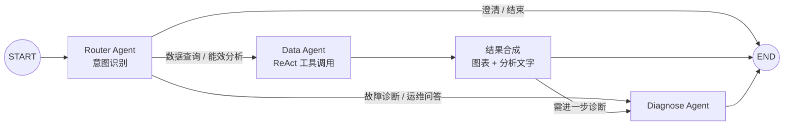
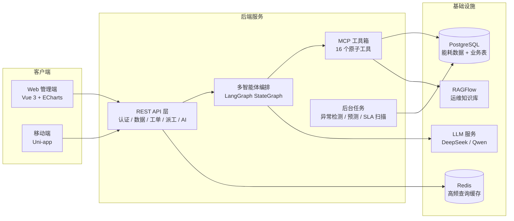

# 建筑能耗智能管理与运营优化系统

基于 **LangGraph 多智能体 + MCP 工具箱 + RAG + 生成式 UI** 的建筑能耗查询统计与智慧运维平台。

> 面向建筑运行能耗「查询统计 + 智慧运维」的一体化需求：用自然语言完成能耗查询、COP 能效分析、故障诊断与报表生成；并串起异常检测 → 预测预警 → 工单 → 派工 → 维修沉淀的闭环。
>
> **项目性质**：服务外包竞赛作品，2026-04 后停止迭代。完整实现约 700 个文件（含移动双端），但**不是生产系统**——文末「已知边界」一节如实列出了它没做到什么。

## 三句话讲清

1. **Agent 不是聊天框**——16 个 MCP 原子工具是它唯一能碰的东西，路由 / 数据 / 诊断三个 Agent 由 LangGraph 状态机编排，工具调用前后有参数校验与结果约束。
2. **Agent 行为有回归**——`backend/app/eval` 内置评测集，覆盖意图路由、工具选择、MCP Schema 合法性、RAG 回退与元数据过滤，改 prompt 或加工具后能跑一遍看有没有退化。
3. **数据可自查**——仓库随附仿真生成的能耗 CSV 样例（`data_2026_04.csv`、`fwwb01_*.csv`），可直接导入 PostgreSQL 跑通全链路，不必先对接真实表计。

## 核心功能

### 能耗查询与统计
- 多条件能耗查询（建筑 / 时间段 / 监测参数），支持跨楼宇对比与时段对比
- COP 能效代理指标计算，与 GB 50189-2015 国标基准对比（制冷季 3.5 / 供暖季 2.5）
- 国标期望值 vs 实际值逐小时对比，超阈值自动标记偏差
- ECharts 可视化 + 报表自动生成导出

### 多智能体对话助手

Router Agent（意图识别）→ Data Agent（ReAct 工具编排 → 结果合成）→ Diagnose Agent（复合意图接力诊断）。



生成式交互：对话内直接渲染图表、KPI 卡片、工单草稿等 UI 组件，支持一键建单。

### MCP 工具箱（16 个原子工具）

| 类别 | 工具 |
|---|---|
| 能耗查询 | `query_energy_metrics`、`query_daily_energy_summary`、`get_device_live_status`、`list_available_buildings` |
| 能效与异常 | `calculate_system_cop`、`get_building_rated_values`、`detect_energy_anomalies` |
| 对比与报表 | `compare_metric_across_buildings`、`compare_time_periods`、`generate_report` |
| 知识与检索 | `rag_hybrid_search`、`web_search` |
| 预测 | `building_kpi_forecast_6h_12h`、`building_kpi_forecast_from_features` |
| 交互与工单 | `render_ui_component`、`create_work_order_draft` |

工具定义在 `backend/app/mcp/server.py`，实现在 `backend/app/mcp/tools/`。

### 智慧运维闭环
- **RAG 知识库**：RAGFlow 混合检索运维手册（语义 + 关键词 + 可选重排），回答带来源
- **异常检测**：整点扫描国标期望偏差，事件化沉淀 Incident
- **预测预警**：sklearn 时序模型（6h / 12h bundle）逐小时预测 KPI，自动生成预测工单
- **工单与派工**：AI 审批 → 派工大厅抢单 / 自动派工（评分 + 灰度）→ SLA 分钟级扫描 → 超时重派
- **经验沉淀**：维修完成后回写维保经验库，供后续诊断复用

### 双端
- Web 管理端（Vue 3 + Vite + ECharts）：运营人员用
- 移动端（Uni-app，H5 / App）：运营「运小维」与维修「维小修」双角色，维修端支持语音 / 图像多模态交互

## 系统架构



## 快速开始

### 环境要求
- Python 3.10+（推荐 3.11 / 3.12）
- Node.js 18+ 与 pnpm
- PostgreSQL 14+、Redis 7（可用 `deploy/docker-compose.yml` 起 Redis）
- RAGFlow 实例（知识库检索必需，需单独部署）

### 1. 后端

```bash
cd backend
pip install -r requirements.txt
cp .env.example .env    # 填 DATABASE_URL / LLM_API_KEY / RAGFLOW_* / JWT_SECRET_KEY
uvicorn main:app --reload --host 0.0.0.0 --port 8000
```

启动后：API 文档 `http://localhost:8000/docs`，健康检查 `GET /health`。

数据库表结构由 `backend/app/db` 的模型在服务启动时自动补齐；后台任务（异常检测 / 预测 / SLA 扫描）默认关闭，通过 `.env` 开关显式开启。

### 2. Web 管理端

```bash
cd frontend
pnpm install
pnpm dev        # vite，默认 http://localhost:5173
```

### 3. 移动端（可选）

```bash
cd mobile
pnpm install
pnpm dev:h5     # uni-app H5 模式
```

### 4. 导入样例数据（可选）

仓库根目录随附仿真生成的能耗 CSV（约 14MB）：

| 文件 | 内容 |
|---|---|
| `data_2026_04.csv` | 2026 年 4 月读数 |
| `data_2026_apr_dec.csv` | 4–12 月读数 |
| `fwwb01_realistic_with_simulated_kpis(1).csv` | 单栋楼 KPI 时序（含注入异常） |

```bash
python dataset/import_script.py    # 导入 PostgreSQL
```

### 5. 跑测试（可选）

```bash
cd backend
pytest tests/            # 单元与服务层，无需外部依赖
pytest test_mcp_real.py  # e2e：需真实数据库与 MCP 配置
```

### 6. 跑 Agent 评测集（可选）

```bash
cd backend
python -m app.eval.runner
```

覆盖：意图路由 / 快路径、工具选择、MCP Schema 合法性、RAG 回退与元数据过滤、工单草稿、图端到端。

## 项目结构

```
construction-management/
├── backend/                  # FastAPI + LangGraph + MCP（约 170 个 Python 文件）
│   ├── main.py               # 应用入口
│   └── app/
│       ├── api/              # REST 路由（auth / chat / data / 工单 / 派工 / 报表……）
│       ├── graph/nodes/      # router_agent · data_agent · diagnose_agent
│       ├── mcp/              # MCP 服务与 16 个原子工具实现
│       ├── services/         # 异常检测 / 预测 / 派工 / AI 审批 / 审计……
│       ├── eval/             # Agent 评测集（cases · models · runner）
│       ├── tests/            # pytest 套件（44 个文件：auth / api / 派工 / 派单生命周期）
│       └── db/ core/ schemas/
│   └── test_*.py             # e2e 脚本（真实库 / 真实 MCP / LLM，需外部依赖）
├── frontend/                 # Vue 3 + Vite + ECharts 管理端
├── mobile/                   # Uni-app 双角色移动端
├── dataset/                  # 数据导入脚本入口
├── docs/                     # 需求 / 架构 / 数据库 / 用户手册 / RAG / MCP 设计
├── tests/                    # Playwright 冒烟样例
├── docker-compose.yml        # 本地基础设施
└── data_2026_04.csv …        # 仿真生成的能耗样例数据
```

## 技术栈

| 层级 | 选型 |
|---|---|
| 后端 | Python 3.10+、FastAPI、uvicorn |
| 智能体 | LangGraph（StateGraph）、langchain-openai、MCP |
| LLM | DeepSeek（对话编排）、Qwen / DashScope（双端多模态） |
| 数据 | PostgreSQL、SQLAlchemy 2.0（async）、Redis 7 |
| RAG | RAGFlow（混合检索 + 可选重排） |
| 预测 | scikit-learn（joblib bundle） |
| Web | Vue 3、Vite、TypeScript、Pinia、ECharts |
| 移动端 | Uni-app（H5 / App） |

## 已知边界（如实列出）

读代码前先看这几条，省得误会：

- **测试有，但分层不均**。`backend/tests/` 是 44 个文件的 pytest 套件（认证、API、派工服务、派单生命周期、配置等），可直接跑；根目录另有 7 个 e2e 脚本（真实数据库 / 真实 MCP / LLM 集成），**需要外部依赖才能跑**，本地默认跑不通。前端只有一份 Playwright 冒烟样例（`tests/example.spec.ts`）。Agent 行为的回归另靠 `backend/app/eval` 的评测集——它和单测不是一回事，测的是路由与工具选择有没有退化。
- **仿真引擎源码不在仓库**。能耗数据由物理规则仿真脚本生成，但 `dataset/` 只保留了 54 行的导入入口，生成逻辑未随仓库提交；仓库提供的是生成好的 CSV，可以据此跑通全链路，但看不到造数过程。
- **仓库根目录有竞赛期遗留物**：若干临时 CSV、ipynb、docx 和一个 `supabase-old.dump`，未清理。不影响代码阅读，介意的话可以自行忽略。
- **预测模型 bundle 不在仓库**（约 265MB，joblib/pkl）。要跑预测功能需自行训练，其余功能不受影响。
- **RAGFlow 需单独部署**，没有它时 `rag_hybrid_search` 走降级路径（评测集里有对应的回退用例）。
- **竞赛作品，不再迭代**。评级口径、权限模型、多租户隔离这些生产必备件都没做。
- **LLM 依赖外部 API**，没有 key 时对话链路不可用，但数据查询、统计、报表等 REST 接口仍可独立使用。

## 文档

| 文档 | 内容 |
|---|---|
| [docs/02_System_Architecture.md](docs/02_System_Architecture.md) | 系统架构设计 |
| [docs/00_Requirements_Analysis.md](docs/00_Requirements_Analysis.md) | 需求分析 |
| [docs/03_Database_Design.md](docs/03_Database_Design.md) | 数据库设计 |
| [docs/04_User_Manual.md](docs/04_User_Manual.md) | 用户使用手册 |
| [docs/01_Project_Overview.md](docs/01_Project_Overview.md) | 项目总览 |
| [docs/RAG.md](docs/RAG.md) | 知识库与检索方案 |
| [docs/MCP设计与多智能体工具箱 (Toolbox for Multi-Agent).md](docs/MCP设计与多智能体工具箱%20(Toolbox%20for%20Multi-Agent).md) | MCP 工具箱设计 |
| [docs/赛题.md](docs/赛题.md) | 赛题背景与要求 |

> `docs/` 下另有大量过程性设计稿（派单灰度、重派分级、双端 AI 实施方案等），是竞赛期间的设计留档，未整理。

## 开发规范

- 配置一律从 `backend/.env` 加载，不要把密钥提交到仓库
- 新增 MCP 工具需同时在 `app/mcp/server.py` 注册并补一条评测用例

## License

MIT
