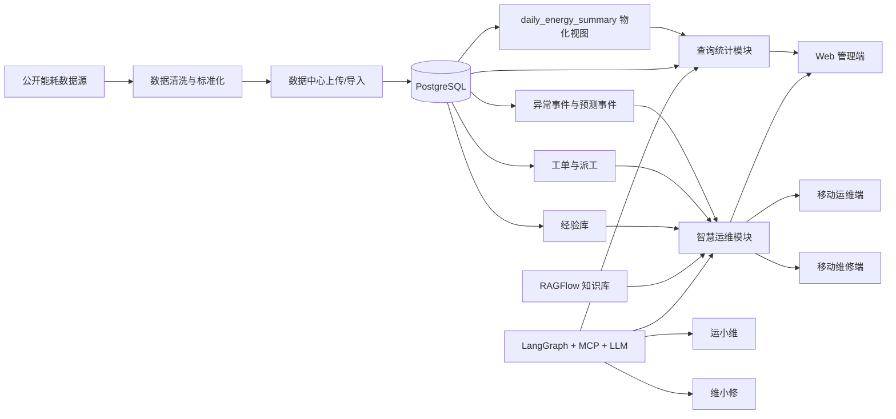
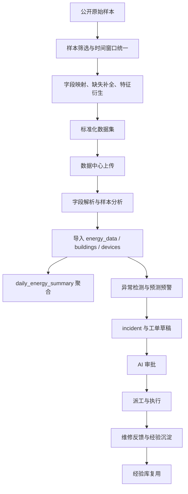

# 02 技术方案文档

> 对应赛题提交材料中的“技术方案文档”。
> 本文聚焦数据集设计说明、数据流程设计、查询统计、智慧运维、模块架构、算法模型与接口设计，面向评审答辩与方案说明场景。

## 1. 项目概述

### 1.1 赛题背景与目标

建筑运行阶段的能耗管理与运维优化是“双碳”目标落地中的关键问题。赛题要求参赛团队围绕建筑能源场景，构建规范化能耗数据集，研发集查询统计与智慧运维于一体的智能管理系统，并具备 Web 化系统展示能力。

本项目以“绿枢智控”为核心方案，围绕以下三条主线完成系统建设：

1. 数据处理主线：构建可接入、可查询、可分析的标准化建筑能源数据底座。
2. 查询统计主线：实现条件筛选查询、MCP 自然语言查询、时段汇总、COP 计算、异常分析和自动报表。
3. 智慧运维主线：实现知识问答、实时异常监测、6/12 小时预测预警、AI 审批工单、智能派单和维修辅助闭环。

### 1.2 项目建设目标

本项目的建设目标分为四层：

- 数据底座目标：形成满足赛题要求的标准化建筑能源数据集，并支持数据上传、解析、清洗、导入和统一存储。
- 业务分析目标：支持按建筑、时间、参数、设备等维度进行精准查询，并完成统计分析与可视化展示。
- 智能运维目标：基于知识库、经验库和智能体编排，实现能耗问答、异常分析、故障辅助诊断、工单审批与维修指导。
- 系统集成目标：通过 Web 管理端、移动运维端、移动维修端和双 AI 助手，构建完整的人机协同运维闭环。

### 1.3 系统总体能力概览

“绿枢智控”当前已形成以下核心能力：

- 数据中心：支持 CSV/Excel 数据集上传、字段分析、样本预览、数据导入与知识文档上传。
- 查询统计：支持条件筛选查询、MCP + LLM 自然语言查询、时段汇总、COP 分析、异常分析、图表展示和报表导出。
- 智慧运维：支持实时异常监测、6/12 小时预测预警、AI 审批、工单派发、派工跟踪和消息通知。
- AI 助手：支持运维管理端“运小维”只读问询和维修端“维小修”对话式工单执行与现场指导。
- 多端协同：支持 Web 管理端、移动运维端和移动维修端统一接入同一后端与数据底座。

### 1.4 赛题要求与系统功能映射

| 赛题要求 | 系统对应能力 |
| --- | --- |
| 能耗数据集构建、清洗、标准化 | 数据集设计说明、数据导入接口、标准化字段映射、统一数据存储 |
| 多条件数据查询 | Web 查询统计页、数据查询接口、MCP 工具查询 |
| 时段汇总、COP 计算、数据异常分析 | 查询统计模块、首页总览页、运维页、报表模块 |
| 可视化图表展示 | 首页、分建筑概览、查询统计页、运维页多图表展示 |
| 自动生成统计报表 | 统计报表导出、AI 对话汇总报表生成 |
| 领域知识库与智能问答 | RAGFlow 知识库、经验库、运小维/维小修 |
| 能耗异常原因分析与运维辅助 | 异常检测、预测预警、AI 审批、工单闭环、维修指导 |
| Web 系统集成 | Web 管理端 + 移动运维端 + 移动维修端 + AI 助手统一系统 |

## 2. 总体技术架构

### 2.1 系统总体架构图



### 2.2 技术栈说明

| 层级 | 技术栈 | 作用 |
| --- | --- | --- |
| 后端服务层 | FastAPI | 提供认证、数据、工单、派工、AI、报表等 API |
| 数据存储层 | PostgreSQL | 存储建筑、设备、能耗时序、异常事件、预测事件、工单、派工、经验数据 |
| 缓存层 | Redis | 缓存首页总览、工单、异常等高频查询结果 |
| 智能编排层 | LangGraph | 管理多步骤智能体编排、工具调用与上下文状态 |
| 工具协议层 | MCP | 封装数据查询、预测、知识检索等工具供智能体调用 |
| 知识检索层 | RAGFlow | 承载运维手册、设备规范等知识库文档 |
| Web 前端 | Vue 3 + Vite + ECharts | 实现首页总览、数据中心、查询统计、工单管理等管理端功能 |
| 移动端 | Uni-app | 实现运维管理与维修执行移动流程 |
| 模型接入层 | DashScope/Qwen 兼容接口 | 支撑问答、图像理解、语音转文字、TTS 等 AI 能力 |

### 2.3 多端协同关系

系统采用“一套后端、多端接入”的协同方式：

- Web 管理端负责全局总览、数据中心、查询统计、异常研判、工单审阅、派工与人员画像维护。
- 移动运维端负责工单审阅、派工/改派、执行跟踪和现场管理协同。
- 移动维修端负责工单接收、到场、开始处理、协同请求、完成反馈与经验沉淀。
- AI 助手层中，“运小维”偏只读运营问询，“维小修”偏维修执行与现场指导。

### 2.4 总体闭环说明

系统形成如下业务闭环：

1. 数据进入系统后完成标准化入库。
2. 查询统计模块提供多维度分析、图表展示和报表导出。
3. 实时异常检测与预测预警发现问题后生成 incident 与工单草稿。
4. AI 审批模块模拟人工审批流程，给出批准或驳回建议。
5. 智能派单结合人员画像、班组、技能和当前负载完成派工。
6. 维修人员在移动端推进工单处理流程，并可通过维小修获取维修指导。
7. 维修反馈和经验沉淀回流到经验库，支撑后续类似问题复用。

## 3. 数据集设计说明

> 本章单独回答“数据是什么、怎么构建、怎么标准化”，与后续“数据如何流转”的数据流程设计严格区分。

### 3.1 数据设计目标

本项目的数据集设计围绕五个目标展开：

- 可接入：能够从公开样本、CSV/Excel 文件和标准化结构中快速接入系统。
- 可查询：字段设计满足按建筑、时间、参数、设备、异常状态进行精准查询。
- 可分析：字段结构能够直接支撑时段汇总、COP 计算、异常分析和预测预警。
- 可追溯：数据保留建筑标识、设备标识和时间索引，支撑工单、派工与维修过程回溯。
- 可扩展：数据逻辑结构既支持当前演示型样本，也支持后续更大规模真实项目扩展。

### 3.2 数据来源与选取原则

项目数据源基于公开建筑能源数据集构建，并结合《数据处理与标准化设计.docx》的设计方法进行筛选、补全和标准化。数据选取遵循以下原则：

- 来源公开透明：优先选择 GitHub 等公开可获取的建筑能源样本，保证方案合规可复现。
- 建筑类型典型：优先选择办公楼、教学楼、公共服务类建筑，贴合赛题业务场景。
- 时序连续稳定：优先保留时间连续性好、关键字段缺失率较低的样本。
- 字段可解释：优先保留能够映射到能耗、环境、设备与运维语义的字段。

### 3.3 建筑样本与时间窗口设计

本项目最终选取三类代表性建筑作为演示样本：

- 教学楼：体现规律性强、作息驱动明显的教学场景。
- 办公楼：体现工作日负荷波动、HVAC 调节与设备运维场景。
- 公共服务类建筑：对应系统中的 `Public services` 类别，用于体现公共空间负荷特征。

时间窗口设计采用统一的小时级粒度，整体业务口径如下：

- 时间精度：监测时间统一到小时级，满足赛题要求。
- 分析范围：以缺失占比低、连续性较好的年度窗口为主，便于趋势分析、异常分析与演示。
- 系统默认口径：后端统一配置 `DATA_TIME_START=2016-04-01`、`DATA_TIME_END=2016-12-31`，便于前后端查询范围一致。

### 3.4 字段设计与赛题映射

赛题推荐字段主要分为四类：基础信息、能耗数据、影响因素、设备信息。本项目在标准化数据集设计中采用“四层字段结构 + 关系型拆分落库”的方式。

#### 3.4.1 标准化逻辑字段结构

| 字段层次 | 关键字段 | 作用 |
| --- | --- | --- |
| 基础信息层 | `building_id`、`building_type`、`timestamp` | 支撑建筑维度筛选、时间维度聚合与趋势分析 |
| 能耗指标层 | `electricity_kwh`、`water_m3`、`hac_energy`、`sim_supply_temp_c`、`sim_return_temp_c` | 支撑时段汇总、COP、HVAC 工况分析 |
| 环境影响层 | `air_temp_c`、`dew_temp_c`、`humidity_rh_pct` | 支撑环境工况解释、异常原因分析和预测建模 |
| 设备信息层 | 设备编号、设备类型、运行状态 | 支撑设备追踪、设备级归因、运维问答与维修指导 |

#### 3.4.2 实际落库映射关系

为保证模型扩展性和查询效率，系统在数据库中采用规范化设计：

- `buildings`：存储建筑静态属性。
- `devices`：存储设备与传感器静态信息。
- `energy_data`：存储逐时能耗事实数据。
- `device_telemetry_hourly` 与 `device_status_latest`：存储设备级状态与快照。
- `daily_energy_summary`：存储面向统计分析的日聚合结果。

这意味着赛题所需的“设备信息”并不直接以冗余字段堆叠到 `energy_data` 中，而是通过建筑表、设备表和设备状态表组合表达，从而兼顾业务清晰度与工程可维护性。

### 3.5 数据清洗与缺失值处理

数据清洗流程主要包括以下步骤：

1. 按时间排序并检查每类字段的缺失比例与连续缺失段长度。
2. 检查时间字段合法性、建筑标识一致性和关键数值字段的单位正确性。
3. 对明显超出业务合理范围的异常值进行标记或修正。
4. 对缺失值进行多变量关联补全，尽可能保留原始时序结构。

结合已有数据处理设计，项目采用基于多变量关系的插补思想对关键缺失项进行补全，相比简单均值填补更能保持建筑能耗数据的波动结构。在工程实现上，补全后的数据还会经过以下校验：

- 数值上下界校验：避免出现负能耗、极端异常温度等明显错误值。
- 时序连续性校验：避免因缺失补全导致趋势断裂。
- 业务一致性校验：例如供回水温度差不应长期为异常反向关系。

### 3.6 特征衍生与标准化处理

为使数据集更好适配赛题需求，系统在原始字段基础上进行了以下特征衍生：

- 湿度推导：基于环境温度与露点温度计算或拟合相对湿度，形成完整环境工况字段。
- 供回水温度构建：结合现有 HVAC 数据与业务规则，构建适用于 COP 计算与工况分析的供回水温度字段。
- 设备标识补充：为建筑绑定电力、水务、暖通等设备对象，增强数据追踪能力。
- 命名统一：统一采用可直接支撑程序调用的标准字段名，如 `electricity_kwh`、`air_temp_c`。
- 单位统一：统一能耗、温度、湿度和流量等字段单位，消除跨模块语义歧义。

### 3.7 数据存储与输出格式

本项目的数据支持三种标准化输出方式：

- CSV：适合数据集交付、二次分析与演示导入。
- JSON：适合接口传输、样例展示与对接智能体工具。
- PostgreSQL：适合作为系统正式运行时的数据底座，支持查询、聚合、异常检测、工单与运维闭环。

其中，系统运行时以 PostgreSQL 为主，结合物化视图提升日级统计查询性能。

### 3.8 数据字典与样例说明

#### 3.8.1 关键字段说明

| 字段 | 单位 | 含义 | 主要用途 |
| --- | --- | --- | --- |
| `building_id` | - | 建筑唯一标识 | 建筑筛选、关联工单与设备 |
| `building_type` | - | 建筑类型 | 分建筑统计、展示与对比分析 |
| `timestamp` | 小时 | 监测时间 | 时序查询、时段聚合、趋势分析 |
| `electricity_kwh` | kWh | 电力能耗 | 总能耗分析、异常检测 |
| `water_m3` | m³ | 水耗 | 用水分析、漏损异常识别 |
| `hac_energy` | kWh | 暖通空调综合能耗 | HVAC 分析、COP 计算 |
| `sim_supply_temp_c` | ℃ | 供水温度 | HVAC 工况与 COP 计算 |
| `sim_return_temp_c` | ℃ | 回水温度 | HVAC 工况与 COP 计算 |
| `air_temp_c` | ℃ | 环境温度 | 环境影响分析、预测模型输入 |
| `dew_temp_c` | ℃ | 露点温度 | 湿度推导、工况解释 |
| `humidity_rh_pct` | %RH | 相对湿度 | 环境工况解释、异常原因分析 |

#### 3.8.2 标准化样例记录

```json
{
  "building_id": "Office_A",
  "building_type": "Office",
  "timestamp": "2016-06-15T08:00:00Z",
  "electricity_kwh": 428.7,
  "water_m3": 12.4,
  "hac_energy": 163.5,
  "sim_supply_temp_c": 7.2,
  "sim_return_temp_c": 12.1,
  "air_temp_c": 29.3,
  "dew_temp_c": 21.0,
  "humidity_rh_pct": 62.4
}
```

## 4. 数据流程设计

> 本章单独回答“数据如何流转、如何支撑查询统计与智慧运维”，与上一章数据集设计说明分开描述。

### 4.1 数据全流程总览



### 4.2 数据采集与导入流程

系统中的数据采集与导入流程分为五步：

1. 数据上传：用户在数据中心上传 CSV 或 Excel 文件。
2. 文件解析：系统识别字段名、列类型、样本行与统计信息，供用户确认数据可用性。
3. 结构校验：校验时间字段、建筑字段和关键能耗字段是否完整。
4. 数据导入：将结构化数据写入 `energy_data`，必要时补充 `buildings` 与 `devices` 关系数据。
5. 导入回显：前端显示导入进度、导入行数和导入后的数据管理视图。

该流程对应系统现有数据中心功能，保证“数据集设计说明”中的标准化结果能够真正进入业务系统。

### 4.3 数据存储与聚合流程

系统采用“事实表 + 视图 + 业务事件表”的存储方式：

- 逐时事实数据写入 `energy_data`。
- 日级统计通过 `daily_energy_summary` 物化视图聚合，加速统计分析查询。
- 异常检测结果写入 `anomaly_events`。
- 预测预警结果写入 `predicted_anomaly_events`。
- 连续异常聚合形成 `anomaly_incidents`。
- 工单与派工流程落入 `work_orders` 与 `dispatch_tasks`。
- 维修经验和 AI 会话分别沉淀到经验表和 AI 审计相关表。

这种流程保证了：

- 明细查询有事实表支撑。
- 报表和趋势分析有聚合视图支撑。
- 智慧运维闭环有异常、预测、工单与派工表支撑。

### 4.4 查询统计数据流

查询统计数据流主要包含两条路径：

#### 4.4.1 条件筛选查询路径

1. 用户在查询统计页选择建筑、时间范围和监测参数。
2. 前端调用查询接口读取 `daily_energy_summary` 或 `energy_data`。
3. 后端根据时间粒度自动选择聚合视图或事实表。
4. 返回趋势图、表格和统计摘要。

#### 4.4.2 MCP 自然语言查询路径

1. 用户通过 AI 控制台提出自然语言问题，如“查询办公楼上周电耗趋势”。
2. Router Agent 识别问题意图并选择数据查询工具。
3. MCP 工具执行结构化查询、统计或跨楼宇比较。
4. 智能体对结构化结果进行解释与可视化呈现。

该数据流直接支撑以下赛题能力：

- 条件筛选精准查询
- 基于 MCP 的 LLM 查询
- 时段汇总、COP 计算、异常分析
- 报表生成与 AI 汇总解释

### 4.5 智慧运维数据流

智慧运维模块对应图中的“运维管理端 + 维修端”双路径：

1. 后端基于逐时数据与基线逻辑进行实时异常检测。
2. 预测服务生成未来 6/12 小时 KPI 预警。
3. 异常事件与预测事件均可生成 incident 和工单草稿。
4. AI 审批模块对工单进行批准/驳回判断，并输出理由与派工画像。
5. 工单进入待派工状态后，由调度端进行人工派工或半自动派工。
6. 维修人员在移动端完成接单、到场、开始处理、协同处理与完成反馈。
7. 维修反馈和处理经验回写经验库，为下一轮问答和指导提供支持。

其中，“实时监测”和“6/12h 预测”两条路径都能进入工单流程，是系统的核心闭环设计之一。

### 4.6 知识库与经验库数据流

知识库与经验库数据流如下：

1. 运维手册、设备文档、规范文件通过数据中心上传至 RAGFlow。
2. 文档完成解析、切片和向量化后进入知识检索链路。
3. 维修反馈、处理备注和经验总结进入经验库表。
4. 运小维和维小修在回答问题时联合调用知识库与经验库。
5. 经验使用与反馈又会回写到经验表，形成可持续优化的知识闭环。

知识库偏规范性、通用性；经验库偏现场性、案例性。两者共同支撑异常原因分析、故障定位和维修指导。

### 4.7 多端交互数据流

多端交互数据流可概括为：

- Web 管理端：负责数据录入、统计分析、异常研判、工单审阅、派工与人员画像配置。
- 移动运维端：负责派工执行、工单状态跟踪、消息通知与现场管理。
- 移动维修端：负责工单动作推进、协同处理、维小修指导与经验反馈。
- 运小维：围绕工单、派工、统计和流程进行只读问询。
- 维小修：围绕工单执行、维修指导、图像分析、语音与步骤卡片进行辅助。

系统通过统一 API、统一数据模型和统一身份体系实现多端协同。

## 5. 查询统计模块设计

### 5.1 查询模块设计

查询模块由“条件查询”和“自然语言查询”两部分组成。

#### 条件筛选精准查询

- 支持按建筑、时间范围、监测参数进行筛选。
- 支持数据展示视图与统计分析视图切换。
- 针对日级统计优先读取 `daily_energy_summary`，针对细粒度分析读取 `energy_data`。

#### 基于 MCP 的 LLM 查询

- 基于 LangGraph + MCP 工具进行意图识别与工具调用。
- 支持自然语言能耗查询、同比环比比较、跨建筑比较、设备状态查询等场景。
- 输出不仅包含结论，还可附带证据来源与图表结果。

### 5.2 统计分析模块设计

系统至少实现以下三类核心统计分析：

- 时段汇总：按日、周、月聚合电耗、水耗与暖通能耗。
- COP 计算：基于空调系统能耗与供回水温度变化计算能效表现。
- 数据异常分析：分析能耗偏离、环境耦合变化和异常分布特征。

此外，系统还支持首页总览、分建筑统计和运维态势汇总，用于反映系统整体运行状况。

### 5.3 可视化设计

可视化设计采用“首页总览 + 分建筑页 + 查询统计页 + 运维页”四类视图组织方式：

- 首页总览：展示建筑总览 KPI、能耗占比、异常概况和 AI 洞察。
- 分建筑页：分别展示教学楼、办公楼、公共服务类建筑的差异化统计信息。
- 查询统计页：展示趋势图、COP 图、环境图、设备图和异常结论卡片。
- 运维页：展示近期异常、预测预警、工单预览和可解释性信息。

前端图表主要基于 ECharts 构建，兼顾比赛展示效果与信息可读性。

### 5.4 自动报表生成设计

系统支持两类报表输出：

- 统计报表生成：将查询结果导出为 CSV 或结构化报表数据。
- AI 对话汇总报表生成：将 AI 会话中的分析结论、证据和建议整理为管理简报。

报表输出适用于比赛展示、结果复盘与管理汇报。

## 6. 智慧运维模块设计

### 6.1 运维管理端设计

运维管理端是智慧运维的核心控制中枢，包含以下能力：

- 知识库与经验库：支持文档上传、解析、检索与经验复用。
- 智能问答：回答能耗查询、设备运行状态查询、异常原因分析等问题。
- 实时监测：展示近期异常、当前风险和设备状态。
- 异常检测：基于规则与基线识别当前异常事件。
- 预测预警：生成未来 6/12 小时的 KPI 风险预警。
- AI 审批工单：模拟人工审批过程，给出批准/驳回理由与派工画像。
- 智能派单：基于人员画像、技能、班组、值班与负载进行派工推荐或执行。

### 6.2 维修端设计

维修端设计聚焦“执行效率”和“经验沉淀”，包括：

- 智能指导辅助维修：通过维小修生成步骤卡片、操作建议和注意事项。
- 维修反馈：记录处理结果、反馈说明、完成状态和协同信息。
- 经验共享：将现场经验转为可沉淀、可复用的经验库内容。
- 多模态辅助：支持文本、图片、语音转文字和 TTS 播报。

### 6.3 工单闭环设计

工单闭环分为两类触发路径：

1. 实时异常触发路径：实时异常检测 -> incident -> 工单草稿 -> AI 审批 -> 待派工 -> 派工 -> 维修反馈 -> 关闭。
2. 预测预警触发路径：6/12h 预测 -> 预测事件 -> 工单草稿 -> AI 审批 -> 待派工 -> 派工 -> 维修反馈 -> 关闭。

这两条路径统一进入同一工单与派工体系，便于运维人员统一管理。

### 6.4 人机协同设计

系统采用“AI 辅助 + 人工确认”的人机协同模式：

- AI 可生成审批建议、派工画像、维修步骤和问答结论。
- 人工可回溯 AI 审批结果，并对工单进行人工覆盖或反馈。
- 涉及状态变更的关键动作仍需通过后端状态机与审计逻辑执行。
- 运小维第一阶段偏只读问询，避免直接越权执行关键业务动作。

## 7. 模块架构设计

### 7.1 后端服务架构

后端按能力拆分为以下服务域：

- 认证与用户：登录、注册、Token 刷新、角色管理。
- 数据服务：数据范围、建筑信息、能耗查询、数据中心上传与导入。
- 运维服务：异常检测、预测服务、incident 聚合、工单与派工、通知。
- AI 服务：智能体编排、模型接入、RAG 检索、维修指导、AI 审批。

### 7.2 前端 Web 架构

Web 前端主要由以下页面构成：

- 首页总览 `Home`
- 智慧运维 `Operations`
- 工单中心 `WorkOrders`
- 人员画像 `WorkerProfiles`
- 数据中心 `DataCenter`
- 查询统计 `QueryStats`

这些页面通过统一路由、统一鉴权和统一接口层接入后端。

### 7.3 移动端架构

移动端基于 Uni-app 构建，分为两类角色页面：

- 运维端：总览、工单审阅、派工中心、消息与个人中心。
- 维修端：工单大厅、我的工单、工单详情、维小修、历史与个人中心。

移动端通过统一 API 与 Web 共享同一数据模型和业务状态机。

### 7.4 AI 与 LangGraph/MCP 架构

AI 架构由以下部分构成：

- Router Agent：负责意图识别与任务路由。
- MCP 工具层：负责数据查询、预测、知识检索、物理计算等能力封装。
- 运小维：偏只读工单与运营问询。
- 维小修：偏维修执行与步骤指导。
- 模型 Provider：负责接入 Qwen/DashScope 等模型能力。

### 7.5 数据库与缓存架构

数据库采用 PostgreSQL，缓存采用 Redis：

- PostgreSQL 负责持久化明细数据、业务事件、工单、派工、经验与 AI 会话。
- 物化视图加速首页和统计分析的高频聚合查询。
- Redis 负责首页总览、异常概况、工单列表等高频读取场景加速。

## 8. 算法与模型设计

### 8.1 数据补全与特征构建方法

数据补全采用多变量相关性驱动的插补思想，重点保留建筑能源数据的非线性波动特征。特征构建包括：

- 湿度推导
- 供回水温度构建
- 设备标识补充
- 时间上下文与建筑类型等辅助特征构建

### 8.2 COP 计算逻辑

系统基于暖通空调能耗与供回水温度差进行 COP 分析，结合经验基准判断能效是否偏低，并在前端提供趋势图与解释性结论。

### 8.3 异常检测与归因逻辑

异常检测综合使用以下信息：

- 基线期望值
- 实时能耗偏离
- 供回水温差变化
- 设备运行状态
- 楼宇级与设备级归因逻辑

检测结果落入异常事件表，并可进一步生成工单。

### 8.4 预测预警模型设计

系统当前通过预测服务生成未来 6/12 小时的 KPI 风险预警，可加载离线训练模型进行运行时推理；后续可进一步扩展为 LSTM 等时序模型，实现更强的动态基线与异常预测能力。

### 8.5 RAG 检索与知识问答设计

知识问答采用“知识库 + 经验库 + 结构化数据查询”结合的设计：

- 知识库提供规范性答案。
- 经验库提供案例性答案。
- 结构化数据查询提供事实性证据。

三者共同支撑运小维和维小修的智能问答与解释能力。

### 8.6 维修指导与经验库闭环设计

维修指导采用步骤卡片化输出，结合工单上下文、知识检索结果和现场反馈生成操作建议。维修完成后，经验以“原始文本 + AI 整理结果”的形式沉淀到经验库，避免经验丢失并支持后续复用。

## 9. 接口设计

### 9.1 接口分组

| 模块 | 代表接口 | 说明 |
| --- | --- | --- |
| 认证接口 | `POST /api/auth/register`、`POST /api/auth/login`、`GET /api/auth/me` | 注册、登录、用户信息获取 |
| 数据导入接口 | `POST /api/datacenter/datasets/upload`、`POST /api/datacenter/datasets/{dataset_id}/import-to-energy-data` | 数据集上传与导入 |
| 查询统计接口 | `GET /api/home/overview-bundle`、`GET /api/home/section-bundle`、`GET /api/buildings/{building_type}/energy` | 首页与统计查询 |
| 报表接口 | `GET /api/reports/export` | 导出统计报表 CSV |
| 知识库接口 | `POST /api/datacenter/documents/upload`、`POST /api/datacenter/documents/{doc_id}/parse` | 文档上传与知识库解析 |
| 异常/预测接口 | `GET /api/anomalies/recent`、`GET /api/predictions/recent` | 异常与预测预警查询 |
| 工单/派工接口 | `GET /api/work-orders`、`POST /api/work-orders/{ticket_id}/dispatch`、`POST /api/dispatch-tasks/{dispatch_id}/accept` | 工单、派工、执行动作 |
| 运小维接口 | `POST /api/operator-ai/chat`、`POST /api/operator-ai/chat/stream` | 运维问询 |
| 维小修接口 | `POST /api/worker-ai/chat`、`GET /api/worker-ai/work-orders/{ticket_id}/steps`、`POST /api/worker-ai/media/analyze-image` | 维修指导、步骤、图片分析 |

### 9.2 接口设计原则

- 统一鉴权：通过 Bearer Token 进行身份认证。
- 模块解耦：数据接口、工单接口、AI 接口按业务分组。
- 读写分离：运小维以只读能力为主，维小修的状态动作必须经过状态机校验。
- 可解释性：AI 相关接口尽量返回证据、步骤和状态说明。

## 10. 系统特色与创新点

### 10.1 MCP + LLM 自然语言查询

系统将建筑能耗查询能力封装为 MCP 工具，通过 LangGraph 调用实现自然语言到结构化查询的转换，提升了复杂统计问题的交互效率。

### 10.2 数据查询与统计分析一体化

系统将明细查询、统计汇总、图表展示和报表导出整合在统一查询统计模块中，不再将查询与分析割裂处理。

### 10.3 实时监测 + 预测预警双路径工单触发

系统不仅对实时异常进行监测，还对未来 6/12 小时进行预测预警，两条路径均可进入工单闭环，增强了运维的主动性。

### 10.4 AI 审批 + 智能派单 + 移动维修闭环

系统将 AI 审批、派工执行和移动维修流程统一到同一状态机和同一数据模型中，形成“异常发现 -> 工单审批 -> 派工执行 -> 维修反馈”的完整闭环。

### 10.5 知识库 + 经验库 + 双 AI 助手协同运维

系统同时建设规范知识库与现场经验库，并通过运小维和维小修分别服务管理端和维修端，实现从运营分析到现场执行的双 AI 协同运维。
