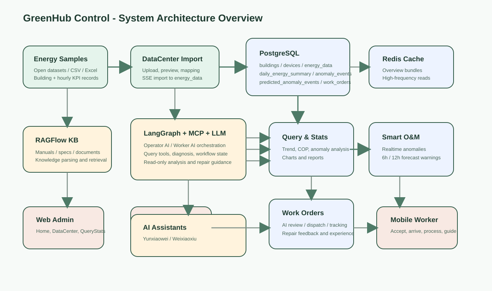
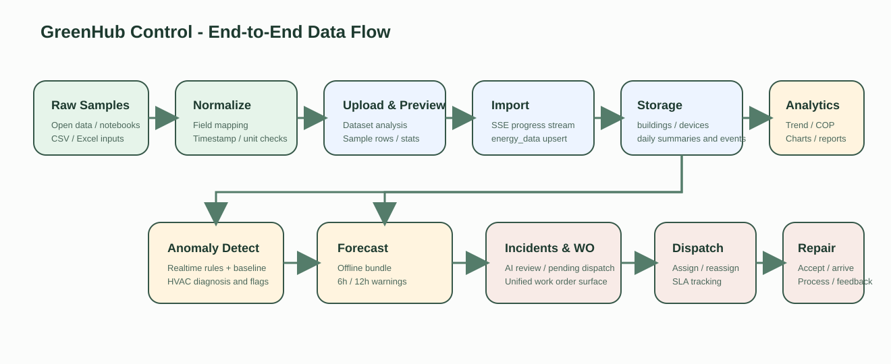

# 02 技术方案文档

> 对应赛题提交材料中的“技术方案文档”。本文只写当前项目已经实现并且能从仓库中核对到的内容，不做脱离代码的想象性扩写。

文档版本：v1.2  
更新时间：2026-04-20  
适用场景：答辩汇报、方案说明、系统实现对照

## 目录

1. 项目概述
2. 总体技术架构
3. 数据集设计说明
4. 数据流程设计
5. 查询统计模块设计
6. 智慧运维模块设计
7. 模块架构与关键数据表
8. 算法与模型设计
9. 接口设计
10. 系统特色与创新点

## 1. 项目概述

### 1.1 建设背景

建筑能耗系统在实际落地时，往往先卡在两个地方。第一是数据进不来，或者进来了但字段口径混乱，后续查询、分析、建模都接不上。第二是发现问题以后没有形成真正的处置闭环，异常停留在图表和告警层面，工单、派工、维修和经验复用仍然靠人工切换多个系统完成。

“绿枢智控”就是围绕这两个问题来做的。项目没有把自己做成一个单纯的展示页面，而是把标准化数据接入、统计分析、异常识别、预测预警、工单审批、派工执行、移动维修和知识经验沉淀串成一条连续链路。换句话说，它既关心“数据怎么看”，也关心“问题怎么处理掉”。

### 1.2 建设目标

这个项目的目标可以概括为四层。

- 先把楼宇能耗样本整理成可导入、可复核、可查询的标准化数据底座。
- 再把查询统计能力做完整，支持按建筑、时间、指标和异常类型做多维分析。
- 在运维侧，把实时异常、预测预警、工单流转、派工执行和维修反馈接起来。
- 最后，通过 Web 管理端、移动运维端、移动维修端以及碳小能、运小维、维小修三类助手协同，把整个流程真正跑通。

### 1.3 与赛题要求的对应关系

从赛题要求来看，项目主要覆盖了几个核心方向。数据中心负责结构化样本上传、字段映射和导入，解决数据集构建和标准化的问题；查询统计页、首页概览和 MCP 工具查询共同承担多条件查询、时段汇总、COP 分析和异常研判；RAGFlow 文档知识库、维护经验库以及 PC 端“碳小能”和移动端“运小维”“维小修”共同对应知识问答和运维辅助；Web 端和 Uni-app H5 则完成了多端集成展示。

如果用一句话概括，赛题强调的是“数据 + 分析 + 系统 + 闭环”，这个项目的实现也是沿着这四条线展开的。

## 2. 总体技术架构

### 2.1 系统总体架构图



图 2-1 系统总体架构图。  
图中可以看出，系统采用的是比较稳妥的分层方案：数据入口在左侧，平台服务在中间，AI 编排与知识检索在中上层，多端交互在底层。这样的结构没有刻意追求花哨，而是优先保证数据、业务和前端入口之间的边界清楚。

### 2.2 架构说明

后端以 FastAPI 为主，统一暴露认证、数据、工单、派工、AI 和报表接口。数据库使用 PostgreSQL，主要存储建筑、设备、小时级能耗明细、日级汇总、异常事件、预测事件、工单、派工记录和维修经验。Redis 负责缓存首页总览、工单列表这类高频读取的数据；即便 Redis 不可用，系统也能退化到本地缓存，不至于整体失效。

AI 能力并不是直接散落在页面里的。项目把 LangGraph 作为流程编排层，把 MCP 作为工具调用层，再通过 RAGFlow 接入文档知识库。这样做的好处是，PC 管理端的“碳小能”、移动运维端的“运小维”和移动维修端的“维小修”虽然面向的场景不同，但底层工具能力是复用的，后续维护也更清楚。

更具体一点看，当前通用智能链路并不是单一问答模型，而是由 Router Agent、Data Agent 和 Diagnose Agent 分工完成。Router Agent 负责判断用户问题更偏查询、预测、诊断还是知识检索；Data Agent 负责走受控工具链拿数、组织图表 artifact；Diagnose Agent 负责结合异常、知识和工单上下文做更偏诊断和处置的推理。这样拆开以后，系统既能保留自然语言交互入口，又不会把所有业务判断都压在一次模型输出上。

对前端而言，这条链路最终收口到统一的 SSE 对话接口。页面不是一次性等待一段最终答案，而是会依次收到 `thinking`、`text`、`artifact`、`done` 等事件；图表、工单卡片和报表下载链接也都通过 artifact 回传，由前端按组件类型渲染。这种交互方式和普通 REST 接口不同，但它正好契合了“先分析、再展示、再决定下一步”的使用习惯。

Web 管理端使用 Vue 3 + Vite，承担首页、查询统计、数据中心、工单管理和人员画像。移动端采用 Uni-app H5，拆成移动运维端和移动维修端两条使用路径。前者偏调度和审阅，后者偏执行和反馈，角色边界比较明确。

从工程实现角度看，这种分层还有一个现实好处，就是每一层都能单独解释。比如后端路由统一挂在 `/api` 前缀下，启动时还会补齐数据库兼容结构和物化视图；前端只负责围绕这些明确的接口做页面组织，不再把复杂的业务判断散落在组件内部。对于后续维护来说，这比把逻辑写进单个“大页面”要稳定得多，也更适合多人协作。

### 2.3 多端协同关系

项目当前有三类主要业务角色。`admin` 更偏系统管理员视角，负责全局查看和权限维护；`manager` 是运维经理，主要做审阅、派工、执行跟踪和运营分析；`ops` 是维修人员，主要在移动维修端完成接单、到场、处理、协同和反馈。

从代码实现看，移动运维端允许 `admin` 和 `manager` 登录，移动维修端只允许 `ops` 登录；Web 端则承担统一展示和管理入口。这样的划分是符合业务直觉的，避免让维修人员直接接触过多后台配置，也避免让管理端承担现场执行动作。

### 2.4 业务闭环

整个系统的业务闭环可以按下面的顺序理解。

1. 数据先通过数据中心进入系统，完成标准化和入库。
2. 查询统计模块基于明细表和日级汇总视图提供趋势、对比、异常和报表能力。
3. 实时异常检测和 6/12 小时预测预警分别产生事件。
4. 事件进入 incident 和工单草稿流程，由 AI 审批或人工监督决定是否继续处置。
5. 工单审批通过后进入待派工，由管理端或自动调度逻辑分配维修人员。
6. 维修人员在移动端推进接单、到场、处理、协同和反馈。
7. 维修结果和处理经验回流到经验库，供后续类似问题复用。

这条链路不是文档里“画出来的闭环”，而是当前仓库中已经拆分成多组路由和服务在运行的闭环。

## 3. 数据集设计说明

### 3.1 设计思路

这个项目的数据集设计，重点不是把字段堆得很多，而是让字段足够支撑后续分析和运维流程。也就是说，字段要能支持查询统计，也要能支持异常检测、预测预警和工单追溯。如果只是做成一个展示型数据表，后面的智慧运维链路就接不上。

### 3.2 样本来源、建筑口径与时间窗口

项目当前围绕 3 栋示范楼宇组织数据，建筑口径和后端代码保持一致，分别是 `Fox_education_Louie`、`Fox_office_Alice` 和 `Fox_public_Henry`，对应教学楼、办公楼和公共服务楼三类场景。这样做的目的不是追求楼宇数量，而是保证样本类型有差异，能覆盖不同使用模式下的能耗变化。

时间粒度统一到小时级。仓库中的标准化全年样本覆盖 `2016-01-01 00:00:00` 到 `2016-12-31 23:00:00`；系统实际演示时，前后端默认会收口到 `2016-04-01` 到 `2016-12-31` 这个区间，避免不同页面因为时间范围不一致导致展示结果对不上。

这里之所以保留“全年样本”和“默认演示窗口”两个口径，是因为它们服务的目的并不一样。全年样本更适合说明数据集本身是完整的、连续的；默认演示窗口则更适合做系统展示，因为它能让首页、查询统计、异常和预测在同一时间区间里互相印证，减少答辩现场出现“这页有数据、那页没数据”的情况。

### 3.3 数据规模口径

从项目当前可核对的资料来看，全年标准化样本总量是 26,316 条，时间跨度覆盖完整一年。按系统默认演示窗口推算，落在 `2016-04-01` 到 `2016-12-31` 之间的记录量大约是 19,800 条。这个数字不是拍脑袋估的，而是按 3 栋楼、275 天、小时级粒度推出来的，适合作为答辩时的口径说明。

设备数量按当前数据库设计口径可以理解为 12 个左右的核心设备单元，即 3 栋楼、每栋楼 4 类基础设备。这里的重点不是精确到每一条历史设备记录，而是说明当前演示系统已经具备“楼宇 - 设备 - 能耗”三层结构，不是单纯的楼宇总表。

### 3.4 标准字段设计

数据落库时，最核心的两个字段是 `timestamp` 和 `building_id`。前者负责把所有记录放进统一时间轴，后者负责把记录稳定地挂到具体楼宇上。这两个字段如果不稳定，后续无论是查询、对比还是工单追溯都会出问题，所以系统在导入阶段把它们当成必需项处理。

在此基础上，项目保留了三类能耗主指标：`electricity_kwh`、`water_m3` 和 `hac_energy`。其中电耗和水耗比较直观，`hac_energy` 主要服务于 HVAC 工况判断、COP 代理计算和异常诊断。为了让异常解释更有依据，系统还保留了 `sim_supply_temp_c`、`sim_return_temp_c`、`air_temp_c`、`dew_temp_c` 和 `humidity_rh_pct` 这组环境与工况字段。

也就是说，当前数据字段不是按“越多越好”来组织，而是围绕后续真实要用到的功能来选的。

如果把这些字段放回业务场景里看，会更容易理解它们为什么被保留下来。`electricity_kwh` 和 `water_m3` 直接服务于能耗趋势和异常识别，`hac_energy` 连接到 COP 和 HVAC 过耗判断，供回水温度服务于 HVAC 根因诊断，外部温湿度则给“为什么会在这个时段异常”和“模型为什么这么预测”提供环境背景。也就是说，这套字段设计不是为了“看起来完整”，而是为了后续每个模块都能找到自己需要的依据。

### 3.5 字段映射与单位处理

数据中心导入时，会先根据别名去识别字段。例如时间字段允许出现 `timestamp`、`time`、`datetime`、`ts`、`日期时间`、`时间` 等常见写法；楼宇字段允许 `building_id`、`building`、`building_name`、`楼宇id`、`楼宇` 等变体。电、水、HVAC 和环境字段也有一套别名映射规则，这些规则已经写在 `routes_datacenter.py` 里，不是文档临时总结出来的。

这里有一个需要单独说明的细节：系统允许把 `water_l` 识别为 `water_m3` 的候选别名，但不会自动做单位换算。这意味着导入者仍然要对样本口径负责。如果数据源的水耗确实是升，就不能因为字段名被识别到了就默认单位已经正确。这个地方在答辩时反而可以作为“系统做了自动映射，但没有越权替代人工核对”的设计说明。

### 3.6 数据清洗与标准化策略

项目当前采用的清洗方式比较工程化，而不是做成一套复杂的离线清洗平台。主要流程如下。

1. 先读取上传文件，分析列名、样本行和基本统计信息。
2. 根据别名规则去匹配标准字段。
3. 如果缺少 `timestamp` 或 `building_id`，直接终止导入。
4. 校验楼宇 ID 是否真实存在于 `buildings` 表中，不合法的楼宇不会入库。
5. 把时间列统一解析为可入库的时间戳，把数值列尽量转成浮点型。
6. 用批量 upsert 的方式写入 `energy_data`，按主键冲突更新。

从工程结果看，清洗前后的差别主要体现在三个方面。第一，字段名称从多源样本的自然命名统一到了系统口径；第二，主键不完整或楼宇不合法的记录会被过滤；第三，导入完成后可以直接拿到 `imported_rows`、`failed_rows`、`invalid_building_ids` 和 `col_map` 这些结果，用来复核导入质量。相比单纯描述“做了清洗”，这种写法更贴近实际系统。

另外，项目当前没有把清洗做成完全自动的黑箱。导入时保留了预览、样本确认和失败反馈，就是为了给使用者留下复核空间。尤其是在数据口径可能来自不同来源、单位并不完全统一的情况下，这种“系统先帮你识别，但不替你做最后判断”的方式，比全自动导入更符合真实工程环境。

### 3.7 标准化样例

标准化后的单条小时级记录，结构可以表达成下面这样：

```json
{
  "timestamp": "2016-06-15T08:00:00+00:00",
  "building_id": "Fox_office_Alice",
  "electricity_kwh": 428.7,
  "water_m3": 12.4,
  "hac_energy": 163.5,
  "sim_supply_temp_c": 7.2,
  "sim_return_temp_c": 12.1,
  "air_temp_c": 29.3,
  "dew_temp_c": 21.0,
  "humidity_rh_pct": 62.4
}
```

这个结构已经足够支撑查询统计、异常检测、预测预警和工单追溯，不需要额外再发明一套平行数据格式。

## 4. 数据流程设计

### 4.1 数据全流程图



图 4-1 数据全流程图。  
图里的路径从原始样本一直走到维修反馈和经验复用，核心意思很简单：数据不是为了停留在分析页面里，而是要顺着系统继续流向事件、工单和处置。

### 4.2 数据采集与导入流程

结构化数据的进入路径主要由两个接口完成：一个负责上传和预览，另一个负责正式导入。上传阶段，系统会返回列信息、统计摘要和样本行，方便使用者先判断数据是否值得导入；导入阶段则通过 SSE 持续推送解析、校验、写入和完成状态。

真正导入时，系统会先识别字段映射，再检查楼宇合法性，最后按 500 行一批做 upsert。导入结束以后，前端可以拿到导入行数、失败行数、列映射、时间范围和无效楼宇列表。这一点很重要，因为它意味着导入不是“黑盒动作”，而是可回看的。

从导入过程本身看，SSE 反馈的阶段也比较清楚，通常会经历 parsing、validating、preparing、importing 和 done 几个阶段。这样做不是为了炫技，而是因为数据文件一旦稍大，用户如果只能看到一个长时间不动的按钮，很难判断系统到底是卡住了还是还在处理。把导入过程拆成几个可见阶段，本质上是在降低使用过程中的不确定感。

### 4.3 数据存储与聚合流程

系统没有把所有功能都压在一张大表上，而是采用了“明细表 + 聚合视图 + 事件表”的组合方式。`energy_data` 负责存小时级明细，`daily_energy_summary` 负责承接日级汇总，`anomaly_events` 和 `predicted_anomaly_events` 分别表示已经发生的异常和未来预警，`work_orders` 与 `dispatch_tasks` 则把数据层的问题接到了业务层。

应用启动时还会主动做几件保障性的事情：初始化 Redis，补齐历史 schema 兼容项，确保 AI 助手、通知、经验和派工运行表存在，最后保证 `daily_energy_summary` 物化视图可用。这一部分虽然不直接展示给用户，但对系统能否稳定演示非常关键。

这也是为什么本文会把“启动行为”写进架构说明。很多项目文档只写静态架构图，不写系统启动时到底做了什么，结果一到联调环境就发现数据库版本不一致、旧表缺字段、视图没创建。当前仓库已经把这些兼容动作做进启动流程里了，文档如果不写出来，反而解释不了系统为什么能在不同阶段的数据库上继续跑起来。

### 4.4 查询统计数据流

查询统计实际上有两条路。第一条是普通页面查询，前端直接调用 `/api/buildings/{building_type}/energy`、`/api/buildings/{building_type}/rated-vs-actual` 这类接口，拿结构化结果去画图。第二条是自然语言查询，用户通过 Web 端“碳小能”或移动运维端“运小维”提问，LangGraph 先做意图识别，再调用 MCP 工具返回结论、指标、证据和图表信息。

在数据读取层，系统优先读 `daily_energy_summary`，如果这个时间段没有聚合结果，再退回到 `energy_data` 做实时聚合。这样既兼顾速度，也保证数据不因为视图没刷出来就完全查不到。

这两条链路在页面上的体感也不一样。普通查询更适合“我要看某栋楼某段时间的结果”，它稳定、可复现，也更适合导出；自然语言查询更适合“我先问一个管理问题，再顺着看结果”。两者并不是互相替代，而是一个偏精确，一个偏交互。项目把两者都保留下来，实际上是为了服务不同熟练度的使用者。

进一步看，通用 AI 对话入口还支持 `session_id`、`thinking_mode` 和 `enable_web_search` 这类上下文参数。对使用者来说，这意味着同一轮分析不是孤立的单问单答，而是可以沿着同一个会话继续追问；对系统来说，这意味着同一条业务链可以在保持上下文的前提下继续返回图表、原始数据快照、工单卡片和报表下载指令。

在当前 Web 实现里，查询统计能力也已经不仅限于“离开页面再去单独问一句”。前端保留了页面元素上下文传递能力，选中的图表、指标模块或分析区域可以作为上下文附加给 AI 控制台。这样一来，碳小能不只是回答抽象问题，也能围绕当前页面正在看的那一块内容继续解释“这张图反映了什么”“这一段异常为什么值得关注”。这部分正好对应详细方案里强调的“智能点选解读”，只是当前仓库实现更偏页面上下文增强，而不是完全独立的一套新页面。

### 4.5 智慧运维数据流

智慧运维这部分可以理解为两条并行的触发链。第一条是实时异常链，依靠当前数据和基线偏差识别问题；第二条是预测预警链，依靠历史窗口和离线模型包预测未来 6 小时和 12 小时的风险。两条链虽然来源不同，但最终都会并入工单与派工体系，这样管理端不需要同时维护两套处理流程。

需要补充的是，两条链的管理语义也不一样。实时异常更像“已经发生的问题”，适合立即核查；预测预警更像“可能会发生的问题”，适合提前安排关注和排班。把它们统一放进工单体系，不是为了抹平差异，而是为了让调度端在同一工作台里就能区分“现在要处理的”和“接下来要盯的”。

### 4.6 知识库与经验库数据流

文档知识库的入口在数据中心。用户上传 PDF、DOCX、TXT 或 Markdown 文档后，可以通过解析接口把内容送进 RAGFlow。维修经验的入口则更靠后，它来自工单处理之后的反馈和总结。前者偏规范和说明书，后者偏现场经验，两者结合以后，碳小能、运小维和维小修的回答就不会完全悬空。

这两类知识源解决的其实不是同一个问题。文档知识更适合回答“规范上应该怎么做”“设备手册建议怎么排查”，现场经验更适合回答“以前遇到类似情况时通常先看什么、容易卡在哪一步”。项目把它们接在同一条问答链路上，目的就是避免助手只会复述手册，也避免它只会讲经验却没有依据。对于运维系统来说，真正有价值的回答往往既要讲出处，也要讲落地做法。

在当前实现里，RAGFlow 也不是唯一依赖。知识检索链路保留了本地知识片段兜底；当知识库召回不足、又显式开启 `enable_web_search` 时，Diagnose Agent 还可以通过 `web_search` 补充公开规范和技术资料。也就是说，知识增强链路是“主知识库优先、外部补充可选、本地兜底保底”的结构，而不是单点依赖某一个检索源。

## 5. 查询统计模块设计

### 5.1 条件筛选查询

查询统计模块首先要解决的是“人能直接用”的问题。当前 Web 端支持按建筑类型、时间范围和指标组合做筛选，主要覆盖日级能耗趋势、HVAC 表现、实际值对比、异常时段分析和报表导出几个场景。对答辩来说，这一块最容易讲清楚，因为它和页面能直接对应上。

项目保留这套传统筛选查询，不是因为 AI 不够用，而是因为很多分析场景本来就需要一个稳定、可复现、可导出的查询入口。比如周报、月报、对比分析和数据复核，都更适合通过明确条件重新跑出同一份结果。也正因为如此，文档里需要把这部分写清楚，说明系统不是“只能靠自然语言问”，而是同时保留了工程上更稳妥的查询方式。

从页面组织上看，首页总览承担的是平台级、跨建筑的整体观察，查询统计页承担的是更偏单建筑或单类建筑的专属分析。前者强调“现在整体运行得怎么样”，后者强调“某一类楼宇为什么会这样、不同时间段差异在哪里”。这两种视角合在一起，才构成了详细方案里所说的“从全局到局部”的分析链路。

### 5.2 基于 MCP 的自然语言查询

如果说筛选查询解决的是“知道要查什么”的问题，那么 MCP 自然语言查询解决的是“只知道想问什么”的问题。当前系统里，Web 端由碳小能承担这类管理分析入口，移动运维端则由运小维承接更贴近工单和调度过程的只读问询。它们都会先判断问题是在问楼宇趋势、工单进度、异常分布还是人员处理效率，再调用对应的数据工具。

这部分设计的价值不在于“会聊天”，而在于把结构化接口能力重新组织成可问可答的形式。对于答辩现场，这种表达方式通常比直接展示接口更容易让评委理解。

从底层执行方式看，这部分也不是“模型直接自由发挥”。Router Agent 先路由问题，再由 Data Agent 通过 ReAct 式工具调用收集事实、生成图表摘要，必要时再由 Diagnose Agent 接力做诊断分析。自然语言入口表面上是一个对话框，实质上仍然建立在受控的数据查询、诊断规则和知识检索工具之上。

### 5.3 图表与报表输出

前端图表主要基于 ECharts，当前已经覆盖首页 KPI、趋势折线、实际值与期望值对比、异常分布和根因流向等展示。报表层支持日级汇总和原始明细两类导出，既适合管理简报，也适合做数据复核。换句话说，查询统计模块不只是“看一眼”，也考虑了“怎么带走”和“怎么回头查”。

从使用场景上看，图表和报表承担的任务也不一样。图表更适合快速发现波动、对比差异和讲清趋势，报表更适合留档、汇报和交叉复核。把两者放在同一模块里，本质上是在承认一个现实：管理者在系统里看到的结果，最终往往还要进入会议材料、运维记录和问题复盘，不可能永远停留在浏览器页面里。

这一层在当前项目里还被延伸到了 AI 交互侧。除了固定页面里的导出按钮，通用 `/api/chat` 链路还可以返回 `LineChart`、`BarChart`、`Gauge`、`WorkOrderCard`、`ReportDownload` 这类 artifact，由前端直接渲染成趋势图、指标卡、待确认工单或报表下载入口。也就是说，详细方案里提到的“自动报表生成”和“AI 驱动动态界面”并不是停留在概念层，而是已经通过 artifact 渲染协议落到了当前系统里。这样一来，AI 输出不再只有文字，而是可以直接带着适合后续处理的展示部件一起返回。

## 6. 智慧运维模块设计

### 6.1 运维管理端

运维管理端的核心职责有三件事。第一件是看得见，能看到首页异常、预测预警和工单概况；第二件是定得下，能对工单做审阅、批准、驳回、派工和改派；第三件是追得住，能持续跟踪派工执行状态、SLA 临期和超时情况。

这部分功能主要分布在 Web 工单管理页、Web 端碳小能、移动运维端和运小维只读问询里。它们职责不同，但都围绕同一套工单与派工数据运转。

换一个更接近实际工作的说法，运维管理端做的是“判断和调度”，而不是“代替现场执行”。它需要的信息天然更偏汇总、更偏异常、更偏进度，也更强调跨楼宇、跨班组和跨时间的视角。因此项目没有把管理端做成现场表单的简单放大版，而是让它围绕概览、审批、派工和跟踪四个动作组织页面。

### 6.2 维修执行端

移动维修端的设计重点不是展示，而是让维修人员用最少的操作推进流程。当前页面里有工作台、我的工单、工单大厅、工单详情和维小修几个主要入口。维修人员先确认任务，再到场、开始处理，必要时发起协同，最后提交结果和经验。整个过程尽量控制在少数关键动作上，不把后台的复杂性带到现场。

### 6.3 工单闭环与状态流转

这里最容易混淆的是“工单主状态”和“派工执行状态”。项目当前把它们明确区分开了。

工单主状态可以理解为业务层面的闭环状态，主线如下：

`pending_review -> pending_dispatch -> dispatched -> completed / false_alarm / escalated -> closed`

派工执行状态可以理解为现场执行层面的推进状态，主线如下：

`pending_dispatch -> pending_accept -> accepted -> arrived -> processing -> waiting_support(可选) -> completed`

前者关注这张工单整体是否还要继续处理，后者关注现场执行到了哪一步。比如一张工单已经处于 `dispatched`，并不代表维修已经完成，它只是说明这张工单已经挂上了有效派工任务；真正的执行进度要看 `pending_accept`、`accepted`、`arrived`、`processing` 这些子状态。

当前代码还引入了 `approval_status`、`dispatch_summary_status` 和 `work_result` 这三个维度字段，用来把原本混在一个 `status` 里的语义拆开。这一点对后续统计和列表筛选很重要，也能解释为什么文档里要刻意把状态写细。

如果只保留一个总状态字段，很多业务问题其实回答不了。比如“还有多少单没审批”“当前有多少单已经派出但没人接单”“最近误报率是多少”，这三类问题分别对应审批维度、执行维度和处理结果维度。项目把这三个维度拆开以后，页面上的筛选、统计口径和 AI 问询都更容易做准确。

在常规派工之外，当前系统还补了一层共享调度能力。对于未指派协同、超时待接管和复杂场景下的二次响应，系统通过 `dispatch_hall_entries` 和 `dispatch_hall_applications` 承接共享大厅事项；管理端可以审核申请并正式指派，维修端也可以在工单大厅里申请协同或接管。这样，工单流转不再被限制为“始终只有一个责任人单线处理”。

与此对应，派工链路里还存在自动重派相关能力。系统会先做只读评估和影子观察，再根据 feature flag 决定是否真正执行 `auto-reassign`；如果当前工单不在自动重派灰度范围，或者没有合适候选人，也可以转入工单大厅作为兜底。这部分不是替代人工调度，而是把原本完全依赖人工盯超时的动作，前移成了系统可感知、可评估、可部分执行的流程节点。

### 6.4 人机协同边界

项目里的 AI 并不是替人做决定，而是帮助人更快做出判断。碳小能负责管理侧分析、证据整合和工单建议生成，但不直接代替人完成最终审批和正式改派；运小维是移动运维侧的只读分析助手，不直接做审批和改派；维小修是维修指导助手，不直接越权修改业务状态；AI 审批负责给出建议，但关键业务动作仍然通过正式接口执行。这样的边界虽然看起来不“炫”，但在真实系统里更稳，也更容易向评委解释清楚。

AI 审批本身也不是脱离上下文孤立做判断。当前实现会先查询 `context_events` 中与异常时段重合的特殊事件，例如 `overtime`、`renovation`、`special_event`、`maintenance_window` 等；没有生效事件时直接批准，有事件时才调用模型判断这些背景是否足以解释异常，并在模型失败时按 fail-open 策略降级批准。这样做的核心目的，是把模型的判断限定在“这些背景能不能解释异常”这个窄问题上，而不是让它无约束地决定整个工单去留。

## 7. 模块架构与关键数据表

### 7.1 后端与前端模块结构

后端代码按路由、服务和数据模型来组织。`routes_auth.py`、`routes_data.py`、`routes_datacenter.py`、`routes_workorder.py`、`routes_dispatch.py`、`routes_operator_ai.py`、`routes_worker_ai.py` 等文件分别承担不同业务入口；服务层把 AI 审批、派工、预测、异常和经验处理这些逻辑收在一起；数据库层通过 SQLAlchemy 模型和迁移 SQL 维护结构。

Web 端当前主要路由是 `/home`、`/querystats`、`/datacenter`、`/workorders` 和 `/worker-profiles`。工单管理下面又拆出审阅、派工和执行跟踪几个视角。消息中心目前并不是独立一级路由，而是挂在首页铃铛和个人中心里，这一点和不少答辩 PPT 里的模块图不一样，文档里需要按实际实现来写。

移动端则明确分成运维侧和维修侧两条路径。前者偏审阅和调度，后者偏执行和反馈，角色限制也写在代码里。

### 7.2 关键数据表说明

`buildings` 是建筑主数据表，负责定义楼宇的基本身份和用途。`devices` 负责把设备挂到楼宇上，让后续异常、状态和维修动作有对象可追。`energy_data` 是系统最重要的小时级事实表，查询统计、异常检测和预测预警都要从这里拿原始数据。`daily_energy_summary` 是围绕展示和统计效率构建的物化视图，它不是替代明细，而是为了加快按天查询。

在事件层，`anomaly_events` 表示已经发生的异常，`predicted_anomaly_events` 表示未来窗口内的风险。两者都可以进一步进入 incident 或工单草稿流程。`work_orders` 是工单主表，保存异常描述、审批结果和处理结论；`dispatch_tasks` 是派工执行表，保存谁接了单、执行到了哪一步、有没有超时和改派。把这两张表分开，是为了避免工单语义和现场执行语义揉在一起。

在这些核心表之外，还有几组中间层和支撑层对象也很关键。`kpi_expected_hourly` 保存逐小时期望基线，`kpi_anomaly_flags` 保存细粒度症状标记，它们共同构成从基线到异常事件的中间链；`context_events` 保存加班、装修、维护窗口等背景事件，供 AI 审批查询；`dispatch_hall_entries` 与 `dispatch_hall_applications` 则支撑工单大厅中的协同和接管流程。

从关系上看，`buildings` 和 `devices` 更偏静态主数据，`energy_data` 和 `daily_energy_summary` 更偏时序事实，`anomaly_events` 和 `predicted_anomaly_events` 更偏事件层，`work_orders` 和 `dispatch_tasks` 则是业务动作层。这个分层思路比较传统，但也正因为传统，才让系统后续的统计、追溯和问题排查都有落点，不会出现“所有信息都塞进一张表，最后谁也解释不清”的情况。

## 8. 算法与模型设计

### 8.1 数据补全与特征构建

算法侧的数据准备分成两种。一种是在线分析直接用的结果表，比如 `kpi_expected_hourly`、`kpi_anomaly_flags`；另一种是预测模型需要的特征构造。后者会从历史时序中构造 41 维特征，包括 5 个 KPI 的多组滞后值、滚动统计量、时间特征以及气象湿度特征。

这里可以把“数据补全与特征构建”理解成把原始小时记录转换成模型能稳定使用的输入。原始时序数据虽然真实，但往往只表达了“这一小时发生了什么”；加入 lag、rolling、时间和天气特征以后，模型才能同时看到“前面几小时是怎么变化的”“当前处在一天中的哪个时段”“外部环境有没有明显扰动”。这一步并不花哨，却决定了后面的预测结果是不是有基本的可解释性。

更完整地看，当前算法链路不是直接拿原始值做最终判断，而是先生成期望值，再打症状标记，再沉淀异常事件。系统通过 `kpi_expected_hourly` 建立逐小时基线，再由 `kpi_anomaly_flags` 把偏差拆成更细的症状层信号，最后才把值得进入运维流程的结果写入 `anomaly_events`。这样做的意义在于，系统始终有一个可解释的参照系，而不是仅凭某个瞬时值高低直接判异常。

### 8.2 COP 计算逻辑

当前项目里讲的 COP，更准确地说是“COP 代理指标”，不是严格的热工 COP。原因很直接：数据库里没有独立的制冷量字段，没法按标准公式完整计算。

输入层面，系统主要使用 `hac_energy`、`sim_supply_temp_c`、`sim_return_temp_c` 和 `air_temp_c`。计算时，会先过滤掉 `hac_energy <= 0.1` 或供回水温差不为正的记录，再按 `(sim_return_temp_c - sim_supply_temp_c) * 15 / hac_energy` 计算代理值。这个值按小时生成，最后汇总出均值、最小值和最大值。工况判断则通过平均室外温度完成，22℃ 以上视为制冷季，15℃ 以下视为供暖季，中间视为过渡季。再往后，系统会把结果与制冷 3.5、供暖 2.5 这两个国标基准做比较，输出是否低于基准。

这一套逻辑的作用很明确：它不是做学术仿真，而是为了给查询统计页和运维分析提供一个工程上能解释、能比较、能落在页面上的 HVAC 效率指标。

举个直观一点的理解方式：如果某一段时间里供回水温差明显存在，但 `hac_energy` 反而偏高，那么代理 COP 就会偏低，这通常意味着系统在“花了更多能耗，但没有换来更好的换热效果”。这个判断虽然不是严格热工意义上的 COP 诊断，但对运维人员来说已经足够有用，因为它能快速指出“这里值得重点看”。

### 8.3 异常检测与归因逻辑

异常检测采用的是规则型方案，核心思想是“相对偏差 + 绝对偏差”双阈值。水耗、电耗和 HVAC 能耗分别有自己的阈值组合，同时还会看供水温和回水温的偏离情况。这样做的好处是，系统不会因为夜间低负荷下的微小波动而产生大量垃圾告警。

输出层面，系统会得到 `flag_water`、`flag_electricity`、`flag_hvac_energy`、`flag_supply_deviation`、`flag_return_deviation` 等标记，并在 HVAC 异常场景下进一步做归因，输出类似 `A_chiller_or_sensor_supply`、`B_low_delta_t_bypass`、`C_offhours_schedule_or_stuck_on` 这样的诊断结果。诊断本身不是为了凑标签，而是为了把后续工单和维修指导说得更具体。

从流程上看，在线异常结果写入 `anomaly_events`，连续异常可以进一步聚合成 incident 并生成工单草稿。也就是说，异常识别不是停留在图上，而是直接参与后面的业务闭环。

这套规则型异常识别还有一个现实优势，就是解释成本低。比起完全黑箱的异常分数，当前系统更容易回答“为什么判成异常”：是水耗偏差过大、电耗超了双阈值，还是 HVAC 的供回水表现不正常。对于答辩和实际运维来说，这种可解释性往往比单纯追求模型复杂度更重要。

### 8.4 预测预警模型设计

预测模块当前已经落地，不是“未来打算做”。它使用的是离线训练后固化下来的 `forecast_multi_6_12h_bundle.pkl`，运行时通过独立 worker 子进程做推理。每栋楼至少要有 25 条连续历史记录，系统才能构造出完整特征。

特征总数是 41 维，主要由 30 个 lag 特征、4 个 rolling 统计、3 个时间特征和 4 个气象湿度特征组成。模型一次输出 10 个目标值，分别对应 5 个 KPI 在 6 小时和 12 小时两个预测窗口上的结果。预测指标覆盖 `water_l`、`electricity_kwh`、`sim_supply_temp_c`、`sim_return_temp_c` 和 `hac_energy`。

预测出来以后，并不是所有结果都写入库里。系统会先用 `_assess_risk` 判断风险级别，只有达到 warning 的项才会落到 `predicted_anomaly_events`。水、电、HVAC 这三类风险最终分别映射为 `water_leak`、`electricity_overload` 和 `hvac_overconsumption`。所以预测模块的定位很明确：它是“提前看见风险”的工具，而不是把所有未来值都保存一遍的时序仓库。

特征设计也带有很明显的工程取向。之所以使用 lag、rolling、时间和天气这几组特征，是因为它们既能表达历史惯性，也能表达当下所处的时段和环境。楼宇能耗本身就很依赖日周期、周周期和天气条件，因此这种特征组合比一味追求复杂模型结构更符合当前项目的数据规模和演示目标。

### 8.5 RAG 检索与知识问答

知识问答部分采用“文档上传 -> RAGFlow 解析 -> 向量检索 -> 助手组织回答”的路径。文档来源可以是运维手册、设备说明书、规范文件等。上传和解析在数据中心完成，后续由碳小能、运小维和维小修在回答过程中引用。它的价值不在于让助手说得更长，而在于让回答有出处，不完全依赖模型记忆。

这部分设计还有一个容易被忽略的作用，就是把知识维护入口前移到了项目组可操作的层面。只要文档能上传、能解析、能被检索，后续知识库内容就可以随着运维资料更新而同步变化，不需要每次都改代码。对答辩来说，这也比单纯说“我们接了一个大模型”更有说服力，因为它回答了知识从哪里来、以后怎么维护的问题。

同时，当前知识问答链路还考虑了服务可用性问题。RAGFlow 正常时，系统优先走主知识库召回；当 RAG 服务未配置、召回失败或覆盖不足时，系统可以退回本地知识片段，必要时再由 `web_search` 做补充检索。对于正式系统来说，这种设计比“知识库一断，问答整体瘫痪”要稳得多。

### 8.6 维修指导与经验闭环

维小修会围绕工单上下文生成维修步骤卡片，并允许用户更新步骤状态。当前可用状态包括 `pending`、`completed`、`skipped`、`needs_support` 和 `uncertain`。这意味着维修指导不是一次性文本输出，而是可以随着现场处理过程被持续更新。

工单结束后，维修人员还可以把处理经验沉淀下来。经验库并不是独立摆设，它会在后续碳小能、运小维和维小修处理相似问题时再次被引用。这样，系统就把“文档知识”和“现场经验”两类知识源真正接到了一起。

## 9. 接口设计

### 9.1 接口分组

当前接口分组比较清楚。

- 认证接口集中在 `/api/auth/*`。
- 数据查询接口集中在 `/api/buildings/*` 和 `/api/home/*`。
- 数据中心相关接口集中在 `/api/datacenter/*`。
- 碳小能与通用智能对话、会话和会话报表接口集中在 `/api/chat/*`。
- 工单接口集中在 `/api/work-orders/*`。
- 派工执行接口集中在 `/api/dispatch-tasks/*`。
- 共享工单大厅接口集中在 `/api/dispatch-hall/*`。
- 上下文事件接口集中在 `/api/context-events/*`。
- 工单洞察与自动重派观察接口集中在 `/api/work-order-insights/*`。
- 管理侧批处理接口集中在 `/api/admin/*`。
- 运小维接口集中在 `/api/operator-ai/*`。
- 维小修接口集中在 `/api/worker-ai/*`。

这种分组方式不是简单按技术模块拆文件，而是尽量贴近业务职责来组织。这样做的好处很直接：前端在接接口时更容易按页面功能定位，后端在排查问题时也更容易缩小范围。比如数据导入问题优先看 `/api/datacenter/*`，派工执行问题优先看 `/api/dispatch-tasks/*`，而不是在一堆混合接口里来回翻。

### 9.2 设计原则

项目当前的接口设计遵循三个原则。第一，普通页面优先拿结构化数据，避免前端自己拼业务逻辑。第二，工单审批动作和现场执行动作分开，防止状态语义混乱。第三，AI 接口除了自然语言回答，还尽量返回 `facts`、`metrics`、`chart`、`evidence_refs` 这类结构化信息，方便前端做进一步展示。

另外，当前接口设计还尽量保持了“分析接口和正式写接口分开”的思路。像碳小能的对话分析、运小维这样的问询接口，本质上仍以读取、解释和建议为主；派工、接单、到场、反馈这些才是正式写接口。这样做既便于权限控制，也便于排查问题。一旦现场说“为什么状态被改了”，可以直接去看写接口，而不需要在问询链路里到处排查副作用。

### 9.3 关键接口示例

#### 示例一：数据集上传

请求方法是 `POST`，地址为 `/api/datacenter/datasets/upload`，请求类型为 `multipart/form-data`，核心参数就是上传文件本身。

```http
POST /api/datacenter/datasets/upload HTTP/1.1
Authorization: Bearer <access_token>
Content-Type: multipart/form-data
```

成功时，接口会返回数据集 ID、原始文件名、文件类型、行数、列数、上传时间、列信息、统计摘要和样本行。返回结构大致如下：

```json
{
  "id": "1f7e78d9-5b2d-4b4f-8d5f-9b0c71a50815",
  "original_name": "demo_energy.xlsx",
  "file_type": "xlsx",
  "row_count": 19800,
  "column_count": 10,
  "uploaded_at": "2026-04-20T10:30:00+00:00",
  "columns": [
    { "name": "timestamp", "dtype": "datetime64[ns, UTC]" },
    { "name": "building_id", "dtype": "object" }
  ],
  "stats": {
    "null_counts": { "timestamp": 0, "building_id": 0 }
  },
  "sample_rows": [
    {
      "timestamp": "2016-04-01T00:00:00+00:00",
      "building_id": "Fox_office_Alice"
    }
  ]
}
```

如果文件类型不被支持，则会直接返回错误信息，而不会进入后续导入阶段。

```json
{
  "detail": "不支持的文件格式 '.txt'，请上传 .csv / .xlsx / .xls 文件"
}
```

#### 示例二：建筑能耗趋势查询

这个接口用于按楼宇类型读取日级能耗趋势，地址示例如下：

```http
GET /api/buildings/Office/energy?start_date=2016-04-01&end_date=2016-04-07&include_water=true
```

正常返回时，接口会说明数据来源、时间范围和记录列表。项目当前会优先从 `daily_energy_summary` 读取，如果物化视图没有对应区间数据，再回退到 `energy_data` 实时聚合。

```json
{
  "building_type": "Office",
  "building_id": "Fox_office_Alice",
  "start_date": "2016-04-01",
  "end_date": "2016-04-07",
  "source": "daily_energy_summary (materialized view)",
  "include_device_status": false,
  "count": 7,
  "records": [
    {
      "day": "2016-04-01",
      "total_electricity_kwh": 1482.6,
      "avg_ambient_temp": 19.3,
      "total_water_m3": 15.8,
      "total_hac_energy": 526.4,
      "avg_supply_temp": 7.4,
      "avg_return_temp": 12.0,
      "avg_humidity": 61.2,
      "avg_dew_temp": 10.8
    }
  ]
}
```

如果开始日期晚于结束日期，接口会返回 400 错误。

```json
{
  "detail": "start_date 不能晚于 end_date"
}
```

#### 示例三：运小维只读问询

运小维接口地址为 `/api/operator-ai/chat`。它的核心输入是 `message`，其他参数如 `session_id`、`ticket_id`、`scope`、`include_evidence` 和 `include_chart` 都是辅助上下文。

```json
{
  "message": "最近 7 天办公楼异常主要集中在哪些时段？",
  "session_id": "opai_demo_001",
  "include_evidence": true,
  "include_chart": true
}
```

返回结果除了自然语言结论，还会附带只读标记、事实摘要、指标和证据引用，示例如下：

```json
{
  "assistant": "运小维",
  "session_id": "opai_demo_001",
  "answer_type": "operations_analysis",
  "answer": "最近 7 天办公楼异常主要集中在工作日傍晚和夜间低负荷时段，建议优先复核空调与夜间高耗规则。",
  "readonly": true,
  "facts": {
    "scope": {
      "building_type": "Office",
      "hours": 168
    }
  },
  "metrics": {
    "anomaly_count": 12
  },
  "chart": null,
  "evidence_refs": ["anomaly_events", "daily_energy_summary"],
  "suggested_followups": ["查看超时工单", "按班组拆分", "对比上一周期"],
  "blocked_actions": []
}
```

#### 示例四：碳小能流式对话

如果在 Web 管理端使用碳小能，请求地址为 `/api/chat`，响应类型是 `text/event-stream`。请求体除了问题本身，还可以带上会话 ID、思考模式和是否允许联网搜索：

```json
{
  "message": "请结合最近异常和工单状态，概括办公楼当前最需要优先处理的问题",
  "session_id": "chat_demo_001",
  "thinking_mode": "deep",
  "enable_web_search": false
}
```

服务端返回不是一次性 JSON，而是一串事件流。典型顺序通常是先返回 `thinking`，再返回 `text` 片段，必要时穿插 `artifact`，最后以 `done` 结束：

```json
{ "type": "thinking", "agent": "router", "message": "正在分析您的请求...", "hop_count": 0 }
{ "type": "text", "content": "最近异常主要集中在办公楼夜间空调高耗。", "is_final": false }
{ "type": "artifact", "component_type": "LineChart", "title": "办公楼近7日空调能耗趋势", "data_payload": { "x": ["04-01", "04-02"], "y": [126.3, 131.8] } }
{ "type": "artifact", "component_type": "ReportDownload", "title": "办公楼异常分析报表", "download_url": "/api/reports/export?building_type=Office&report_type=summary" }
{ "type": "done", "session_id": "chat_demo_001", "hop_count": 2 }
```

这一类接口说明了当前系统的 AI 交互已经不是“后端拼一段长字符串再返回”，而是把推理提示、正文、图表组件和后续动作入口拆成了前端可独立消费的事件。

## 10. 系统特色与创新点

### 10.1 自然语言查询不是装饰功能

传统系统里，数据查询常常要求使用者先理解字段和页面逻辑，再一点点筛选。这个项目把 MCP 工具和 LangGraph 编排接进来以后，碳小能和运小维都可以直接围绕“我想知道什么”来组织查询。价值不在于形式新，而在于它确实降低了使用门槛。

### 10.2 查询分析和运维处置在一条线上

很多展示型系统到图表就结束了。这个项目的不同之处在于，查询统计、异常识别、预测预警、工单审批和维修执行共享同一套数据底座，前面的分析结果可以自然进入后面的处置流程，不需要再手工搬运一遍。

### 10.3 预测预警和实时异常并行存在

只做实时异常，处理往往偏事后；只做预测，又容易显得悬空。项目当前同时保留了实时异常和 6/12 小时预测两条路径，并把它们统一接到工单体系里。这种设计更适合答辩时说明“系统既能看到已发生的问题，也能提前提示将发生的风险”。

### 10.4 三类助手协同是围绕业务分工来的

碳小能负责 PC 管理端的综合分析与交互式解释，运小维负责移动运维侧的只读问询，维小修负责移动维修侧的现场指导。它们不是简单换个名字，而是分别对应不同终端、不同角色和不同阶段。这样分工以后，管理端和维修端都能在自己的语境里使用助手，而不会出现一个助手既想做统计分析又想直接承担现场指导的混乱情况。

### 10.5 文档知识与现场经验被放到了同一条链路上

很多系统会做知识库，也会做经验沉淀，但两者往往互不相通。当前项目把 RAGFlow 文档知识库和维护经验库同时接到了碳小能、运小维、维小修这三个入口上。结果就是，系统既能回答“规范上怎么做”，也能回答“以前遇到类似情况是怎么处理的”。这比单独堆一个知识问答模块更有实际意义。
