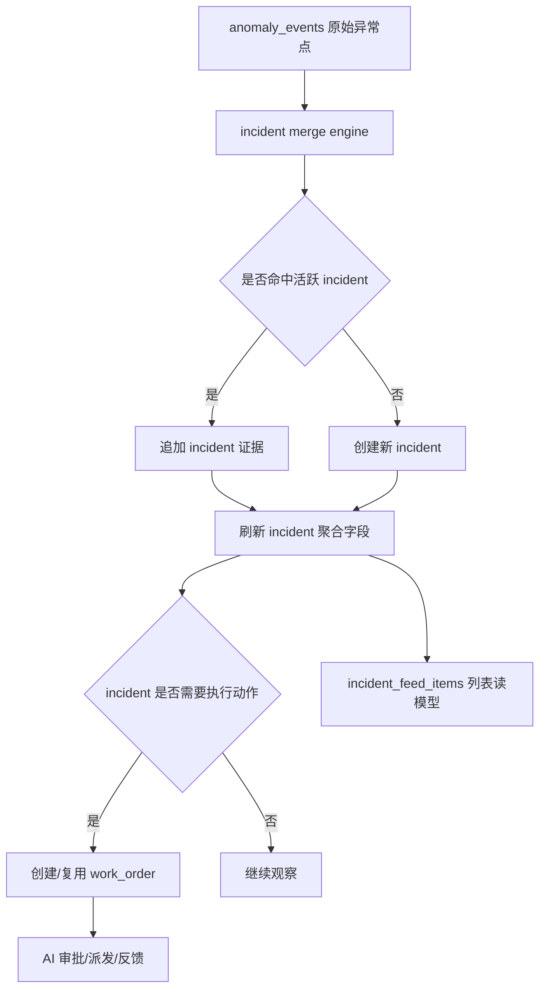

# Incident 驱动的异常与工单分层重构方案

本文档描述一种**不以实现成本为约束、以性能和用户体验为最高优先级**的理想方案。该方案不删除现有表和现有数据，而是在现有 `anomaly_events`、`work_orders`、`work_order_anomaly_links` 之上，新增 `incident` 层，把“异常事实”“事故聚合”“执行工单”“前端展示”拆开建模。

文档重点回答四个问题：

1. 现有方案到底哪里有问题
2. 为什么“把连续异常并到同一张工单”仍然不是最优终局
3. 为什么要新增 `incident` 层
4. 这个重构方案如何同时优化性能、用户体验和后续演进能力

---

## 一、背景与结论

### 1.1 当前系统的真实问题

当前系统中：

- `anomaly_events` 表保存小时级异常点
- `auto_work_order_service.py` 会对每条异常点直接创建一张工单
- `work_orders` 同时承担“异常载体”“审批对象”“派工对象”“前端列表对象”四种职责

这会导致：

1. 连续异常造成工单数量爆炸
2. 前端看到的是大量重复卡片，而不是一个持续中的问题
3. 查询层越来越依赖对历史工单和关联证据做动态聚合
4. 状态机会越来越复杂，因为“故障状态”和“工单处理状态”被混在一起

### 1.2 本文档的核心结论

如果只考虑性能和用户体验，最优解不是“在 `work_orders` 上做更聪明的并单”，而是：

- 保留 `anomaly_events` 作为原始事实层
- 新增 `anomaly_incidents` 作为系统主实体
- 把 `work_orders` 降级为 incident 之下的“执行单/派工单”
- 前端主列表默认展示 incident，而不是直接展示工单

一句话概括：

**原始异常点是事实，incident 才是用户真正关心的问题，work order 只是处理这个问题的一次执行动作。**

---

## 二、现状分析：现在到底哪里不合理

### 2.1 现状流程

当前主流程可以简化为：

```text
energy_data / 检测规则
    -> anomaly_events（小时级异常点）
    -> auto_create_alert_orders()
    -> 每条 anomaly_event 直接 create_work_order()
    -> AI 审批
    -> dispatched / completed / false_alarm / closed
```

也就是说，系统默认把“异常点”和“工单”近似视为一一对应。

### 2.2 现状的业务问题

#### 问题 1：连续异常会制造大量重复工单

示例：

- 07:00 电耗异常
- 08:00 电耗异常
- 09:00 电耗异常
- 10:00 电耗异常

在业务上，这通常是同一个持续故障；但在现有模型中，它会变成四张工单。

结果是：

- `已派单` 数量虚高
- 管理员需要在大量几乎相同的卡片里辨认“到底有几个真实问题”
- 维修人员收到的是多张高度重复的任务

#### 问题 2：用户看到的是“事件碎片”，而不是“故障整体”

用户真正关心的是：

- 这是哪栋楼、哪个设备出了什么问题
- 它从什么时候开始
- 现在还在不在持续
- 严重程度有没有变高
- 谁在处理
- 处理到哪一步了

而现有列表更多展示的是：

- 某一个小时触发了一条异常
- AI 针对这个小时做了一次审批
- 又生成了一张工单卡片

这会让 UI 更像“日志列表”，而不是“问题列表”。

#### 问题 3：`work_orders` 承担了过多语义

当前 `work_orders` 同时承担：

1. 异常归档对象
2. AI 审批对象
3. 维修派工对象
4. 前端展示对象
5. 统计口径对象

这种耦合会导致一个典型后果：

- 任何“故障持续”“误报后复发”“重新派工”“升级外协”“关闭后再出现”的需求，最终都会把 `work_orders.status` 变得越来越别扭

#### 问题 4：状态语义混乱

例如现在的 `dispatched`，它既像：

- “这个问题需要处理”

又像：

- “某一张执行工单已经派发”

这两者在业务上不是一回事：

- “问题是否存在”是 incident 级状态
- “某张派工单是否被派发”是 work order 级状态

如果不拆开，未来一旦支持“误报关闭后再复发重新派工”，状态机会迅速复杂化。

#### 问题 5：查询和统计会越来越重

当前如果想展示：

- 持续次数
- 首次出现时间
- 最近出现时间
- 峰值偏差
- 是否持续恶化

通常需要对 `work_order_anomaly_links` 做聚合，或者动态扫描历史工单。这在数据量小的时候没问题，但随着数据增长会带来：

- 列表查询变重
- 排序复杂
- 移动端首屏加载变慢
- 统计接口越来越依赖大 SQL

#### 问题 6：通知体验会恶化

如果每新增一个异常点就对应一张新工单，那么通知层也很容易变成：

- 07:00 推一次
- 08:00 再推一次
- 09:00 再推一次

这不是有效提醒，而是通知风暴。

#### 问题 7：AI 审批容易被重复触发

如果异常点与工单一一对应，那么连续异常本质上会导致：

- 多张工单
- 多次 AI 审批
- 多次相似理由写入
- 多次列表更新

这既浪费算力，也会降低可解释性，因为用户看到很多重复的 AI 判断。

---

## 三、为什么“只做并单增强”还不够

把连续异常并到同一张 `work_order`，确实能解决一部分问题，但它仍然不是最优终局，原因如下。

### 3.1 并单增强解决的是“数量”，不是“职责错位”

“并单”主要解决：

- 连续异常不要生成太多 open 工单

但它没有解决：

- `work_orders` 仍然同时承担问题实体和执行实体
- 前端仍然默认围绕工单建模
- 状态机仍然在一个对象上承载“问题状态”和“派工状态”

### 3.2 未来场景依然会卡住

如果只有并单增强，下面这些场景仍然会难处理：

1. 一个 incident 先被 AI 驳回，之后异常持续升级，需要重新审核
2. 一个 incident 已派工，但维修确认“缺件等待”，期间证据继续增长
3. 一个 incident 被判误报关闭，隔 12 小时又重新出现
4. 一个 incident 需要重新派发给其他维修人员
5. 一个 incident 产生多次执行动作，例如先内部维修，再升级外协

这些都说明：

**incident 和 work order 不是同一个实体。**

### 3.3 用户主视图也不应该是工单

从体验角度看，运维管理者更需要“问题视图”：

- 当前有多少真实故障
- 哪些在持续恶化
- 哪些已经派人处理
- 哪些刚关闭又复发

工单只是“处理动作”，不是管理者心智中的主对象。

因此，如果要做到真正体验最优，前端主列表就不应该直接读 `work_orders`，而应该读 `incident`。

---

## 四、理想方案总览：四层分离模型

### 4.1 四层结构

理想模型拆成四层：

1. **事实层**：`anomaly_events`
2. **事故层**：`anomaly_incidents`
3. **执行层**：`work_orders`
4. **展示层**：`incident_feed_items` 或 incident 列表视图

### 4.2 各层职责

| 层级 | 主要对象 | 职责 |
|------|----------|------|
| 事实层 | `anomaly_events` | 记录每一个小时级异常点，保持不可变 |
| 事故层 | `anomaly_incidents` | 聚合同一持续故障，作为系统主实体 |
| 执行层 | `work_orders` | 表示针对某个 incident 发起的一次处理动作 |
| 展示层 | `incident_feed_items` | 给前端高频列表页直出读模型 |

### 4.3 新架构下的关系

```text
一个 anomaly_event -> 属于 0..1 个 incident
一个 incident -> 关联 1..N 个 anomaly_event
一个 incident -> 对应 0..N 个 work_order
一个 work_order -> 归属于 1 个 incident
```

这套关系比“anomaly_event <-> work_order”更符合业务现实。

---

## 五、为什么要新增 Incident 层

这是整个方案里最核心的修改，因此这里单独展开解释。

### 5.1 原因 1：incident 才是业务真正关心的对象

用户面对的不是：

- “08:00 那条异常点”

而是：

- “Henry 公共服务楼的暖通系统从昨天晚上开始持续异常，到现在还没恢复”

这个对象就是 incident。

### 5.2 原因 2：incident 是天然的聚合边界

所有下面这些信息，本质上都是 incident 属性，而不是单个工单属性：

- 首次出现时间
- 最近出现时间
- 持续时长
- 累计异常次数
- 峰值偏差
- 是否仍在持续
- 是否曾经复发

如果没有 incident 层，这些信息就只能被硬塞到 `work_orders` 上，久而久之会变得非常拧巴。

### 5.3 原因 3：incident 和 work order 的生命周期不同

incident 可以是：

- 刚开始观察
- 已经确认需要处理
- 正在处理
- 临时恢复
- 再次复发
- 最终关闭

而 work order 更像：

- 待审批
- 已批准
- 已派发
- 已完成
- 已关闭

一个 incident 在它的生命周期中，可能会经历多张 work order。

### 5.4 原因 4：incident 让性能优化更自然

如果前端主列表读 incident，那么系统可以在写入时维护 incident 的聚合字段，读的时候直接分页查询 `anomaly_incidents` 即可，不用每次去扫 `work_order_anomaly_links` 临时聚合。

这比“查询时现算”更适合高频移动端场景。

### 5.5 原因 5：incident 更利于后续产品演进

未来如果要做：

- 复发分析
- 平均持续时长
- 多次派工成功率
- 每类问题的处理闭环效率
- incident 级 SLA

有 incident 层会非常自然；没有 incident 层，很多统计都只能从工单和异常点之间硬拼。

---

## 六、详细设计：新增哪些表，为什么新增

本方案不删除旧表，只新增新表和新索引。

### 6.1 新增 `anomaly_incidents`

#### 表职责

这张表是系统中的“问题主表”，用来表达一个连续故障。

#### 建议字段

| 字段 | 类型 | 作用 |
|------|------|------|
| `id` | UUID/String | 主键 |
| `incident_id` | VARCHAR | 对外展示编号，如 `INC-20260403-001` |
| `source` | VARCHAR | `auto_detect` / `prediction` / `manual` |
| `building_id` | VARCHAR | 所属楼栋 |
| `device_id` | VARCHAR | 所属设备 |
| `rule_triggered` | VARCHAR | 异常规则 |
| `hvac_root_cause` | VARCHAR | 暖通根因 |
| `merge_key` | VARCHAR | 合并键，便于快速检索 |
| `incident_status` | VARCHAR | incident 级业务状态 |
| `workflow_status` | VARCHAR | 当前流程摘要状态 |
| `priority` | VARCHAR | 当前优先级 |
| `first_seen_at` | TIMESTAMPTZ | 首次出现时间 |
| `last_seen_at` | TIMESTAMPTZ | 最近异常时间 |
| `continuity_expires_at` | TIMESTAMPTZ | 连续性窗口失效时间 |
| `anomaly_count` | INT | 已归并异常点数 |
| `peak_deviation_pct` | FLOAT | 历史峰值偏差 |
| `latest_actual_value` | FLOAT | 最新实测值 |
| `latest_expected_value` | FLOAT | 最新期望值 |
| `summary_text` | TEXT | 前端主展示摘要 |
| `current_work_order_id` | FK | 当前活跃执行单 |
| `is_active` | BOOL | 是否仍为活跃 incident |
| `resolved_at` | TIMESTAMPTZ | 事故关闭时间 |
| `created_at` | TIMESTAMPTZ | 创建时间 |
| `updated_at` | TIMESTAMPTZ | 更新时间 |

#### 为什么要加这些字段

- `merge_key`：把“查找可合并 incident”变成高效索引查询
- `continuity_expires_at`：把“是否连续”从动态计算变成直接判断
- `anomaly_count` / `peak_deviation_pct`：让列表页无需再回表聚合
- `summary_text`：避免前端每次自己拼复杂文案
- `current_work_order_id`：快速定位当前执行动作

### 6.2 新增 `incident_event_links`

#### 表职责

这张表记录 incident 和原始异常点之间的关系，也就是 incident 的证据时间线。

#### 建议字段

| 字段 | 类型 | 作用 |
|------|------|------|
| `id` | UUID/String | 主键 |
| `incident_id` | FK | 所属 incident |
| `anomaly_event_id` | FK | 对应原始异常点 |
| `sequence_no` | INT | 时间线顺序号 |
| `data_timestamp` | TIMESTAMPTZ | 该证据时间 |
| `actual_value` | FLOAT | 快照 |
| `expected_value` | FLOAT | 快照 |
| `deviation_pct` | FLOAT | 快照 |
| `rule_triggered` | VARCHAR | 快照 |
| `hvac_root_cause` | VARCHAR | 快照 |
| `created_at` | TIMESTAMPTZ | 追加时间 |

#### 为什么不直接只用 `work_order_anomaly_links`

因为 `work_order_anomaly_links` 语义上是“某张执行工单挂了哪些证据”。而 incident 的证据时间线，不应该绑定在某一张具体工单上。

否则一旦出现：

- incident 复发
- 工单重派
- 多次派工

证据归属就会变得混乱。

因此，incident 需要自己的证据时间线表。

### 6.3 新增 `incident_work_order_links`

#### 表职责

记录一个 incident 与多张执行工单之间的关联。

#### 建议字段

| 字段 | 类型 | 作用 |
|------|------|------|
| `id` | UUID/String | 主键 |
| `incident_id` | FK | 所属 incident |
| `work_order_id` | FK | 对应工单 |
| `link_type` | VARCHAR | `primary` / `redispatch` / `escalation` |
| `is_current` | BOOL | 是否当前执行单 |
| `created_at` | TIMESTAMPTZ | 建立关联时间 |

#### 为什么需要它

因为一个 incident 未来很可能对应多次执行动作：

- 初次派工
- 误报后重新派工
- 升级外协
- 再次转派

如果没有关联表，只能在 `work_orders` 上硬塞更多外键和状态分支。

### 6.4 新增 `incident_merge_policies`

#### 表职责

把“什么类型的异常可以在多长时间内合并”从代码里抽离出来，做成策略表。

#### 建议字段

| 字段 | 类型 | 作用 |
|------|------|------|
| `id` | UUID/String | 主键 |
| `rule_triggered` | VARCHAR | 规则 |
| `hvac_root_cause` | VARCHAR | 根因，可空 |
| `continuity_hours` | INT | 连续性窗口 |
| `reopen_hours` | INT | 复发判定窗口 |
| `priority_floor` | VARCHAR | 最低优先级 |
| `is_enabled` | BOOL | 是否启用 |
| `description` | TEXT | 策略说明 |

#### 为什么要加这张表

因为连续性窗口本质上是业务策略，而不是数据库事实。把它硬编码在服务函数里，后期每次调策略都要发版，不利于运营和迭代。

### 6.5 新增 `incident_state_history`

#### 表职责

记录 incident 自身状态的变化历史。

#### 为什么需要

当前 `work_order_audit_log` 记录的是工单状态变化，但 incident 也需要自己的生命周期审计，例如：

- incident 创建
- incident 持续升级
- incident 被重新打开
- incident 因长时间无新证据自动关闭

这类事件不适合写到工单日志里。

### 6.6 新增 `incident_feed_items` 或物化读模型

#### 表职责

这是一个纯展示层的高频读取模型，专供前端列表页使用。

#### 建议字段

保留列表页最常用的扁平字段，例如：

- `incident_id`
- `building_id`
- `device_id`
- `title`
- `summary_text`
- `priority`
- `incident_status`
- `first_seen_at`
- `last_seen_at`
- `anomaly_count`
- `peak_deviation_pct`
- `current_assignee`
- `has_new_evidence`

#### 为什么值得单独加

如果追求极致体验，移动端列表页应该尽量避免：

- 大量 join
- 大量聚合
- 复杂业务字段临时拼装

读模型表的价值就在于“写时处理复杂逻辑，读时极简直出”。

---

## 七、现有表如何保留，为什么不能删

本方案明确要求：

- 不删现有表
- 不删现有字段
- 不破坏当前接口兼容性

### 7.1 `anomaly_events` 继续保留

#### 原因

它是底层事实表，代表检测链路真实产出的原始异常点。它的粒度不能被 incident 替代。

incident 是聚合结果，不是原始事实。

### 7.2 `work_orders` 继续保留

#### 原因

当前系统已经围绕 `work_orders` 实现了：

- AI 审批
- 维修反馈
- 管理员 override
- 审计日志
- 现有前端调用

这些能力不能直接删除，否则风险太高。

理想做法是：

- 保留 `work_orders`
- 把它的职责重新定位为“执行动作”
- 新增 `incident_id` 外键或通过关联表把它接到 incident 上

### 7.3 `work_order_anomaly_links` 继续保留

#### 原因

它仍然对执行单维度有价值：

- 工单详情页希望看到“这张执行单创建时参考了哪些证据”
- 审批回放时希望知道工单当时绑定的证据快照

因此即使有了 `incident_event_links`，它也不应该被删，只是语义从“全局唯一证据挂载表”变成“工单级证据快照表”。

---

## 八、状态设计：为什么必须把 incident 状态和工单状态拆开

这是另一个关键设计点。

### 8.1 现有问题

当前很多状态被硬塞进 `work_orders.status`，导致一个状态既像在描述“问题是否存在”，又像在描述“工单处理到哪一步”。

例如：

- `dispatched`
- `completed`
- `false_alarm`
- `closed`

这些状态对“工单”是合理的，但它们并不完全等价于 incident 的状态。

### 8.2 新方案：两套状态

#### Incident 状态

建议新增 `incident_status`：

- `open`
- `watching`
- `action_required`
- `dispatched`
- `in_progress`
- `resolved`
- `false_positive`
- `closed`
- `reopened`

这套状态服务于“问题管理”。

#### Work Order 状态

保留现有 `work_orders.status`：

- `pending_review`
- `auto_approved`
- `auto_rejected`
- `dispatched`
- `completed`
- `false_alarm`
- `escalated`
- `admin_override_approved`
- `admin_override_rejected`
- `closed`

这套状态服务于“执行流程”。

### 8.3 为什么这样更合理

因为 incident 可以：

- 处于“仍然活跃”的状态
- 但当前没有活跃工单

也可以：

- 已经有工单 `completed`
- 但 incident 还没完全确认关闭

拆成两套状态后，系统表达能力会更强，也更符合用户认知。

---

## 九、事件流设计：从 anomaly_event 到 incident 再到 work_order

### 9.1 新主流程

理想流程应该变成：

```text
anomaly_event 到来
    -> 计算 merge_key
    -> 查找可合并 active incident
    -> 若命中则追加 incident 证据
    -> 若未命中则创建新 incident
    -> 根据 incident 状态决定是否创建/复用/重开 work_order
    -> AI 审批主要发生在 incident 首次进入 action_required 时
```

### 9.2 为什么要先 incident 后工单

因为这意味着：

- “问题是否存在”先被识别
- “是否需要执行动作”再被判断

这比“异常点一来就立刻建一张工单”更符合业务语义。

### 9.3 可合并逻辑应在哪一层做

理想版本里，可合并逻辑应该发生在 incident 层，而不是 work order 层。

原因：

1. incident 是连续故障的承载者
2. work order 是执行动作，不应该被迫承担持续性判断
3. incident 层可以天然支持复发、重开、重派、升级等行为

---

## 十、连续性判断设计：为什么要把时间窗口写成策略

### 10.1 当前业务需求

连续性窗口需要按规则细分：

- 电耗 / 水耗 / 供回水温度偏离：6 小时
- 暖通能耗异常且根因明确：24 小时

### 10.2 为什么不要只写死在代码里

因为这个规则很可能未来调整：

- 某类规则过于敏感，希望缩短窗口
- 某类暖通根因持续性更强，希望延长窗口
- 某栋楼业务上希望更保守或更激进

如果写死在代码里，每次调整都要修改服务逻辑、重新发版、重新测试。

而如果放到 `incident_merge_policies`：

- 可以配置化
- 可以逐条调整
- 可以 A/B 对比不同策略
- 可以快速回滚

### 10.3 为什么要存 `continuity_expires_at`

因为它让判断逻辑从：

- “每次查询时临时回算窗口”

变成：

- “当前异常时间是否小于等于 `continuity_expires_at`”

这对性能和实现清晰度都更好。

---

## 十一、AI 审批应该怎么改，为什么这样改

### 11.1 理想方案：AI 审批以 incident 为主

在理想方案里，AI 不应该对每个小时级异常点重复审批，也不应该在连续异常期间不断创建新工单再审批。

建议改为：

- incident 第一次被创建时做一次审批
- 后续证据追加时默认不重审
- 只有触发特定条件才重审

### 11.2 建议的重审触发条件

以下条件可以触发 incident 级重审：

1. `anomaly_count` 达到阈值
2. `peak_deviation_pct` 明显变高
3. incident 持续时间超过阈值
4. 管理员手动触发
5. 特殊事件上下文发生变化

### 11.3 为什么这样做更好

#### 原因 1：节省模型调用成本

连续异常场景下，不需要每小时重复问一次几乎相同的问题。

#### 原因 2：AI 解释更连贯

AI 可以面向“这个持续中的问题”给出判断，而不是只盯着某一个小时的异常点。

#### 原因 3：更符合管理者认知

管理者想知道的是：

- “这个故障目前应该不应该处理”

而不是：

- “今天 07:00 那次应该不应该处理，08:00 那次呢，09:00 那次呢”

---

## 十二、前端用户体验应该怎么改，为什么这样改

### 12.1 当前体验问题

当前列表页更像工单流水，用户容易遇到：

- 大量重复卡片
- 很难一眼看出有多少真实问题
- 很难判断哪些问题在持续恶化
- 很难区分“问题”和“处理动作”

### 12.2 理想主列表应改为 Incident 列表

主列表卡片建议展示：

- 楼栋 + 设备
- 故障类型
- 当前 incident 状态
- 当前优先级
- 首次发现时间
- 最近异常时间
- 已持续时长
- 连续异常次数
- 峰值偏差
- 当前处理人
- 当前工单状态摘要

### 12.3 为什么这样更符合用户认知

因为用户面对的应该是：

- 一个问题卡片

卡片内部再展开：

- 证据时间线
- 工单时间线
- 审批时间线

而不是一上来就被十几张相似工单淹没。

### 12.4 详情页建议拆成三条时间线

#### 时间线 1：异常证据时间线

展示：

- 每个小时异常点
- 实际值 / 期望值 / 偏差
- 根因变化

#### 时间线 2：AI / 管理员决策时间线

展示：

- AI 审批
- 管理员 override
- 重审

#### 时间线 3：执行时间线

展示：

- 工单创建
- 派发
- 维修反馈
- 升级外协
- 关闭

这样用户可以同时看到：

- 问题是怎么发展的
- 系统是怎么判断的
- 人是怎么处理的

---

## 十三、性能设计：为什么这个方案更快

如果不考虑实现成本，这个方案在性能上优于“仅在 work_orders 上并单”的核心原因是：**它把聚合放在写时，而不是读时。**

### 13.1 写时聚合

每次新异常点进入时，系统同步更新 incident：

- `anomaly_count`
- `first_seen_at`
- `last_seen_at`
- `peak_deviation_pct`
- `summary_text`
- `continuity_expires_at`

这样读列表时不需要再扫长时间线数据。

### 13.2 读时直出

前端列表页只需：

```sql
SELECT * FROM anomaly_incidents
WHERE is_active = true
ORDER BY priority DESC, last_seen_at DESC
LIMIT 20
```

或者直接读 `incident_feed_items`。

这会比：

- 查 `work_orders`
- join `work_order_anomaly_links`
- 聚合最新时间、次数、峰值

更稳定、更快。

### 13.3 活跃 incident 索引会非常高效

建议索引：

- `idx_incident_merge_key_active`
- `idx_incident_status_priority_last_seen`
- `idx_incident_building_last_seen`
- `idx_incident_current_work_order`

### 13.4 大表按时间分区

如果追求极致性能，建议对以下表按月分区：

- `anomaly_events`
- `incident_event_links`
- `work_order_audit_log`
- `incident_state_history`

原因：

1. 这些表天然是时间序列型
2. 查询常常按最近时段进行
3. 归档和冷热分层更容易做

### 13.5 读模型避免移动端首屏卡顿

`incident_feed_items` 的价值就在于：

- 首页列表查询只读一张窄表
- 减少复杂 join 和聚合
- 移动端首屏加载更稳

---

## 十四、通知设计：为什么 incident 级通知更好

### 14.1 当前潜在问题

若每个异常点都能对应一张工单，则通知很容易变成频繁重复提醒。

### 14.2 理想通知策略

只在 incident 生命周期的重要节点通知：

1. 新 incident 创建
2. incident 优先级升级
3. incident 持续超时未处理
4. incident 被重新派工
5. incident 关闭
6. incident 复发重新打开

### 14.3 为什么这样更优

因为通知应该对应“值得用户采取动作的时刻”，而不是“底层数据又来了一条”。

incident 级通知能显著降低噪声。

---

## 十五、兼容与迁移设计：为什么要渐进式重构

虽然这是理想方案，但仍然不能直接推翻现有系统。最佳做法是渐进式重构。

### 15.1 原则

1. 不删表
2. 不删数据
3. 不立刻废弃旧接口
4. 新旧链路可以并行一段时间

### 15.2 建议迁移路径

#### Phase 1：新增 incident 层，不改旧接口

- 新增 `anomaly_incidents`
- 新增 `incident_event_links`
- 新增 `incident_work_order_links`
- 新增 merge policy 和 history 表
- 保持旧的 `work_orders` 接口仍然可用

#### Phase 2：新链路写 incident，同时保留旧工单能力

- 新异常先进入 incident 层
- incident 再决定是否创建或复用 `work_order`
- `work_order` 通过关联表挂到 incident

#### Phase 3：前端主列表切到 incident 视图

- 管理端和移动端列表都改读 incident
- 工单页退居详情或执行视图

#### Phase 4：旧工单列表保留为兼容页

- 作为审计或高级筛选视图保留
- 不再作为默认入口

### 15.3 为什么不建议一步切换

因为现有系统已经围绕 `work_orders` 建了很多逻辑：

- 权限
- 审批
- 反馈
- 审计
- 前端交互

一步切换风险太大。渐进式迁移更安全，也更方便校验新旧口径。

---

## 十六、推荐的理想数据流



这个流程的关键在于：

- incident 成为中间层和主对象
- work order 不再直接承接每一个异常点

---

## 十七、每一项关键修改的原因汇总

| 修改项 | 现有问题 | 为什么要改 | 预期收益 |
|--------|----------|------------|----------|
| 新增 `anomaly_incidents` | 工单承担问题实体职责过重 | incident 才是持续故障的真实载体 | 语义清晰，便于扩展 |
| 新增 `incident_event_links` | 证据被绑在工单上，不利于复发/重派 | incident 需要独立证据时间线 | 支持复杂生命周期 |
| 新增 `incident_work_order_links` | 一个问题未来可能对应多次执行动作 | problem 和 action 应该解耦 | 支持重派、升级、复发 |
| 拆分 incident 状态和工单状态 | 当前状态语义混杂 | 问题状态不等于执行状态 | 生命周期表达更准确 |
| 引入 merge policy 表 | 连续性窗口写死在代码里 | 策略应配置化 | 更易运营和回滚 |
| 列表页切 incident 主视图 | 当前列表重复卡片太多 | 用户关心的是问题，不是日志碎片 | 显著提升可读性 |
| 增加 feed/read model | 列表查询聚合成本高 | 写时聚合、读时直出 | 更好首屏和分页性能 |
| AI 审批 incident 化 | 连续异常易重复审批 | 一个问题通常只需一次主判断 | 节省算力，解释更连贯 |
| 通知 incident 化 | 小时级异常会制造通知风暴 | 通知应围绕生命周期节点 | 降噪，提升有效性 |

---

## 十八、最终结论

从“只考虑性能和用户体验”的角度看，最佳方案不是继续围绕 `work_orders` 打补丁，而是承认三件事：

1. `anomaly_events` 是原始事实，不适合直接给用户看
2. `incident` 才是用户真正关心的问题对象
3. `work_orders` 只是处理 incident 的执行动作

因此，最优架构应该是：

- **事实层**：保留 `anomaly_events`
- **事故层**：新增 `anomaly_incidents`
- **执行层**：保留 `work_orders`，但作为 incident 的下层动作对象
- **展示层**：新增 incident 读模型，前端主列表直接读 incident

这套方案的价值不只是减少重复工单，更重要的是：

1. 让系统表达“持续故障”这件事变得自然
2. 让前端展示围绕真实问题组织
3. 让查询和统计更适合高频场景
4. 为复发、重派、升级、SLA、运营分析留出清晰演进空间

如果把“连续异常并单”理解为一次战术优化，那么“引入 incident 层”就是战略级重构。

它不是为了让表更多，而是为了让每个对象只做自己该做的事。
