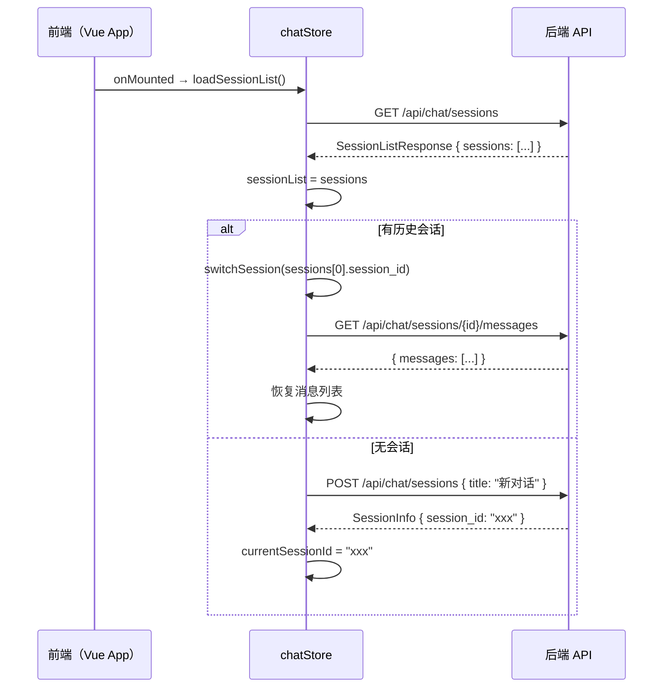

# 多智能体控制台会话管理 — 前端对接文档

> **适用版本**：后端改造完成后（`routes_chat.py` v2）  
> **前端栈**：Vue 3 + TypeScript + Pinia + Vite  
> **编写日期**：2026-03-11

---

## 一、后端新增 API 总览

| 方法 | 路径 | 功能 | 对应 Cursor 功能 |
|------|------|------|---|
| `GET` | `/api/chat/sessions` | 获取会话列表 | 左侧历史侧边栏 |
| `POST` | `/api/chat/sessions` | 预建命名会话 | New Chat 按钮 |
| `GET` | `/api/chat/sessions/{id}` | 获取单个会话摘要 | 切换会话时拉取上下文 |
| `PATCH` | `/api/chat/sessions/{id}` | 重命名 / 更新楼宇绑定 | 右键重命名 |
| `POST` | `/api/chat/sessions/{id}/archive` | 归档会话 | More > Archive |
| `DELETE` | `/api/chat/sessions/{id}` | 物理删除 | 右键删除 |
| `GET` | `/api/chat/sessions/{id}/messages` | 获取消息历史 | 切换会话后恢复消息 |
| `POST` | `/api/chat` | SSE 对话（已增强） | 对话输入框 |

---

## 二、TypeScript 类型定义

在 `frontend/src/api/types.ts`（新建或追加）中添加以下类型：

```typescript
// ─── 会话管理相关类型 ────────────────────────────────────────────────────────

export interface SessionInfo {
  session_id: string
  title: string
  created_at: string        // ISO8601 UTC 时间戳
  updated_at: string
  message_count: number
  last_message: string | null   // 最后一条用户消息的前 200 字（列表预览用）
  building_id: string | null    // 会话绑定的楼宇类型，如 "Office"
  is_archived: boolean
  has_pending_action: boolean   // 是否有待审批 HITL 工单（显示角标用）
}

export interface SessionListResponse {
  sessions: SessionInfo[]
  total: number
}

export interface SessionCreateRequest {
  title?: string  // 不传则后端默认"新对话"
}

export interface SessionUpdateRequest {
  title?: string         // 不传则不修改
  building_id?: string   // 传 "" 可清除绑定
}

// ─── POST /api/chat 请求体（已有，补充文档） ───────────────────────────────

export interface ChatRequest {
  message: string
  session_id?: string | null  // 不传或传 null 则后端自动生成新 session
}
```

---

## 三、`stream_client.ts` 扩展

在 `frontend/src/api/stream_client.ts` 末尾追加以下 REST 调用函数：

```typescript
import { apiFetch } from './http'
import type {
  SessionInfo,
  SessionListResponse,
  SessionCreateRequest,
  SessionUpdateRequest,
} from './types'

// ─── 会话列表 ───────────────────────────────────────────────────────────────

/** 获取所有活跃会话（前端侧边栏加载用） */
export async function fetchSessionList(
  includeArchived = false
): Promise<SessionListResponse> {
  const qs = includeArchived ? '?include_archived=true' : ''
  return apiFetch<SessionListResponse>(`/api/chat/sessions${qs}`)
}

// ─── 创建会话 ───────────────────────────────────────────────────────────────

/** 预建命名会话，返回 session_id 供后续对话使用 */
export async function createSession(
  req: SessionCreateRequest = {}
): Promise<SessionInfo> {
  return apiFetch<SessionInfo>('/api/chat/sessions', {
    method: 'POST',
    body: JSON.stringify(req),
  })
}

// ─── 重命名 / 更新绑定楼宇 ──────────────────────────────────────────────────

export async function updateSession(
  sessionId: string,
  req: SessionUpdateRequest
): Promise<SessionInfo> {
  return apiFetch<SessionInfo>(`/api/chat/sessions/${sessionId}`, {
    method: 'PATCH',
    body: JSON.stringify(req),
  })
}

// ─── 归档 ───────────────────────────────────────────────────────────────────

export async function archiveSession(sessionId: string): Promise<SessionInfo> {
  return apiFetch<SessionInfo>(
    `/api/chat/sessions/${sessionId}/archive`,
    { method: 'POST' }
  )
}

// ─── 删除 ───────────────────────────────────────────────────────────────────

export async function deleteSession(sessionId: string): Promise<void> {
  await apiFetch(`/api/chat/sessions/${sessionId}`, { method: 'DELETE' })
}

// ─── 获取消息历史（切换会话时恢复） ─────────────────────────────────────────

export interface HistoryMessage {
  role: 'user' | 'assistant'
  content: string
}

export async function fetchSessionMessages(
  sessionId: string
): Promise<{ session_id: string; messages: HistoryMessage[]; total: number }> {
  return apiFetch(`/api/chat/sessions/${sessionId}/messages`)
}
```

---

## 四、`chatStore.ts` 扩展

将 `frontend/src/stores/chatStore.ts` 按以下结构扩展：

### 4.1 新增 State 字段

```typescript
import type { SessionInfo } from '@/api/types'

// 在 state() 返回对象中追加：
sessionList: [] as SessionInfo[],        // 会话列表（侧边栏数据源）
currentSessionId: null as string | null, // 当前激活的会话 ID
sessionListLoading: false,               // 列表加载中
```

### 4.2 新增 Actions

```typescript
import {
  fetchSessionList,
  createSession,
  updateSession,
  archiveSession,
  deleteSession,
  fetchSessionMessages,
} from '@/api/stream_client'
import type { ChatMessage } from './chatStore'  // 已有类型

// ── 加载会话列表 ─────────────────────────────────────────────────────────────
async function loadSessionList(includeArchived = false) {
  sessionListLoading.value = true
  try {
    const res = await fetchSessionList(includeArchived)
    sessionList.value = res.sessions
  } finally {
    sessionListLoading.value = false
  }
}

// ── 创建并切换到新会话 ───────────────────────────────────────────────────────
async function newSession(title?: string) {
  const info = await createSession({ title })
  sessionList.value.unshift(info)       // 插入列表头部
  await switchSession(info.session_id)  // 立即切换
}

// ── 切换到指定会话（恢复消息历史） ─────────────────────────────────────────
async function switchSession(targetSessionId: string) {
  if (currentSessionId.value === targetSessionId) return

  // 清空当前消息（避免残留）
  messages.value = []
  currentAgentStatus.value = null
  pendingWorkOrder.value = null
  currentSessionId.value = targetSessionId

  // 从后端拉取消息历史并重建前端消息列表
  const history = await fetchSessionMessages(targetSessionId)
  messages.value = history.messages.map((m) => ({
    id: Date.now() + Math.random(),  // 临时 ID
    type: m.role === 'user' ? 'user' : 'ai',
    content: m.content,
    thinkingSteps: [],
    thinkingFinished: true,
  } as ChatMessage))

  sessionId.value = targetSessionId   // 更新 SSE 使用的 session_id
}

// ── 重命名会话 ────────────────────────────────────────────────────────────────
async function renameSession(sessionId: string, newTitle: string) {
  const updated = await updateSession(sessionId, { title: newTitle })
  const idx = sessionList.value.findIndex((s) => s.session_id === sessionId)
  if (idx !== -1) sessionList.value[idx] = updated
}

// ── 归档会话 ────────────────────────────────────────────────────────────────
async function archiveSessionAction(targetId: string) {
  await archiveSession(targetId)
  sessionList.value = sessionList.value.filter((s) => s.session_id !== targetId)
  // 若归档的是当前会话，切换到列表第一个（或新建）
  if (currentSessionId.value === targetId) {
    if (sessionList.value.length > 0) {
      await switchSession(sessionList.value[0].session_id)
    } else {
      await newSession()
    }
  }
}

// ── 删除会话 ─────────────────────────────────────────────────────────────────
async function deleteSessionAction(targetId: string) {
  await deleteSession(targetId)
  sessionList.value = sessionList.value.filter((s) => s.session_id !== targetId)
  if (currentSessionId.value === targetId) {
    if (sessionList.value.length > 0) {
      await switchSession(sessionList.value[0].session_id)
    } else {
      clearSession()
      currentSessionId.value = null
    }
  }
}
```

### 4.3 修改 `sendMessage` — 将 `currentSessionId` 传入 SSE

在 `sendMessage` 中，将 `session_id` 从 `sessionId.value`（旧）改为 `currentSessionId.value`：

```typescript
// 修改前
const newSessionId = await sendChatMessage(userText, sessionId.value, handlers)

// 修改后（确保始终使用 currentSessionId）
const newSessionId = await sendChatMessage(userText, currentSessionId.value, handlers)
// 首次响应后，从响应头读取 x-session-id 并更新 currentSessionId
onDone: (event) => {
  if (!currentSessionId.value) {
    currentSessionId.value = event.session_id
  }
  // 刷新列表中该会话的 message_count（乐观更新）
  const idx = sessionList.value.findIndex((s) => s.session_id === currentSessionId.value)
  if (idx !== -1) sessionList.value[idx].message_count++
  isLoading.value = false
}
```

---

## 五、`AgentConsole.vue` 改造要点

### 5.1 整体布局调整

参照 Cursor 的三区布局，将原来的单栏 Console 改为左右分栏：

```
┌──────────────────────────────────────────────────────────┐
│  AgentConsole                                            │
├────────────────┬─────────────────────────────────────────┤
│  会话列表侧边栏 │  对话区域                                │
│  （宽 220px）  │                                          │
│                │  ┌─── 顶部工具栏 ─────────────────────┐ │
│  [+ 新对话]    │  │  标题  |  楼宇  |  更多(⋮)          │ │
│  ─────────────  │  └────────────────────────────────────┘ │
│  📝 会话 1     │                                          │
│  📝 会话 2 ●  │  消息列表区                              │
│  📝 会话 3     │                                          │
│                │  ─────────────────────────────────────── │
│                │  输入框 + 发送按钮                        │
└────────────────┴─────────────────────────────────────────┘
```

### 5.2 会话列表侧边栏组件（`SessionSidebar.vue`，新建）

```vue
<template>
  <aside class="session-sidebar">
    <!-- 新建会话按钮 -->
    <button class="new-chat-btn" @click="store.newSession()">
      <Icon icon="lucide:plus" />
      新对话
    </button>

    <!-- 会话列表 -->
    <div class="session-list">
      <div
        v-for="session in store.sessionList"
        :key="session.session_id"
        class="session-item"
        :class="{ active: session.session_id === store.currentSessionId }"
        @click="store.switchSession(session.session_id)"
        @contextmenu.prevent="openContextMenu($event, session)"
      >
        <!-- 标题 -->
        <span class="session-title">{{ session.title }}</span>
        <!-- 待审批工单角标 -->
        <span v-if="session.has_pending_action" class="badge pending" />
        <!-- 消息数 -->
        <span class="msg-count">{{ session.message_count }}</span>
      </div>
    </div>

    <!-- 右键菜单 -->
    <ContextMenu
      v-if="ctxMenu.visible"
      :x="ctxMenu.x"
      :y="ctxMenu.y"
      :items="ctxMenuItems"
      @close="ctxMenu.visible = false"
    />
  </aside>
</template>
```

关键交互逻辑：

```typescript
// onMounted 时加载列表
onMounted(() => store.loadSessionList())

// 右键菜单选项
const ctxMenuItems = [
  { label: '重命名', icon: 'lucide:pencil', action: () => startRename(ctxMenu.session) },
  { label: '归档',   icon: 'lucide:archive', action: () => store.archiveSessionAction(ctxMenu.session.session_id) },
  { label: '删除',   icon: 'lucide:trash-2', action: () => confirmDelete(ctxMenu.session) },
]
```

### 5.3 对话区域顶部工具栏改造

将原来的「清除按钮」扩展为完整工具栏：

```vue
<header class="console-header">
  <!-- 会话标题（双击进入编辑态） -->
  <span
    class="session-title"
    @dblclick="startInlineRename"
  >
    {{ currentSessionTitle }}
  </span>

  <!-- 绑定楼宇标签 -->
  <select
    v-if="buildingStore.buildings.length"
    :value="currentSession?.building_id ?? ''"
    @change="onBuildingChange"
    class="building-selector"
  >
    <option value="">全部楼宇</option>
    <option
      v-for="b in buildingStore.buildings"
      :key="b.building_type"
      :value="b.building_type"
    >
      {{ b.display_name ?? b.building_type }}
    </option>
  </select>

  <!-- 更多操作下拉菜单 -->
  <Dropdown trigger="click">
    <template #trigger>
      <button class="icon-btn">
        <Icon icon="lucide:more-horizontal" />
      </button>
    </template>
    <template #content>
      <DropdownItem @click="startRename">重命名</DropdownItem>
      <DropdownItem @click="store.archiveSessionAction(store.currentSessionId)">归档</DropdownItem>
      <DropdownDivider />
      <DropdownItem danger @click="confirmDelete">删除对话</DropdownItem>
    </template>
  </Dropdown>
</header>
```

### 5.4 `Operations.vue` 集成

`AgentConsole` 在 `Operations.vue` 中以侧边嵌套方式展示，改造方式：

```vue
<!-- Operations.vue 中的 AgentConsole 引用不变，只需 AgentConsole 内部加 sidebar -->
<AgentConsole />
```

只需在 `AgentConsole.vue` 内部添加侧边栏，不需要改 `Operations.vue`。

---

## 六、启动顺序与初始化流程



---

## 七、样式参考（TailwindCSS / 自定义 CSS）

### 侧边栏尺寸规范

```css
.session-sidebar {
  width: 220px;
  min-width: 180px;
  max-width: 280px;
  resize: horizontal;        /* 可拖拽调宽 */
  border-right: 1px solid var(--border-color);
  overflow-y: auto;
  padding: 8px 0;
}

.session-item {
  display: flex;
  align-items: center;
  gap: 8px;
  padding: 6px 12px;
  cursor: pointer;
  border-radius: 6px;
  margin: 0 4px;
  transition: background 0.15s;
}

.session-item:hover    { background: var(--hover-bg); }
.session-item.active   { background: var(--active-bg); font-weight: 500; }

.session-title {
  flex: 1;
  overflow: hidden;
  text-overflow: ellipsis;
  white-space: nowrap;
  font-size: 13px;
}

.badge.pending {
  width: 8px;
  height: 8px;
  border-radius: 50%;
  background: #f59e0b;  /* 待审批黄色 */
  flex-shrink: 0;
}
```

---

## 八、注意事项 & 常见问题

### Q1：切换会话时消息历史不显示？
检查 `switchSession` 中是否正确调用了 `fetchSessionMessages` 并将结果映射为前端 `ChatMessage` 格式（特别注意 `type: 'user' | 'ai'` 字段）。

### Q2：新建会话后 session_id 何时写入 chatStore？
`POST /api/chat/sessions` 返回 `SessionInfo.session_id`，在 `newSession()` action 中立即赋值给 `currentSessionId`，随后的 `POST /api/chat` 请求体会携带该 ID。

### Q3：自动标题何时更新？
后端在第一条消息处理完成后（`done` 事件发出前）异步更新标题。前端在收到 `done` 事件后调用 `loadSessionList()` 刷新列表，即可看到更新后的标题。

```typescript
// 在 chatStore.ts 的 onDone handler 中追加：
onDone: (event) => {
  isLoading.value = false
  // 刷新会话列表以显示自动更新的标题
  loadSessionList()
}
```

### Q4：服务重启后会话能恢复吗？
能。只要 PostgreSQL 中的 `chat_sessions` 表数据完整，后端在接收到已知 `session_id` 时会自动从 DB 反序列化恢复 `AgentState`。

### Q5：`building_id` 绑定的作用？
绑定楼宇后，切换到该会话时，建议前端同步 `buildingStore.select(session.building_id)`，让数据仪表盘与 AI 上下文保持一致。
