## 四、核心技术设计

本章重点说明项目中真正支撑“能耗查询、风险识别、智慧运维、维修辅助”落地的核心技术。与传统系统仅依赖固定页面、静态报表和人工经验不同，“绿枢智控”围绕多智能体编排、工具调用、知识增强、规则与模型融合、流式交互和多模态辅助等能力，形成了一套面向建筑能源场景的智能化技术体系。这些技术并不是为了堆砌前沿概念，而是服务于查询统计、异常分析、预测预警、工单审批、派单调度和现场维修等具体业务目标。

### 4.1 基于 LangGraph 的多智能体协同编排技术

本项目并未采用单一问答机器人，而是构建了由 `Router Agent`、`Data Agent` 和 `Diagnose Agent` 组成的多智能体协同架构。系统首先由 Router Agent 对用户问题进行意图识别、实体抽取与置信度判断，再根据查询、诊断、知识检索、预测和工单等不同任务路由到对应智能体执行。对于“既要查数据，又要解释原因”的复合型问题，系统还支持 Data Agent 与 Diagnose Agent 的接力处理，从而实现从数据获取到诊断分析的连续推理。

这种图式编排方式的优势在于：系统不再让一个大模型承担全部任务，而是把“理解问题、调用工具、归纳数据、给出诊断”拆分为多个职责明确的节点，由状态机控制执行顺序与跳转条件。这样不仅增强了推理过程的稳定性，也降低了复杂问题下的回答漂移风险，使平台具备了从自然语言理解到业务执行的完整智能协作能力，是本项目智能化实现的总体中枢。

图 4-1 多智能体协同编排流程

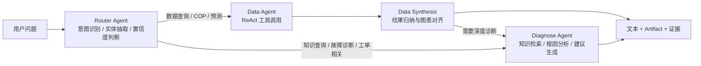

### 4.2 基于 ReAct 的智能体推理机制

在智能体执行层面，本项目采用了 ReAct（Reasoning + Acting）式工作机制。其核心思想不是让大模型直接输出最终答案，而是先根据问题形成初步判断，再主动调用查询、诊断、检索、预测等工具获取事实依据，最后在观察工具返回结果后继续推理并组织结论。`Data Agent` 和 `Diagnose Agent` 都遵循这一机制，因此系统中的 AI 并不是“空口回答”，而是“边思考、边调用、边验证”。

这一机制尤其适合建筑能源场景。因为能耗分析、异常归因和维修建议通常都依赖实时数据、设备状态、知识文档和规则结果，单靠语言模型记忆难以保证准确性。通过 ReAct 机制，系统能够把模型的语言理解能力与业务工具的确定性能力结合起来，从而提升输出结果的真实性、可追溯性和可解释性，也使 AI 更接近真正的“业务 Agent”而不是普通聊天机器人。

从工程实现上看，Data Agent 采用“两阶段 ReAct”设计：第一阶段专注于工具调用与事实收集，不直接生成长文本；第二阶段再由综合总结模块根据工具结果和图表清单输出分析结论。Diagnose Agent 则在 ReAct 循环中把异常检测、知识检索和联网补充组合起来，形成更完整的诊断推理链。

图 4-2 ReAct 推理闭环

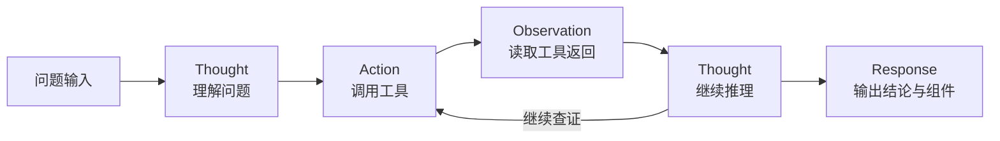

可将该过程抽象表示为：

$$
\begin{aligned}
Answer &= LLM(Question, Context, ToolObservations) \\
ToolObservations &= \{obs_1, obs_2, \ldots, obs_n\}
\end{aligned}
$$

其中：

- $Question$ 表示用户当前问题；
- $Context$ 表示会话上下文、时间范围、楼宇信息等约束；
- $ToolObservations$ 表示 MCP 工具返回的结构化结果集合。

### 4.3 基于 MCP 的业务工具调用机制

为了避免大模型直接拼接 SQL 或脱离业务规则进行自由生成，本项目在 AI 与业务系统之间设计了 MCP 标准工具层，将能耗查询、设备状态查询、COP 计算、异常检测、预测预警、知识检索、工单草稿生成、报表生成等能力统一封装为标准工具。系统通过工具注册中心、统一调用入口和参数校验机制，使大模型从“自由回答”转变为“按规则调用业务能力”。

该机制的优势在于：一方面，MCP 工具层显著提升了系统的稳定性、可控性与可审计性；另一方面，也提高了系统的扩展能力，后续若新增分析工具、业务动作或新型 Agent，只需在工具层扩展即可，而不需要重写整条智能链路。因此，MCP 在本项目中实际上承担了“AI 与业务系统之间标准接口层”的作用，是实现查询、诊断、预测、工单与报表联动的关键技术。

需要特别说明的是，当前版本已经落地的工具主要是围绕“查数据、做分析、做诊断、做预测、做联动”这几类核心业务能力展开；后文提到的数据治理、碳排核算、寿命评估等内容属于后续可扩展方向，并不代表当前版本已经全部实现。当前已实现工具可概括如下：

| 工具分组 | 当前已实现工具 | 当前业务作用 |
|---|---|---|
| 楼宇与设备定位 | `list_available_buildings`、`get_device_live_status` | 完成楼宇合法值识别、设备状态读取与上下文定位 |
| 数据查询与汇总 | `query_energy_metrics`、`query_daily_energy_summary` | 获取小时级原始数据与日/周/月趋势汇总 |
| 对比分析 | `compare_metric_across_buildings`、`compare_time_periods` | 支撑多楼横向对比与同环比分析 |
| 物理分析与基线 | `calculate_system_cop`、`get_building_rated_values`、`detect_energy_anomalies` | 计算 COP、读取期望值、识别异常与偏差 |
| 知识增强 | `rag_hybrid_search`、`web_search` | 检索知识库与外部公开资料，补充诊断证据 |
| 预测预警 | `building_kpi_forecast_6h_12h` | 预测未来 6/12 小时 KPI 并生成预警信息 |
| 交互与业务联动 | `render_ui_component`、`create_work_order_draft`、`generate_report` | 生成界面组件、工单草稿与报表输出 |

此外，系统中还保留了如 `building_kpi_forecast_from_features` 等内部调试工具，用于验证模型输入输出链路，但不作为常规业务展示能力对外描述。

在此基础上，MCP 仍然具有很强的业务可拓展性。围绕本项目现有场景，后续可以继续拓展的工具类型包括：

| 工具类别 | 可扩展工具示例 | 对应业务价值 |
|---|---|---|
| 数据治理类 | 字段映射建议、缺失值诊断、导入质量评分 | 提高数据接入效率与数据质量 |
| 物理分析类 | 碳排核算、能效等级评估、节能策略模拟 | 提升能源分析的深度与专业性 |
| 运维决策类 | 备件推荐、SLA 超时预测、排班建议 | 强化工单调度与资源配置 |
| 知识服务类 | 标准条文定位、SOP 推荐、相似案例对照 | 提高问答和指导的专业度 |
| 资产管理类 | 设备寿命评估、保养计划生成、巡检任务草稿 | 支撑长期设备运维管理 |

图 4-3 MCP 工具层结构

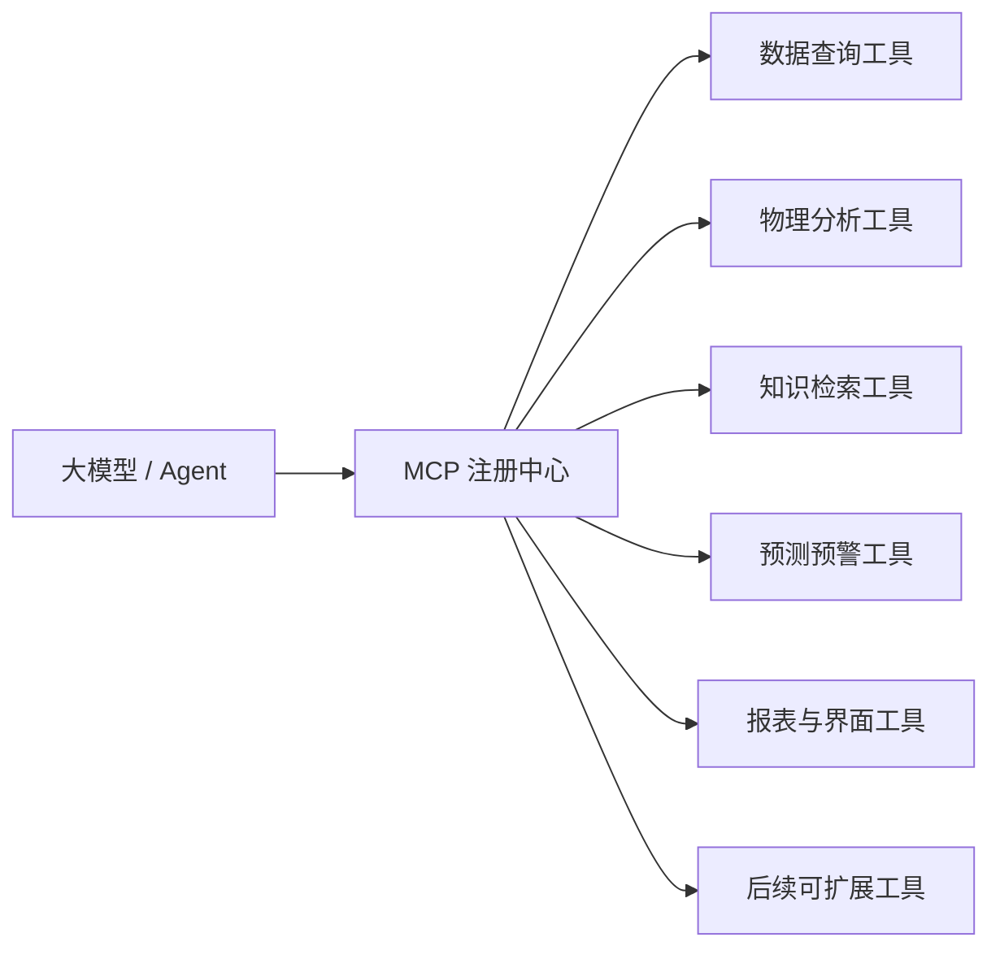

### 4.4 AI 驱动的动态界面生成技术

本项目中的 AI 并不只是返回一段文字，而是能够输出结构化 `Artifact`，由前端动态渲染为趋势图、柱状图、仪表盘、诊断面板和报表下载组件。也就是说，系统不仅实现了“AI 会回答”，还实现了“AI 会组织结果的展示形式”。在查询统计和故障诊断场景下，这种生成式 UI 机制能够把文本结论、数据摘要和可视化内容组合成更适合业务理解的界面结果。

这一技术的核心目标不是单纯增强交互炫技，而是让不同经验层次的使用者都能更直观地理解系统输出。对于经验较少的新员工而言，图表、指标和说明文字组合在一起，比纯文本更容易理解；对于经验丰富的老员工而言，结构化图表和摘要卡片可以帮助其更快定位问题重点，减少阅读成本。因此，生成式 UI 的本质价值在于“让 AI 结果更直观、更好理解、更便于使用”。

图 4-4 Artifact 到界面的转换过程

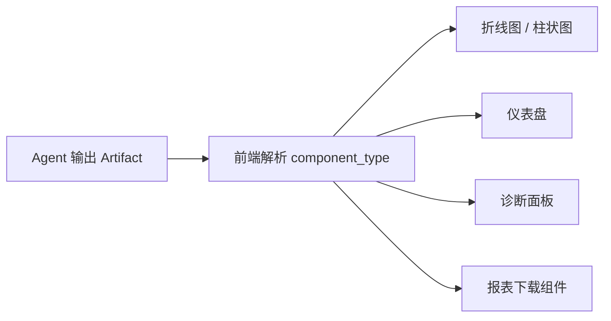

结构化 Artifact 示例：

```json
{
  "type": "artifact",
  "component_type": "LineChart",
  "title": "办公楼近7日电耗趋势",
  "data_payload": {
    "x": ["04-01", "04-02", "04-03"],
    "y": [126.3, 131.8, 129.4]
  }
}
```

### 4.5 流式可解释交互技术

在交互方式上，本项目采用基于 SSE 的流式事件驱动机制，而不是传统的一次性同步返回。系统在对话过程中会持续输出 `thinking`、`text`、`artifact`、`done` 等不同类型事件，前端和移动端则对这些事件进行专门适配，实现“边思考、边展示、边生成组件”的渐进式交互体验。这样，用户能够实时看到系统正在分析什么、输出了哪些文本、生成了哪些图表或卡片，而不必等待整个流程全部结束。

这种设计显著提升了智能交互的透明度和可解释性。对于复杂的查询分析、运维诊断和维修指导任务，用户不仅能更快获得阶段性反馈，也更容易理解系统的推理过程和输出结构。尤其在建筑能源管理这类业务问题链条较长的场景下，流式可解释交互能够有效降低等待焦虑，增强用户对 AI 结果的信任感和使用体验。

图 4-5 流式事件驱动交互时序

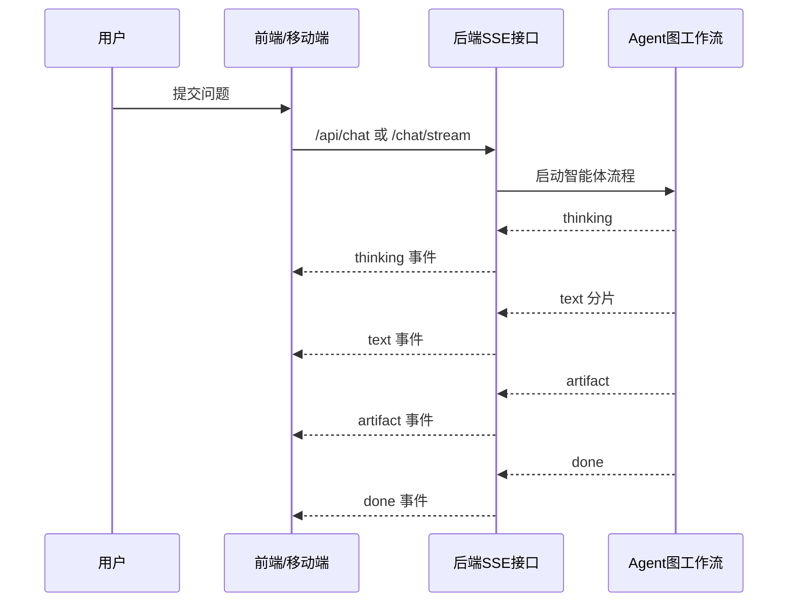

流式事件协议可概括为：

| 事件类型 | 含义 | 典型用途 |
|---|---|---|
| `thinking` | 当前正在执行的分析阶段 | 告知用户系统并未卡死 |
| `text` | 增量文本内容 | 逐步显示分析结论 |
| `artifact` | 结构化组件数据 | 动态渲染图表和面板 |
| `done` | 一轮交互结束 | 关闭加载态，收束流程 |

### 4.6 基于 RAGFlow 与联网搜索协同的知识增强检索技术

在智慧运维与维修指导场景中，单纯依赖通用大模型难以保证专业性和稳定性。为此，本项目引入 RAGFlow 作为知识检索引擎，将设备手册、运维规范、能耗分析资料、历史工单经验等文档转化为可检索知识，并在问答、诊断和维修指导过程中进行知识增强生成。系统在接收到专业问题后，可先进行知识检索，再将检索结果与当前工单、设备状态和异常信息结合，生成更符合领域场景的回答。

在工程实现上，系统采用“向量检索 + 关键词检索 + 重排”的混合检索策略。RAGFlow 负责主知识库召回，当知识库结果不足、问题涉及外部规范更新或需要补充行业资料时，系统还可启用 `web_search` 工具进行联网搜索补充。两者的目标是一致的，都是为了提升知识覆盖范围和答案可信度。前者强调企业/项目内知识的精准命中，后者强调对外部公开知识和新近信息的补充。

同时，为了保证系统在演示和部署环境中的鲁棒性，项目还设计了本地知识库兜底机制。当外部 RAG 服务未配置、不可用或检索失败时，系统仍能依靠本地知识片段完成基础检索与回答。该技术显著提升了 AI 回答的领域相关性、专业可信度和落地可用性，是实现运维问答、标准规范查询和维修辅助的重要底座。

图 4-6 知识增强检索流程

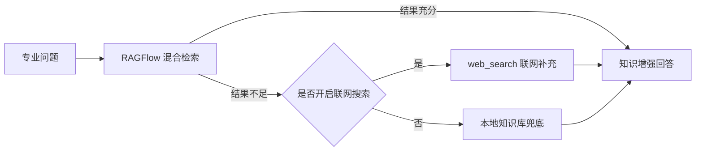

### 4.7 期望值基线生成模型

在异常检测和预测预警之前，系统首先需要回答一个更基础的问题，即“当前楼宇在此时此刻正常情况下应该运行到什么水平”。为了解决这一问题，本项目构建了逐小时 KPI 期望值基线生成模型，用于生成 `kpi_expected_hourly` 期望值数据。该模型不是简单取历史平均值，而是综合考虑建筑类型、运行日程、时间位置、气候影响以及 HVAC 工况等因素，对水耗、电耗、空调能耗以及供回水温度等关键指标给出额定参考值。

系统在基线生成过程中引入了建筑类型映射、日程系数调节、空调模式识别、HVAC 滞回状态机和供回水额定温度建模等逻辑，使期望值不仅具有统计意义，也具有工程语义。正因为有了这一层基线模型，后续异常检测能够判断“是否偏离正常工况”，预测预警也能够比较“未来是否会超出合理范围”。因此，期望值基线生成模型实际上是本项目异常识别和主动预警能力的共同底座。

图 4-7 期望值基线生成过程

```mermaid
flowchart LR
    A[建筑类型 / 面积] --> E[日程系数 S(h)]
    B[时间 / 星期信息] --> E
    C[气温 Ta / 露点 Tdew / 湿度] --> F[热冷负荷计算]
    E --> F
    F --> G[HVAC 工况判定]
    G --> H[water / electricity / hac 期望值]
    G --> I[供回水额定温度]
    H --> J[kpi_expected_hourly]
    I --> J
```

关键计算关系可表示为：

$$
\begin{aligned}
S &= schedule\_factor(usage, hour, dayofweek) \\
Water_{expected} &= A \cdot \left(W_{peak} \cdot S + W_{base} + \max(T_a - 26, 0) \cdot W_{weather}\right) \\
Q_{env} &= U_{env} \cdot (T_a - T_{in}) \\
Q_{internal} &= (P_{base} \cdot S) + (q_{person} \cdot S) \\
Q_{latent} &= \max(0, 15 \cdot (T_{dew} - 15)) \cdot S
\end{aligned}
$$

$$
Q_{load} =
\begin{cases}
A \cdot \max(0, Q_{env} + Q_{internal} + Q_{latent}) / 1000, & \text{制冷工况} \\
A \cdot \max(0, |Q_{env}| - Q_{internal}) / 1000, & \text{供暖工况}
\end{cases}
$$

$$
PLR = \operatorname{clip}\left(\frac{Q_{load}}{Q_{design}}, 0, 1\right)
$$

其中：

- $A$ 表示建筑面积；
- $S$ 表示日程系数，反映建筑在不同小时、不同工作日状态下的占用强度；
- $T_a$ 表示室外空气温度；
- $T_{dew}$ 表示露点温度；
- $T_{in}$ 表示工况下的目标室内基准温度；
- $Q_{env}$ 表示围护结构引起的环境负荷；
- $Q_{internal}$ 表示内部设备与人员带来的内部负荷；
- $Q_{latent}$ 表示潜热负荷；
- $PLR$ 表示部分负荷率。

在此基础上，空调期望能耗和总电耗进一步计算为：

$$
HAC_{expected} =
\begin{cases}
Q_{load} / COP_{cooling} + E_{pump\_run} + 0.5 \cdot E_{vent}, & \text{制冷工况} \\
Q_{load} / COP_{heating} + E_{pump\_run} + 0.4 \cdot E_{vent}, & \text{供暖工况}
\end{cases}
$$

$$
Electricity_{expected} = A \cdot P_{base} \cdot S / 1000 + HAC_{expected}
$$

供回水额定温度按照工况进一步给出：

$$
\begin{aligned}
\text{制冷:}\quad & T_{supply} = 7^\circ \mathrm{C}, \quad T_{return} = 7 + 5 \cdot PLR \\
\text{供暖:}\quad & T_{supply} = 60^\circ \mathrm{C}, \quad T_{return} = 60 - 10 \cdot PLR
\end{aligned}
$$

上述参数并非随意填写，而是来自本项目当前期望值生成模型的工程化设定。其来源可概括为：

- $S(h)$、建筑类型映射、$P_{base}$、$q_{person}$、$W_{peak}$ 以及 HVAC 滞回状态机，直接继承自项目中用于生成额定值的 notebook 仿真逻辑，并已封装到 `kpi_expected_service.py`；
- $T_{supply}=7^\circ \mathrm{C}$、$60^\circ \mathrm{C}$ 以及对应的 $5^\circ \mathrm{C}$、$10^\circ \mathrm{C}$ 温差，属于建筑 HVAC 场景下常用的冷冻水/供暖水额定工况设定，用于生成可解释的期望供回水温度；
- $COP_{cooling}$、$COP_{heating}$、水泵和新风相关系数属于当前基线模型中的工程仿真参数，其作用是生成“正常工况下应达到的参考值”，并非声明设备出厂铭牌参数；
- 之所以没有直接采用历史均值或黑盒回归来生成期望值，是因为本项目更强调跨楼宇可解释性和后续异常判别的一致参照系。基于物理语义和日程语义构造的基线，更适合作为异常检测和预测预警的统一底座。

### 4.8 基于物理规则与国标耦合的混合智能分析技术

本项目的智能分析并非完全依赖黑盒模型，而是采用“物理机理 + 国标基准 + 业务规则 + AI 解释”相结合的混合智能思路。系统在 COP 计算、额定值对比、供回水温差分析、空调根因识别等环节中，都引入了建筑能源领域的物理约束和国家标准参考值，例如 GB 相关基准、空调系统供回水额定温度、温差阈值和能耗合理范围等。这种设计保证了系统输出不仅“像 AI 的回答”，更是“符合建筑能源专业逻辑的判断”。

以 COP 诊断为例，系统并不是简单让模型主观判断空调是否低效，而是先基于供回水温差和空调能耗构造 $COP_{proxy}$，再与国标基准对比，最后再由 AI 进行解释。可表示为：

$$
\begin{aligned}
\Delta T &= T_{return} - T_{supply} \\
COP_{proxy} &= \frac{\Delta T \cdot \alpha}{E_{hac}} \\
\alpha &= 15.0
\end{aligned}
$$

其中：

- $\Delta T$ 表示供回水温差；
- $E_{hac}$ 表示暖通空调综合能耗；
- $\alpha$ 表示从温差代理值归一化到 COP 量纲的经验缩放系数。

系统当前采用的国标对比基准为：

$$
\begin{aligned}
COP_{GB}^{cooling} &= 3.5 \\
COP_{GB}^{heating} &= 2.5
\end{aligned}
$$

同时，额定值偏差统一用相对偏差度量：

$$
Deviation_{pct} = \frac{Actual - Expected}{|Expected|} \times 100\%
$$

其中需要说明的关键参数来源如下：

- $\alpha = 15.0$ 来自 `physics_calc.py` 中的经验归一化系数，用于把 $\Delta T / E_{hac}$ 这一代理指标映射到与 COP 同量级的可比较区间；它服务于相对诊断与国标对比，不等同于严格热工测量中的真实 COP 标定值；
- $COP_{GB}^{cooling}=3.5$、$COP_{GB}^{heating}=2.5$ 参考了当前代码中注明的 GB 50189-2015 系统综合能效基准，用作建筑空调系统能效对照线；
- 之所以没有采用依赖冷量计或流量计的精确热量法，是因为现有数据库并不具备稳定齐全的流量/冷量测点；在当前数据条件下，采用供回水温差与 HVAC 能耗构造 $COP_{proxy}$，更符合项目可落地性，也更便于在答辩中解释计算逻辑。

这种混合智能方案的价值在于，它把大模型的理解与归纳能力建立在确定性规则和工程知识之上，使系统既能保持智能交互能力，又不会偏离建筑能源赛题的专业边界。对于评审和答辩场景而言，这种“不是纯大模型、也不是纯规则，而是规则与智能融合”的表达会更贴合智慧建筑与能源管理的真实需求。而这套混合智能思路，最终会具体落实到下一节的异常检测与根因识别中。

### 4.9 基于期望值基线与双阈值规则的异常检测算法

在异常识别方面，本项目采用“期望值基线 + 相对偏差阈值 + 绝对偏差阈值”的双阈值检测思路。系统首先基于期望值模型生成逐小时 KPI 基线，再将实时或历史实际值与期望值进行对比，对水耗异常、电耗超标和空调过耗等情形进行识别。相比简单的固定阈值告警，这种方法能够更好适应不同建筑、不同时间段和不同工况下的运行差异，从而降低误报率。

这一部分正是上一节“物理规则 + 国标 + AI”混合智能思路的具体实现。系统不是直接把所有偏差都判为异常，而是要求“相对偏差足够大”且“绝对偏差也超过门槛”，从而过滤夜间低负荷、噪声波动和无意义的小幅偏差。

核心判定形式可统一表示为：

$$
\begin{aligned}
\Delta_m &= Actual_m - Expected_m \\
Rel_m &= \frac{\Delta_m}{\max(Expected_m, \varepsilon)}
\end{aligned}
$$

$$
Flag_m = 1 \iff Rel_m > \theta_{rel,m} \land \Delta_m > \theta_{abs,m}
$$

其中：

- $m$ 表示某一类指标；
- $Actual_m$ 表示实际值；
- $Expected_m$ 表示期望值；
- $\Delta_m$ 表示绝对偏差；
- $Rel_m$ 表示相对偏差；
- $\theta_{rel,m}$、$\theta_{abs,m}$ 分别表示该指标对应的相对阈值和绝对阈值。

系统中各类核心规则可进一步写为：

$$
\begin{aligned}
flag_{water} &= 1 \iff \frac{water - water_{expected}}{water_{expected}} > 20\% \land (water - water_{expected}) > 1000 \, L \\
flag_{electricity} &= 1 \iff \frac{elec - elec_{expected}}{elec_{expected}} > 15\% \land (elec - elec_{expected}) > 0.10 \cdot \max(elec_{expected} - hac_{expected}, 1) \\
flag_{hvac\_energy} &= 1 \iff \frac{hac - hac_{expected}}{hac_{expected}} > 20\% \land (hac - hac_{expected}) \ge 20 \, kWh
\end{aligned}
$$

除此之外，系统还监测供回水温度偏离：

$$
\begin{aligned}
flag_{supply\_deviation} &= 1 \iff |T_{supply} - T_{supply,expected}| > 1.5^\circ \mathrm{C} \\
flag_{return\_deviation} &= 1 \iff |T_{return} - T_{return,expected}| > 2.0^\circ \mathrm{C}
\end{aligned}
$$

针对 HVAC 异常，系统进一步设计了根因识别规则，使系统不仅能“发现异常”，还能够“解释异常”。核心逻辑包括：

$$
\begin{aligned}
A_{low\_efficiency} &= 1 \iff \text{制冷工况} \land |T_{supply} - T_{supply,expected}| > 1.5^\circ \mathrm{C} \\
B_{small\_\Delta T} &= 1 \iff \text{制冷工况} \land flag_{hvac\_energy} = 1 \land (T_{return} - T_{supply}) < 3^\circ \mathrm{C} \\
C_{unexpected\_on} &= 1 \iff \text{非营业时段} \land hac_{actual} > 15 \land hac_{expected} < 8 \land (T_{return} - T_{supply}) \ge 2.5^\circ \mathrm{C}
\end{aligned}
$$

为了避免评审把这些阈值理解为“拍脑袋设定”，这里补充说明其来源与含义：

- 水耗异常中的 $20\% + 1000\,L$ 双阈值，来自项目 notebook 检测逻辑及其服务层实现。其中 $1000\,L$ 等价于 $1\,m^3$，用于滤除小流量扰动、计量误差和非运维意义上的微小波动；
- 电耗异常采用 $15\% + 0.10 \cdot \max(elec_{expected} - hac_{expected}, 1)$ 的组合，而没有直接写成固定 $kWh$ 阈值，是因为不同楼宇、不同营业时段的基础负荷差异较大；把绝对门槛与非 HVAC 基础负荷挂钩，能更有效降低夜间低负荷误报；
- HVAC 异常中的 $20\% + 20\,kWh$ 属于当前工程规则中的显著性阈值，用来保证被识别出的空调过耗已经达到值得触发诊断和工单的程度；
- $1.5^\circ \mathrm{C}$ 与 $2.0^\circ \mathrm{C}$ 分别对应供水、回水偏离的工程判断带；$3.0^\circ \mathrm{C}$ 用于识别“小温差”问题，$2.5^\circ \mathrm{C}$ 用于确认系统在非营业时段仍存在有效运行迹象而非纯噪声；
- 这些阈值在当前版本中属于“由 notebook 规则集迁移而来的工程标定值”。后续若接入真实项目数据，还可以按楼宇类型、机房配置和历史运行特征继续校准。

之所以不直接采用纯统计离群点方法或黑盒异常检测模型，是因为本项目不仅要“找出异常”，还要把异常进一步转化为可解释的根因类别和可执行的工单动作。规则阈值法虽然更朴素，但在建筑能源运维场景下更易解释、也更容易与后续业务流程打通。

图 4-8 异常检测与根因识别流程

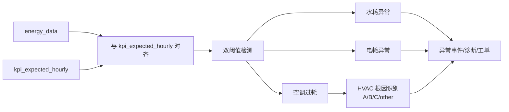

由于该检测算法建立在期望值基线和物理规则基础之上，因此它既具备较强的工程可信度，又能够与 AI 诊断、工单生成和运维分析形成联动，是本项目从数据监测走向智能运维的关键环节。

### 4.10 基于多指标特征工程的 6/12 小时 KPI 预测模型

为了实现从事后响应向事前预警的转变，本项目构建了面向未来 6 小时和 12 小时的综合 KPI 预测能力。预测对象不是单一电耗，而是包括水耗、电耗、空调能耗、供水温度和回水温度在内的多项关键运行指标。模型围绕多指标联合预测进行设计，通过滞后特征、滚动统计特征、时间特征和气象特征等多维信息，构建建筑短时运行趋势预测能力。

从特征工程角度看，系统构造了 41 维输入特征，主要由以下几部分组成：

- 30 个滞后特征：5 个 KPI 各自取 1、2、3、6、12、24 小时滞后；
- 4 个滚动统计特征：$w_{mean24}$、$e_{mean24}$、$hac_{mean24}$、$e_{std24}$；
- 3 个时间特征：$hour$、$dow$、$month$；
- 4 个气象特征：$T_a$、$T_{dew}$、$rh$、$hum$。

可将预测输入表示为：

$$
X_t = [
KPI_{lag1}, KPI_{lag2}, KPI_{lag3}, KPI_{lag6}, KPI_{lag12}, KPI_{lag24},
rolling\_mean24, rolling\_std24,
hour, dow, month,
T_a, T_{dew}, rh, hum
]
$$

其中绝对湿度 $hum$ 按 Magnus 公式推导：

$$
\begin{aligned}
e_{dew} &= 6.112 \cdot \exp\left(\frac{17.67 \cdot T_{dew}}{T_{dew} + 243.5}\right) \\
hum &= \frac{e_{dew} \cdot 2.1674}{273.15 + T_a}
\end{aligned}
$$

变量说明：

- $T_a$ 表示空气温度；
- $T_{dew}$ 表示露点温度；
- $rh$ 表示相对湿度；
- $hum$ 表示绝对湿度；
- $\exp$ 表示指数函数。

在工程实现上，项目采用 `scikit-learn + joblib` 的方式对预测模型进行封装，并通过独立推理 Worker 进程执行模型推理，以避免主业务服务与模型依赖耦合。之所以没有直接采用更重的 LSTM、Transformer 等深度时序模型，是因为当前项目的数据窗口、样本规模和部署目标更适合轻量模型方案；`scikit-learn + joblib + Worker` 具有轻量、易部署、推理链路清晰、依赖隔离简单等优势，更符合工程落地需求。预测结果生成后，还会继续与期望基线进行比对，风险判定形式为：

$$
dev_{pct} = \frac{Predicted - Expected}{|Expected|} \times 100\%
$$

$$
Flag_{forecast} = 1 \iff \frac{Predicted - Expected}{|Expected|} > \theta_{rel} \land (Predicted - Expected) > \theta_{abs}
$$

这里的风险阈值并不是另起一套标准，而是有意与实时异常检测保持一致：水耗沿用 $20\% + 1000\,L$，电耗沿用 $15\% + 0.10 \cdot \max(elec_{expected} - hac_{expected}, 1)$，HVAC 沿用 $20\% + 20\,kWh$。这样设计的原因在于，预测预警和实时异常本质上服务于同一套运维语义，如果两套阈值体系不同，实际部署时会出现“预测说危险、事后却不算异常”或“事后异常很严重、预测却未触发”的口径冲突。统一阈值口径能够让预警结果更容易理解，也更便于后续直接驱动预测类工单。

图 4-9 预测预警流程

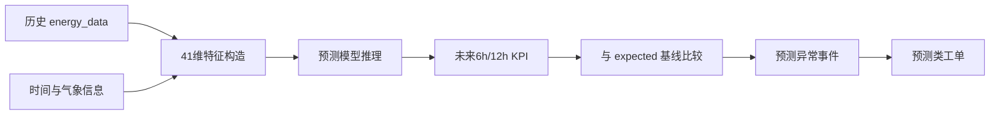

该技术使平台具备了提前发现风险、提前安排处理资源的能力，增强了系统的主动预警水平。

### 4.11 基于上下文事件推理的大模型工单审批技术

在工单流转环节，本项目引入了 AI 审批机制。系统会先查询当前建筑在异常发生时段内的上下文事件，例如加班、装修、极端天气、维护窗口等，再由大模型判断这些事件是否能够合理解释当前异常。如果异常能够被当前事件背景解释，则可驳回派单；若无法解释，则批准进入后续派单流程。

这一技术的关键价值在于，它不是简单地根据异常本身做决策，而是将“异常检测结果”与“业务场景上下文”进行联合推理，从而减少误触发工单和无效派单。同时，系统还设计了失败降级和审计日志机制，在模型调用异常时仍可保障流程继续运行，并为后续人工复核提供完整依据，从而兼顾了智能化与业务可靠性。

之所以不采用端到端黑盒审批分类器，而是采用“先查上下文事件，再让 LLM 做可解释性判断”的方式，是因为工单审批本身具有较强的业务责任属性。审批流程不仅要给出结果，还要能说明依据、保留审计链，并在模型失败时安全降级。当前方案把大模型的任务收缩为“这些事件能否解释异常”这一窄问题：没有生效事件时直接批准，有事件时再调用模型判断。这样既减少了幻觉空间，也让审批逻辑更清晰、更便于答辩说明。

从流程上看，系统遵循“先查事件，再判解释，再决定去留”的审批逻辑：

图 4-10 AI 工单审批流程

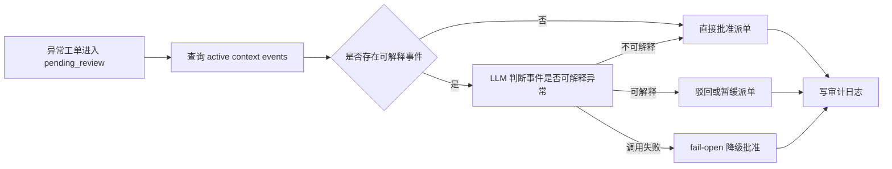

### 4.12 基于规则评分的智能派单与自动重派技术

在派单调度方面，项目构建了规则评分式智能派单机制。系统综合考虑维修人员的技能匹配、班组归属、楼宇覆盖范围、值班状态、当前负载、候选分差等多个因素，对候选人进行排序与推荐，并区分高置信自动派工、低置信兜底派工和进入共享调度大厅三类处理策略。这样既提高了自动化程度，也保留了复杂场景下的人工复核和协同处理空间。

之所以不直接采用黑盒推荐模型或学习排序模型，是因为派工决策天然带有很强的显式业务约束，例如技能、班组、楼宇覆盖、值班状态、是否接受紧急任务和当前负载等，都需要能被调度员看懂并临时调整。同时，当前项目阶段的历史派工样本规模也不足以稳定训练出高可信的黑盒模型。相比之下，规则评分模型更可解释、更易调权，也更适合在真实运维流程中逐步迭代。

其评分思路不是黑盒推荐，而是显式可解释的规则加权模型。可概括表示为：

$$
Score = \max \left(
0,\,
12 + shift_{bonus} + skill_{score} + building_{score} + team_{score} + load_{score} + emergency_{bonus} + enabled_{bonus}
\right)
$$

其中主要权重来源包括：

- $shift_{bonus}$：值班中 18 分，待命 10 分，离岗 2 分；
- $skill_{score}$：匹配技能越多分值越高，最高封顶 38 分；
- $building_{score}$：负责该楼栋时优先加分；
- $team_{score}$：班组偏好匹配时加分；
- $load_{score}$：在手工单越少，可接新单能力越强；
- $emergency_{bonus}$：高优先级任务且可处理紧急任务时额外加分；
- $enabled_{bonus}$：未开启派工会受到明显惩罚。

这些分值也属于当前版本的工程化权重设计，而不是通过大规模历史样本自动学得。比如 $18/10/2$ 体现值班、待命、离岗三类响应优先级；技能分封顶 $38$，是为了让专业匹配成为高权重因素但又不至于完全压过楼宇覆盖和负载；负载分上限 $22$ 则用于明显惩罚过载人员。这样的设计便于在试运行阶段根据调度反馈快速调参，后续若积累足够历史派工数据，再引入学习型排序模型也会更稳妥。

负载评分计算可写为：

$$
\begin{aligned}
load_{ratio} &= \frac{current_{active\_orders}}{max_{active\_orders}} \\
load_{score} &= \max\left(0, \operatorname{int}\left((1 - load_{ratio}) \cdot 22\right)\right)
\end{aligned}
$$

此外，在工单超时、处理受阻或协同失败等场景下，系统还支持自动重派评估与改派执行。该技术体现了项目在运维调度智能化方面的能力，不再停留于简单的工单流转，而是进一步实现了基于规则决策的资源优化配置和流程自适应调整。

图 4-11 智能派单决策流程

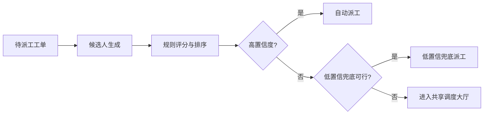

### 4.13 基于多模态大模型的现场维修辅助技术

面向移动维修端，本项目进一步引入了多模态 AI 能力，并以“**维小修**”作为现场维修助手的统一产品名称。维小修支持维修人员上传现场图片、语音描述和文本问题，由多模态模型完成图片理解、语音转写、语音播报和步骤指导，并结合当前工单、知识库与经验库生成维修建议卡片。相比传统静态工单系统，这种多模态交互方式更加贴近真实维修流程，能够降低一线人员对个人经验的依赖。

维小修的价值不仅体现在“能回答”，更体现在“能辅助执行”。它会围绕当前工单自动生成步骤卡片，记录维修状态更新，结合图片、语音和现场观察不断调整建议，并把关键结论回写到维修过程记录中。对于新员工而言，维小修可以降低第一次接触复杂工况时的理解门槛；对于老员工而言，它则更像一个能快速整理现场信息、调取经验和辅助记录的智能搭档。

同时，系统还支持维修过程中的经验沉淀与回流，将现场处理记录、维修结论和经验总结持续纳入经验库，供后续相似工单复用。该技术不仅提升了单次维修效率，也增强了平台在长期运行中的知识积累能力，使系统具备“边使用、边学习、边沉淀”的持续优化特征。

图 4-12 维小修多模态辅助流程

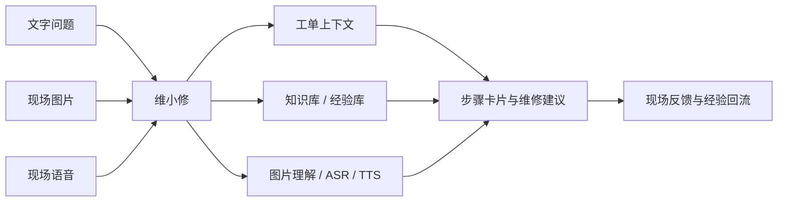

---
