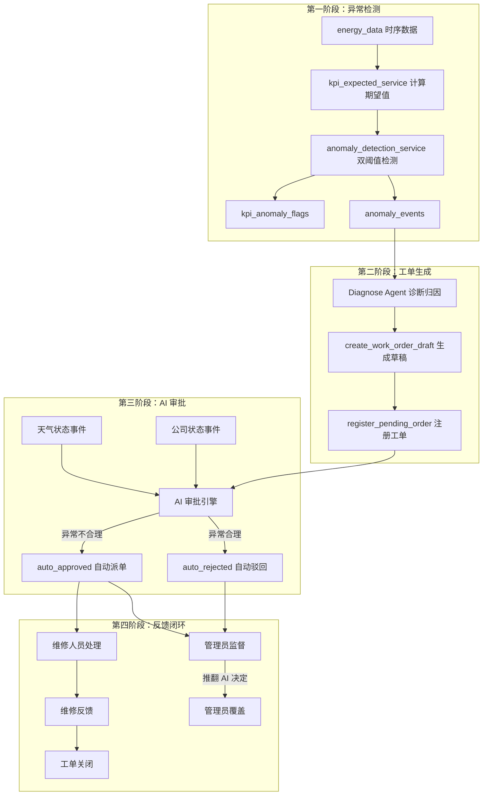
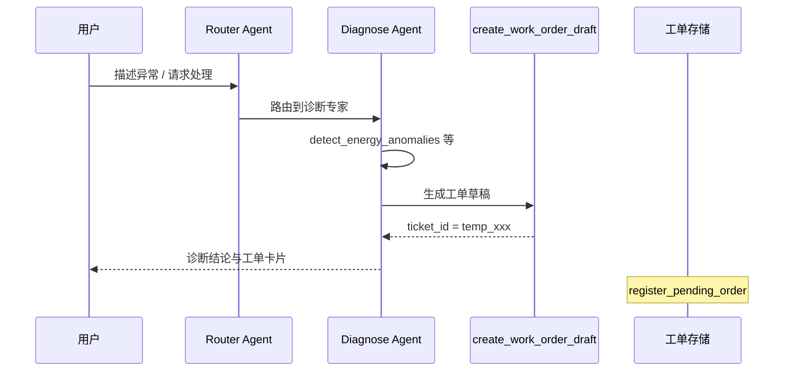
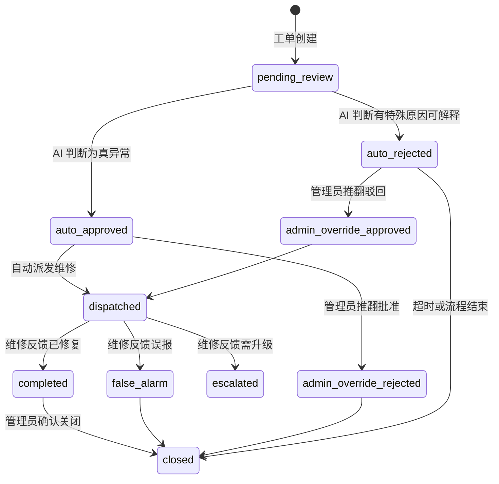
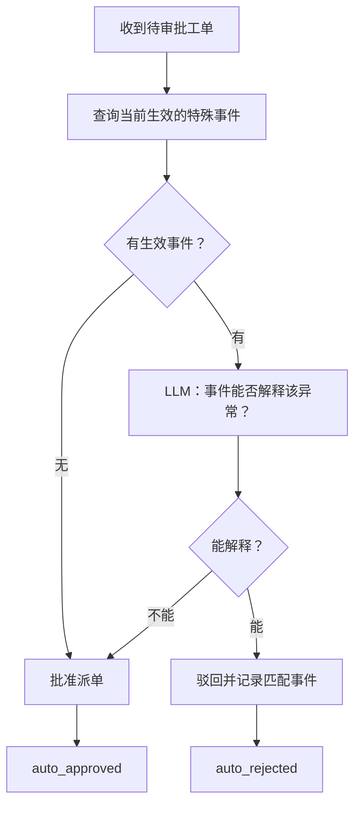
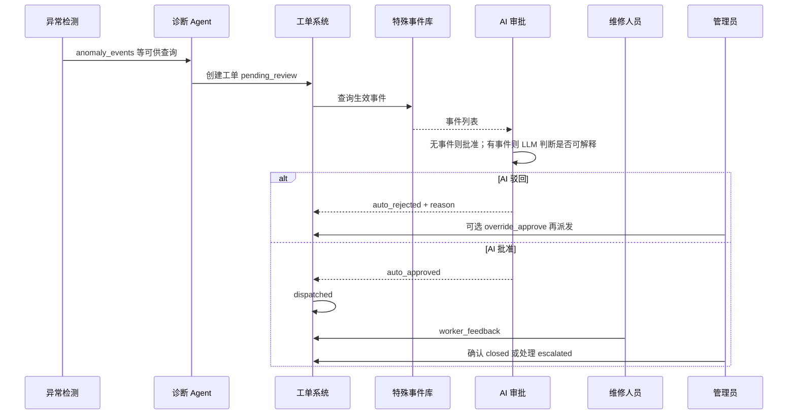

# 异常工单与 AI 审批闭环方案

本文档描述：异常如何产生、异常数据构成、工单系统、AI 审批派发逻辑，以及维修人员与管理员对 AI 已审批工单的反馈与监督机制。与当前仓库实现（批处理异常检测、对话生成工单、内存工单与人工审批）对齐，并给出演进设计。

---

## 一、全局流程总览



---

## 二、异常是怎么来的（现有系统）

### 2.1 期望值计算

`backend/app/services/kpi_expected_service.py` 为每栋楼每小时计算「应该是多少」，主要因素：

| 因素 | 作用 |
|------|------|
| `schedule_factor(h, weekday)` | 日程系数：按建筑类型（办公 / 教学 / 图书馆）与小时定义负荷曲线 |
| 气温 `Ta` | 驱动 HVAC 滞回状态机（制冷 / 供暖 / 通风切换） |
| 露点温度 `Td` | 影响潜热负荷 |
| 建筑面积 `sqm` | 基础用电 / 用水基数 |

输出写入 `kpi_expected_hourly`：`electricity_kwh_expected`、`water_m3_expected`、`hac_energy_expected`、供回水温度期望等。

### 2.2 异常检测规则

`backend/app/services/anomaly_detection_service.py` 对比「实际值 vs 期望值」，**双阈值同时满足**才触发满幅度异常：

| 异常类型（rule_triggered） | 含义 | 触发条件（摘要） |
|----------------------------|------|------------------|
| `water_leak` | 水耗异常 | 相对偏差 > 20% 且绝对偏差 > 1000 L |
| `electricity_overload` | 总电耗超标 | 相对 > 15% 且绝对超过动态基底阈值 |
| `hvac_overconsumption` | 空调能耗过高 | 相对 > 20% 且绝对 ≥ 20 kWh |
| `supply_temp_deviation` | 供水温度偏离 | \|实际 − 期望\| > 1.5 ℃ |
| `return_temp_deviation` | 回水温度偏离 | \|实际 − 期望\| > 2.0 ℃ |

另有软症状（50% 阈值）用于 `anomaly_phase=ramp`；`anomaly_events` 主要记录满幅度触发。

### 2.3 HVAC 第二层根因（仅暖通过耗时）

| 根因码 | 含义 | 判据（摘要） |
|--------|------|--------------|
| `A_low_efficiency` | 主机效能衰退 | 制冷 + 供水偏离期望 > 1.5 ℃ |
| `B_small_deltaT` | 水力失调 | 制冷 + 供回水温差 < 3 ℃ |
| `C_unexpected_on` | 非预期开机 / 排程问题 | `schedule_factor ≤ 0.12` 但实际暖通明显高于期望 + 裕量 |
| `other_hvac` | 待查 | 以上均不满足 |

**设计认知**：进入 `anomaly_events` 的记录，在规则意义上已越过「正常状态」判定；审批环节讨论的是「在业务语境下是否仍应派维修」，而非重新做双阈值检测。

### 2.4 异常的五个组成部分（每条 anomaly_events）

1. **WHO**：`building_id`、关联设备（归因后 `meter_device_id` / 设备表）
2. **WHEN**：`data_timestamp`
3. **WHAT**：`rule_triggered`、`hvac_root_cause`（若有）
4. **HOW**：`actual_value`、`expected_value`、`deviation_pct`、`threshold_value`
5. **WHY**：`message`、`symptom_flags_json`、`anomaly_phase` 等证据字段

批处理入口可参考 `POST /api/admin/detect-anomalies`（见 `backend/app/api/routes_admin.py`）。

---

## 三、工单系统（现状与增强）

### 3.1 工单如何生成（当前实现）

- 数据库层：`anomaly_events` 等用于观测与 Agent 工具读取；**没有**「异常事件自动写工单表」的硬编码链路。
- 对话层：用户经 Router 进入 `Diagnose Agent`（`backend/app/graph/nodes/diagnose_agent.py`），Agent 可调用 `detect_energy_anomalies`、`get_building_rated_values`、`rag_hybrid_search` 等，必要时调用 MCP `create_work_order_draft`（`backend/app/mcp/tools/ui_render.py`）。
- 草稿不落库；图跑完后 `routes_chat.py` 在存在 `pending_action.ticket_id` 时调用 `register_pending_order`（`backend/app/api/routes_workorder.py`），工单暂存在进程内字典 `_work_orders`（演示级）。



### 3.2 工单数据结构（建议增强字段）

在现有字段（`ticket_id`、`device_id`、`building_id`、`issue_description`、`suggested_action`、`priority`、`created_at` 等）基础上，为 AI 审批与闭环建议扩展：

| 分组 | 字段示例 | 说明 |
|------|----------|------|
| 异常证据 | `anomaly_evidence` | 关联 `rule_triggered`、`hvac_root_cause`、时刻、实际/期望/偏差 |
| AI 审批 | `ai_review.decision`、`reason`、`matched_events`、`reviewed_at` | `approve` / `reject` 及可读理由 |
| 维修反馈 | `worker_feedback.result`、`notes`、`feedback_at` | 见第五节 |
| 管理员监督 | `admin_review.action`、`notes`、`reviewed_by`、`reviewed_at` | 见第五节 |

### 3.3 工单状态流转（建议）



| 状态 | 含义 |
|------|------|
| `pending_review` | 待 AI 审批 |
| `auto_approved` | AI 认为应派单 |
| `auto_rejected` | AI 认为当前有特殊语境可解释，不派单 |
| `dispatched` | 已派维修 |
| `completed` / `false_alarm` / `escalated` | 维修侧结果 |
| `admin_override_*` | 管理员覆盖 AI |
| `closed` | 闭环结束 |

---

## 四、AI 审批与派发

### 4.1 设计原则

- **不做异常置信度加权**：异常侧仍以规则检测为准；审批回答的是「在已知公司状态 / 天气状态下，这次偏离是否仍应派维修」。
- **特殊原因平级**：装修、团建、加班、极端天气等任一类型，只要能**合理解释**该工单所涉异常，即可作为驳回依据；不需要数值权重融合。
- **无特殊事件时的默认策略**：若当前无生效特殊事件，可直接 **批准派单**（或走极简规则），避免无意义调用；**仅当存在可能与工单相关的特殊事件时**，再调用 LLM 做「能否解释」的判别。

### 4.2 特殊事件体系（建议）

**公司状态类（宜支持手工录入 / 日历维护）**

| 类型 | 说明 | 示例 |
|------|------|------|
| `renovation` | 装修施工 | 某楼层 / 楼栋施工时段 |
| `team_building` | 团建 | 指定日期的集中活动 |
| `overtime` | 夜间加班赶进度 | 延长空调或照明使用 |
| `special_event` | 其它特殊活动 | 考试周延长开放等 |
| `maintenance_window` | 计划性维护 | 停机 / 试机窗口说明 |

**天气 / 环境类（可手工 + 部分自动）**

| 类型 | 说明 | 自动检测思路（可选） |
|------|------|----------------------|
| `extreme_heat` | 极端高温 | 如 `energy_data.air_temp_c` 超阈值 |
| `extreme_cold` | 极端低温 | 同上 |
| `typhoon` / `heavy_rain` / `snow_ice` | 台风、暴雨、冰雪 | 宜 API 或运维录入 |

事件建议字段：`event_id`、`event_type`、`category`（company / weather）、`building_id`（空表示全局）、`start_time`、`end_time`、`description`、`is_active` 等。

### 4.3 AI 审批决策流程



### 4.4 LLM 输入输出约定（示例）

**输入要点**：工单楼栋、设备、异常时间、规则类型与根因、实际/期望/偏差、自然语言描述；**当前生效事件列表**（平级罗列，无权重）。

**输出建议（严格 JSON）**：

```json
{
  "decision": "approve",
  "reason": "一句话理由",
  "matched_event_id": null
}
```

`decision` 为 `reject` 时，`matched_event_id` 填能解释异常的事件 id（若多个，可选主因或列表扩展字段）。

### 4.5 判别示例（说明性）

| 异常场景 | 特殊事件 | 倾向 |
|----------|----------|------|
| 凌晨非营业时段暖通过高（C_unexpected_on） | 同楼当晚加班至次日早晨 | 驳回（加班可解释） |
| 同上 | 台风预警生效 | 驳回（极端工况可讨论） |
| 同上 | 昨日下午团建已结束 | 批准（时间不匹配） |
| 白天电耗偏高 | 同楼装修进行中 | 驳回 |
| 图书馆水耗异常 | 仅办公楼加班 | 批准（空间不相关） |

具体边界由 Prompt 与运维录入质量共同约束。

---

## 五、维修人员与管理员反馈

### 5.1 维修人员反馈（AI 已批准并派发后）

建议在工单 `dispatched` 及之后开放：

| 结果值 | 含义 | 后续建议 |
|--------|------|----------|
| `fixed` | 已修复 | 进入 `completed` |
| `false_alarm` | 现场无故障 / 误报 | `false_alarm`，供统计 AI 与规则侧 |
| `escalated` | 需升级（更大范围或外协） | `escalated`，通知管理员 |
| `needs_parts` | 缺件 / 等资源 | 可保持 `dispatched` 并记录备注 |

示例请求体：

```json
{
  "result": "fixed",
  "notes": "定时器继电器故障，已更换，试运行正常"
}
```

### 5.2 管理员（运维）监督

| 操作 | 场景 |
|------|------|
| 同意 AI 结论 | 记录审计即可 |
| `override_approve` | AI 驳回，但管理员认为必须派单 |
| `override_reject` | AI 批准，但管理员认为不应派单 |

管理员操作应写入 `admin_review`，并保留与 `ai_review` 的对照，便于事后分析与 Prompt 迭代。

### 5.3 数据用于改进（可选演进）

- 维修 `false_alarm` 比例高：审视某类 `rule_triggered` 是否常与特定场景混淆。
- 管理员频繁推翻 AI：收紧或放宽 Prompt，或补充事件类型与录入规范。

---

## 六、与仓库文件的对应关系

| 主题 | 路径 |
|------|------|
| 批处理异常检测 | `backend/app/services/anomaly_detection_service.py` |
| 期望值 | `backend/app/services/kpi_expected_service.py` |
| 诊断 Agent 与工单草稿 | `backend/app/graph/nodes/diagnose_agent.py` |
| 工单草稿工具 | `backend/app/mcp/tools/ui_render.py` |
| 工单内存与审批 API | `backend/app/api/routes_workorder.py` |
| 会话结束后注册工单 | `backend/app/api/routes_chat.py` |
| 工单 schema | `backend/app/schemas/mcp_schemas.py`（`CreateWorkOrderDraftInput/Output`） |
| 前端工单页 | `frontend/src/views/WorkOrders.vue` |

---

## 七、落地时建议新增 / 修改的模块（实施清单）

### 7.1 建议新增

| 模块 | 职责 |
|------|------|
| `backend/app/services/context_event_service.py` | 特殊事件 CRUD、按时间与楼栋查询生效事件 |
| `backend/app/services/ai_review_service.py` | 组装上下文、调用 LLM、解析决策、写回工单 |
| `backend/app/api/routes_context_events.py` | 事件管理 REST API |

### 7.2 建议修改

| 模块 | 改动要点 |
|------|----------|
| `routes_workorder.py` | 扩展工单结构；注册后触发 AI 审批；维修与管理员反馈接口 |
| `routes_chat.py` | `register_pending_order` 后链式触发 AI 审批（若采用异步任务需注意会话与幂等） |
| `mcp_schemas.py` | 工单输出可选携带 `anomaly_evidence` |
| `main.py` | `include_router` 注册事件路由 |
| `WorkOrders.vue` | 展示 AI 结论、状态筛选、管理员与维修操作入口（需配合鉴权角色） |

### 7.3 建议 API 一览

```
POST   /api/context-events              创建特殊事件
GET    /api/context-events              列表 / 过滤（时间、楼栋）
DELETE /api/context-events/{event_id}   删除或停用

POST   /api/work-orders/{id}/ai-review-trigger   手动触发 AI 重审（可选）
POST   /api/work-orders/{id}/worker-feedback     维修反馈
POST   /api/work-orders/{id}/admin-review       管理员监督 / 覆盖
GET    /api/work-orders/ai-stats                 AI 审批统计（可选）
```

生产环境应将工单与事件**持久化**（数据库表），替代当前内存 `_work_orders`，以支持多实例与审计。

---

## 八、完整生命周期时序（参考）



---

## 九、文档修订说明

- 本文档整合「异常来源、工单、AI 审批、双角色反馈」的完整产品与架构说明，供赛题演示与后续迭代对齐。
- 文中状态与 API 为**目标设计**；与当前代码完全一致的部分已标注文件路径，未实现部分以「建议」列出。

---

*文档版本：与仓库方案讨论稿对齐，可按实现进度更新第七节与 API 路径。*
