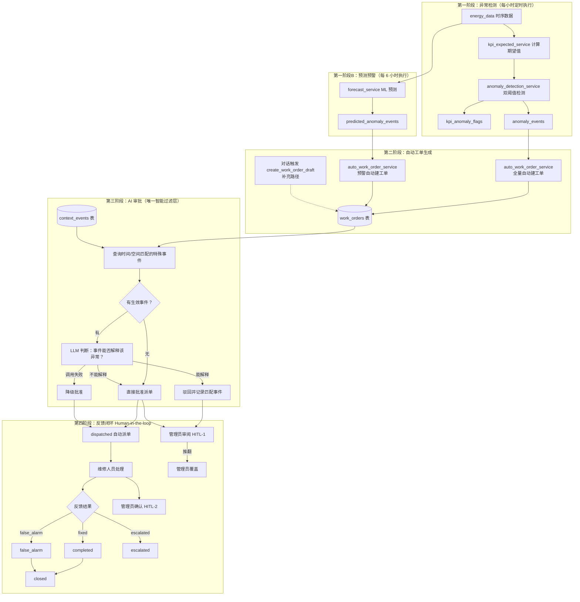
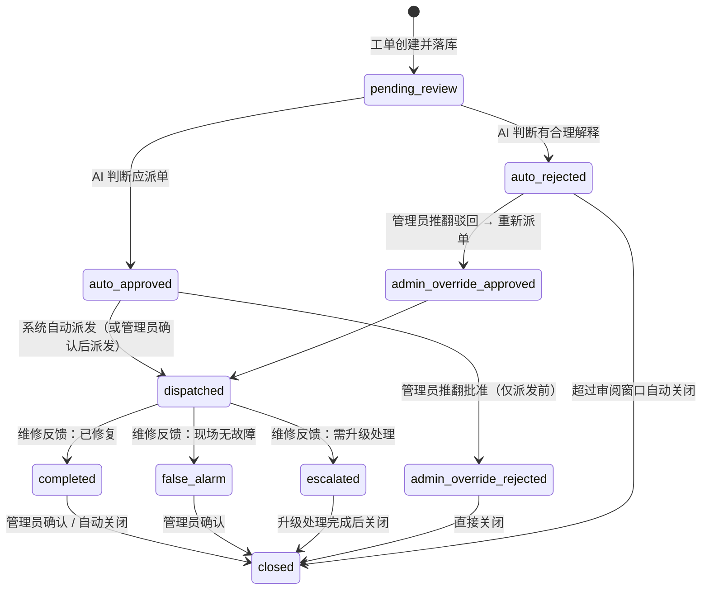
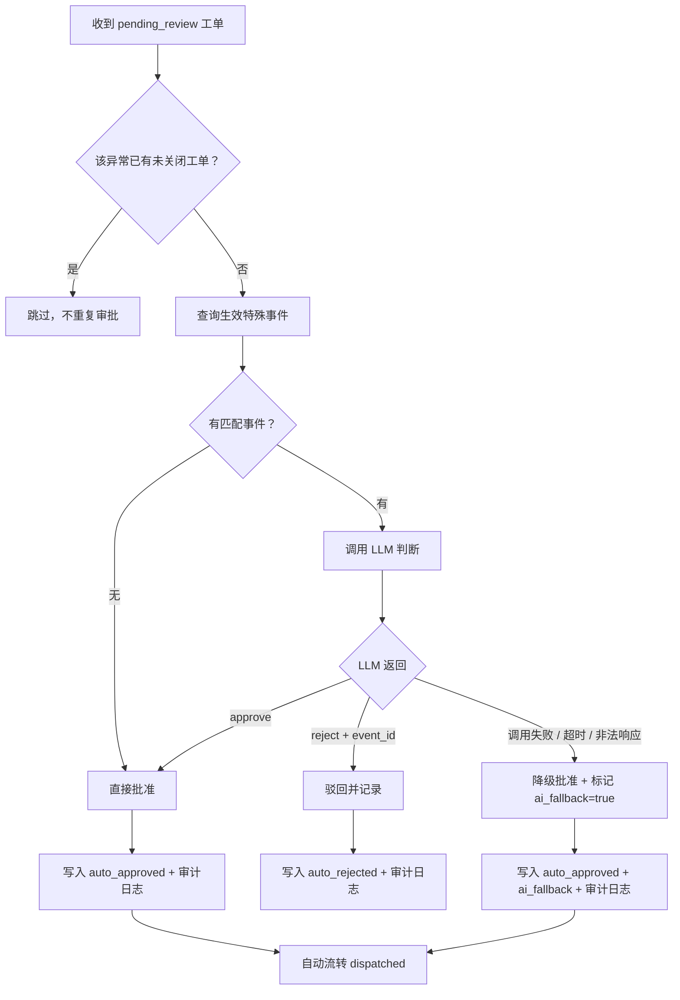
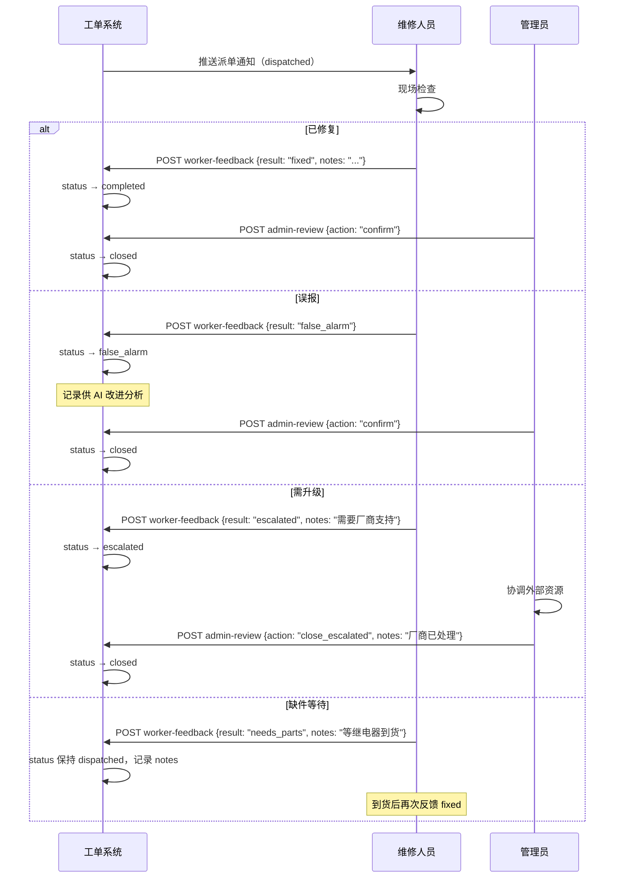
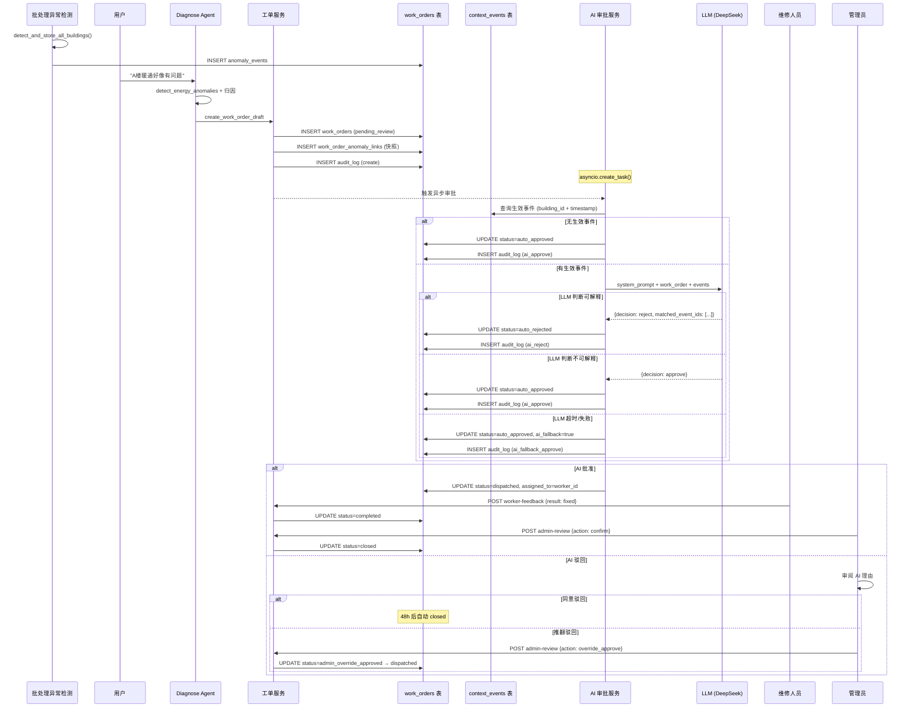

# 异常工单与 AI 审批闭环方案（v2.1）

本文档描述异常工单从产生到关闭的完整自动化生命周期。系统核心设计理念：**所有被检测系统确认的异常和预测预警全部自动生成工单，AI 审批引擎作为唯一的智能过滤层决定是否派单，Human-in-the-loop 体现在管理员对 AI 决策的监督和覆盖。**

> **v2.1 变更**：工单生成从"对话触发"改为"自动触发"——异常检测完成后自动创建工单，无需人工介入。对话中的 `create_work_order_draft` 保留为补充路径。

---

## 一、全局流程总览



### 工单来源与优先级

| 来源 | source 字段 | 优先级规则 | 说明 |
|------|------------|-----------|------|
| 异常检测（告警） | `auto_detect` | water_leak/HVAC根因/偏离>50% → high；30-50% → medium；其余 → low | 已发生的异常，优先级最高 |
| 预测预警 | `prediction` | 预测 risk=high → medium；其余 → low | 未来可能发生，整体低一档 |
| 对话触发（补充） | `manual` | Agent 自行判定 | 人工发现的遗漏问题 |

---

## 二、异常检测（已实现）

### 2.1 期望值计算

`backend/app/services/kpi_expected_service.py` 为每栋楼每小时计算期望值，主要因素：

| 因素 | 作用 |
|------|------|
| `schedule_factor(h, weekday)` | 日程系数：按建筑类型（办公 / 教学 / 图书馆）与小时定义负荷曲线 |
| 气温 `Ta` | 驱动 HVAC 滞回状态机（制冷 / 供暖 / 通风切换） |
| 露点温度 `Td` | 影响潜热负荷 |
| 建筑面积 `sqm` | 基础用电 / 用水基数 |

输出写入 `kpi_expected_hourly`：`electricity_kwh_expected`、`water_m3_expected`、`hac_energy_expected`、供回水温度期望等。

### 2.2 异常检测规则

`backend/app/services/anomaly_detection_service.py` 对比「实际值 vs 期望值」，**双阈值同时满足**才触发满幅度异常：

| 异常类型（rule_triggered） | 含义 | 触发条件（摘要） |
|----------------------------|------|------------------|
| `water_leak` | 水耗异常 | 相对偏差 > 20% 且绝对偏差 > 1000 L |
| `electricity_overload` | 总电耗超标 | 相对 > 15% 且绝对超过动态基底阈值 |
| `hvac_overconsumption` | 空调能耗过高 | 相对 > 20% 且绝对 ≥ 20 kWh |
| `supply_temp_deviation` | 供水温度偏离 | \|实际 − 期望\| > 1.5 ℃ |
| `return_temp_deviation` | 回水温度偏离 | \|实际 − 期望\| > 2.0 ℃ |

另有软症状（50% 阈值）用于 `anomaly_phase=ramp`（早期预警）；`anomaly_events` 主要记录满幅度触发。

### 2.3 HVAC 第二层根因（仅暖通过耗时）

| 根因码 | 含义 | 判据（摘要） |
|--------|------|--------------|
| `A_low_efficiency` | 主机效能衰退 | 制冷 + 供水偏离期望 > 1.5 ℃ |
| `B_small_deltaT` | 水力失调 | 制冷 + 供回水温差 < 3 ℃ |
| `C_unexpected_on` | 非预期开机 / 排程问题 | `schedule_factor ≤ 0.12` 但实际暖通明显高于期望 + 裕量 |
| `other_hvac` | 待查 | 以上均不满足 |

### 2.4 异常的五个组成部分（每条 anomaly_events）

1. **WHO**：`building_id`、关联设备（`meter_device_id` / `anomaly_device_attributions`）
2. **WHEN**：`data_timestamp`
3. **WHAT**：`rule_triggered`、`hvac_root_cause`（若有）
4. **HOW**：`actual_value`、`expected_value`、`deviation_pct`、`threshold_value`
5. **WHY**：`message`、`symptom_flags_json`、`anomaly_phase` 等证据字段

**设计认知**：进入 `anomaly_events` 的记录，在规则意义上已越过「正常状态」判定；AI 审批环节讨论的是「在业务语境下是否仍应派维修」，不重复做双阈值检测。

批处理入口：`POST /api/admin/detect-anomalies` / `POST /api/admin/rebuild-all`。

定时调度：`main.py` lifespan 中注册每小时自动执行（`_periodic_anomaly_detect`）。

### 2.5 自动工单生成（v2.1 新增）

异常检测完成后，`auto_work_order_service.py` 自动将所有 `anomaly_events` 转为工单：

1. **全量建工单**：检测阈值即为第一道过滤，所有通过阈值的异常都值得跟踪
2. **去重**：同一 `anomaly_event` 已关联到未关闭工单时跳过
3. **优先级自动分配**：water_leak/HVAC 根因/偏离>50% → high；30-50% → medium；其余 → low
4. **快照保存**：通过 `work_order_anomaly_links` 保存异常证据，即使 `anomaly_events` 被 TRUNCATE 重建也不丢失
5. **AI 审批**：工单创建后批量触发 AI 审批引擎

预测预警同理：`predicted_anomaly_events` 中 `risk_level != 'normal'` 的记录自动建工单，优先级整体低一档。

代码入口：`backend/app/services/auto_work_order_service.py`

---

## 三、数据库设计

> 工单持久化到 PostgreSQL，支持多实例部署、审计追溯和数据分析。

### 3.1 work_orders 表

```sql
CREATE TABLE work_orders (
    id              UUID PRIMARY KEY DEFAULT gen_random_uuid(),
    ticket_id       VARCHAR(64) UNIQUE NOT NULL,          -- 对外展示 ID，如 WO-20160801-001

    -- 工单基本信息
    building_id     VARCHAR(64) NOT NULL REFERENCES buildings(building_id) ON DELETE CASCADE,
    device_id       VARCHAR(128),                          -- 可空：不一定归因到具体设备
    issue_description TEXT NOT NULL,
    suggested_action  TEXT NOT NULL,
    priority        VARCHAR(16) NOT NULL DEFAULT 'medium', -- low / medium / high / critical
    source          VARCHAR(32) NOT NULL DEFAULT 'manual', -- auto_detect / prediction / manual

    -- 异常关联（通过 work_order_anomaly_links 关联表实现）

    -- 状态机
    status          VARCHAR(32) NOT NULL DEFAULT 'pending_review',
    -- 合法值: pending_review, auto_approved, auto_rejected,
    --         dispatched, completed, false_alarm, escalated,
    --         admin_override_approved, admin_override_rejected, closed

    -- AI 审批结果
    ai_decision         VARCHAR(16),                       -- approve / reject / null（未审批）
    ai_reason           TEXT,
    ai_matched_event_ids TEXT,                             -- JSON array of event_id
    ai_reviewed_at      TIMESTAMP WITH TIME ZONE,
    ai_fallback         BOOLEAN DEFAULT FALSE,             -- true 表示 LLM 调用失败降级批准

    -- 维修反馈
    worker_result       VARCHAR(32),                       -- fixed / false_alarm / escalated / needs_parts
    worker_notes        TEXT,
    worker_feedback_at  TIMESTAMP WITH TIME ZONE,
    assigned_to         UUID REFERENCES users(id),         -- 派发给谁

    -- 管理员监督
    admin_action        VARCHAR(32),                       -- confirm / override_approve / override_reject
    admin_notes         TEXT,
    admin_reviewed_by   UUID REFERENCES users(id),
    admin_reviewed_at   TIMESTAMP WITH TIME ZONE,

    -- 时间戳
    created_at      TIMESTAMP WITH TIME ZONE NOT NULL DEFAULT now(),
    updated_at      TIMESTAMP WITH TIME ZONE NOT NULL DEFAULT now(),
    closed_at       TIMESTAMP WITH TIME ZONE,

    -- 来源追溯
    session_id      VARCHAR(128),                          -- 关联对话 session
    created_by      UUID REFERENCES users(id)              -- 创建者（可能是系统）
);

-- 索引
CREATE INDEX idx_wo_status ON work_orders(status);
CREATE INDEX idx_wo_building ON work_orders(building_id);
CREATE INDEX idx_wo_created ON work_orders(created_at DESC);
CREATE INDEX idx_wo_assigned ON work_orders(assigned_to) WHERE assigned_to IS NOT NULL;
```

### 3.2 work_order_anomaly_links 关联表

一个工单可能关联多条异常事件（如同一栋楼同时触发水耗 + 电耗异常），一条异常事件也可能被多个工单引用。

```sql
CREATE TABLE work_order_anomaly_links (
    id              UUID PRIMARY KEY DEFAULT gen_random_uuid(),
    work_order_id   UUID NOT NULL REFERENCES work_orders(id) ON DELETE CASCADE,
    anomaly_event_id UUID NOT NULL REFERENCES anomaly_events(id) ON DELETE CASCADE,

    -- 快照（防止 anomaly_events 被后续批处理覆盖后丢失证据）
    rule_triggered  VARCHAR(64) NOT NULL,
    hvac_root_cause VARCHAR(64),
    actual_value    FLOAT,
    expected_value  FLOAT,
    deviation_pct   FLOAT,
    data_timestamp  TIMESTAMP WITH TIME ZONE NOT NULL,

    UNIQUE (work_order_id, anomaly_event_id)
);

CREATE INDEX idx_wo_anomaly_wo ON work_order_anomaly_links(work_order_id);
CREATE INDEX idx_wo_anomaly_event ON work_order_anomaly_links(anomaly_event_id);
```

**设计决策**：使用关联表 + 快照字段，而非 JSON 嵌入。原因：
- 后续统计（false_alarm 比例按 `rule_triggered` 聚合）可直接 SQL 完成
- `anomaly_events` 在每次 `detect_and_store_all_buildings` 时会 truncate 重建，快照保证工单证据不丢失

### 3.3 context_events 特殊事件表

```sql
CREATE TABLE context_events (
    id              UUID PRIMARY KEY DEFAULT gen_random_uuid(),
    event_type      VARCHAR(32) NOT NULL,
    -- 公司类: renovation, team_building, overtime, special_event, maintenance_window
    -- 天气类: extreme_heat, extreme_cold, typhoon, heavy_rain, snow_ice

    category        VARCHAR(16) NOT NULL,                  -- company / weather
    building_id     VARCHAR(64) REFERENCES buildings(building_id) ON DELETE CASCADE,
    -- NULL 表示全局（所有楼栋）

    start_time      TIMESTAMP WITH TIME ZONE NOT NULL,
    end_time        TIMESTAMP WITH TIME ZONE NOT NULL,
    grace_period_minutes INTEGER NOT NULL DEFAULT 0,       -- 事件结束后的余波窗口（分钟）
    description     TEXT,

    is_active       BOOLEAN NOT NULL DEFAULT TRUE,
    created_by      UUID REFERENCES users(id),
    created_at      TIMESTAMP WITH TIME ZONE NOT NULL DEFAULT now(),

    CONSTRAINT chk_time_range CHECK (end_time > start_time),
    CONSTRAINT chk_grace_period CHECK (grace_period_minutes >= 0 AND grace_period_minutes <= 480)
);

CREATE INDEX idx_ctx_events_active ON context_events(start_time, end_time) WHERE is_active = TRUE;
CREATE INDEX idx_ctx_events_building ON context_events(building_id);
```

**`grace_period_minutes` 设计说明**：

业务场景中，特殊事件的能耗影响往往超出事件本身的时间边界。例如：
- 加班到凌晨 2 点，但空调可能运行到 3-4 点才完全降温 → `grace_period_minutes = 120`
- 装修期间的大型设备（如切割机）停机后，排风系统仍需运行 → `grace_period_minutes = 60`
- 极端高温天气，即使预警解除，建筑蓄热仍会导致次日早晨空调负荷偏高 → `grace_period_minutes = 360`

AI 审批查询生效事件时，匹配条件为：
```
anomaly_timestamp BETWEEN event.start_time AND (event.end_time + grace_period_minutes)
```

### 3.4 work_order_audit_log 审计日志表

记录工单每次状态变更，用于事后分析和 AI 改进。

```sql
CREATE TABLE work_order_audit_log (
    id              UUID PRIMARY KEY DEFAULT gen_random_uuid(),
    work_order_id   UUID NOT NULL REFERENCES work_orders(id) ON DELETE CASCADE,
    action          VARCHAR(32) NOT NULL,
    -- create, ai_approve, ai_reject, ai_fallback_approve,
    -- dispatch, worker_feedback, admin_override, close

    old_status      VARCHAR(32),
    new_status      VARCHAR(32) NOT NULL,
    actor_type      VARCHAR(16) NOT NULL,                  -- system / ai / worker / admin
    actor_id        UUID,                                  -- user.id（系统操作时为空）
    detail_json     TEXT,                                  -- 可选：变更详情
    created_at      TIMESTAMP WITH TIME ZONE NOT NULL DEFAULT now()
);

CREATE INDEX idx_audit_wo ON work_order_audit_log(work_order_id);
CREATE INDEX idx_audit_time ON work_order_audit_log(created_at DESC);
```

### 3.5 ORM Model 约定

项目使用 SQLAlchemy 2.0 + `DeclarativeBase`，UUID 用 `String` + `lambda: str(uuid.uuid4())`，时间戳用 `TIMESTAMP(timezone=True)` + `server_default=func.now()`，外键用 `ondelete="CASCADE"`。新增模型应遵循同样约定，添加到 `backend/app/db/models.py`。

---

## 四、工单生命周期与状态机

### 4.1 状态流转（完整版）



### 4.2 状态定义与合法转移矩阵

| 状态 | 含义 | 可转移到 | 谁可触发 |
|------|------|---------|---------|
| `pending_review` | 待 AI 审批 | `auto_approved`, `auto_rejected` | 系统（AI 审批服务） |
| `auto_approved` | AI 判断应派单 | `dispatched`, `admin_override_rejected` | 系统自动 / 管理员 |
| `auto_rejected` | AI 判断有合理解释 | `admin_override_approved`, `closed` | 管理员 / 超时任务 |
| `dispatched` | 已派发维修 | `completed`, `false_alarm`, `escalated` | 维修人员 |
| `completed` | 维修完成 | `closed` | 管理员 / 自动 |
| `false_alarm` | 误报 | `closed` | 管理员 / 自动 |
| `escalated` | 需升级 | `closed` | 管理员 |
| `admin_override_approved` | 管理员推翻驳回 | `dispatched` | 系统自动 |
| `admin_override_rejected` | 管理员推翻批准 | `closed` | 系统自动 |
| `closed` | 终态 | — | — |

### 4.3 业务边界规则

| 规则 | 说明 |
|------|------|
| **dispatched 后不可 override_reject** | 维修人员可能已在现场，此时管理员只能等待维修反馈后处理。如确需取消，由管理员直接联系维修人员并将工单标记为 `false_alarm` 关闭 |
| **auto_rejected 审阅窗口** | 管理员应在 **48 小时** 内审阅 AI 驳回的工单，超时后状态自动流转为 `closed`，审计日志记录 `auto_close_timeout` |
| **escalated 必须管理员关闭** | 升级工单涉及外协或跨部门，不可自动关闭 |
| **同一 anomaly_event 不重复生成工单** | 通过 `work_order_anomaly_links` 的唯一约束 + 查询"是否已存在未关闭工单关联此事件"来去重 |
| **closed 是终态** | 不可从 closed 回退到任何状态，如需重新处理应创建新工单 |

---

## 五、AI 审批引擎

### 5.1 设计原则

1. **不做异常置信度加权**：异常侧以规则检测为准；审批回答的是「在已知业务语境下，这次偏离是否仍应派维修」
2. **特殊原因平级**：装修、加班、极端天气等任一类型，只要能合理解释异常，即可驳回；不做数值权重融合
3. **无事件则直接批准**：若当前无生效特殊事件，跳过 LLM 调用，直接 `auto_approved`
4. **失败安全（fail-open）**：LLM 调用失败时默认批准派单（宁可多派单，不漏报故障）

### 5.2 审批决策流程



### 5.3 特殊事件匹配规则

查询生效事件的 SQL 逻辑：

```sql
SELECT * FROM context_events
WHERE is_active = TRUE
  AND (building_id = :wo_building_id OR building_id IS NULL)   -- 空间匹配：同楼或全局
  AND :anomaly_timestamp >= start_time                          -- 时间匹配
  AND :anomaly_timestamp <= end_time + (grace_period_minutes * INTERVAL '1 minute')
ORDER BY
  CASE WHEN building_id = :wo_building_id THEN 0 ELSE 1 END,  -- 同楼优先
  start_time DESC;
```

**匹配维度说明**：

| 维度 | 规则 | 示例 |
|------|------|------|
| **空间** | 事件 `building_id` = 工单 `building_id`，或事件为全局（`building_id IS NULL`） | 办公楼加班事件不匹配图书馆异常 |
| **时间** | 异常时间戳落在 `[start_time, end_time + grace_period]` 内 | 加班到 2:00、grace=120min → 覆盖到 4:00 的异常 |
| **优先级** | 同楼事件优先于全局事件（传给 LLM 时排在前面） | — |

### 5.4 LLM 调用约定

**模型选择**：使用项目现有的 `ChatOpenAI`（DeepSeek / OpenAI 兼容），配置 `LLM_MODEL_DIAGNOSE` 或独立配置项 `LLM_MODEL_REVIEW`。

**Temperature**: `0.0`（确定性决策，不需要创造性）

**超时与重试**：
- 单次调用超时：**10 秒**
- 最大重试：**1 次**（共 2 次机会）
- 重试间隔：**1 秒**
- 两次都失败 → 降级批准（`ai_fallback=true`）

**System Prompt**：

```
你是一名建筑能源管理系统的 AI 审批员。你的职责是判断：给定的异常工单，在当前已知的特殊事件背景下，是否仍然需要派发维修。

## 判断原则
- 你不需要重新判断异常是否存在（异常检测系统已确认）
- 你只需要判断：当前生效的特殊事件，是否能"合理解释"这次异常
- "合理解释"意味着该事件在时间和空间上与异常相关，且事件的性质能导致这类能耗偏离
- 如果没有任何事件能解释，必须批准派单
- 如果有多个事件都能解释，选择最相关的一个作为主因

## 典型判断逻辑
- 加班（overtime）可以解释：非工作时段的电耗/暖通异常、延长时段的水耗异常
- 装修（renovation）可以解释：电耗异常、水耗异常（施工用水）
- 极端高温（extreme_heat）可以解释：空调能耗过高、供回水温度偏离
- 极端高温 不能解释：水耗异常（除非有合理关联）
- 事件已过期（不在 grace_period 内）：不能解释

## 输出格式（严格 JSON，不要输出其他内容）
```

**Input 模板**：

```json
{
  "work_order": {
    "ticket_id": "WO-20160801-001",
    "building_id": "Fox_office",
    "device_id": "Fox_office_Alice_hvac",
    "rule_triggered": "hvac_overconsumption",
    "hvac_root_cause": "C_unexpected_on",
    "anomaly_timestamp": "2016-08-01T03:00:00Z",
    "actual_value": 45.2,
    "expected_value": 5.0,
    "deviation_pct": 804.0,
    "issue_description": "凌晨 3 点暖通能耗 45.2 kWh，期望 5.0 kWh，偏差 804%"
  },
  "active_events": [
    {
      "event_id": "evt-001",
      "event_type": "overtime",
      "category": "company",
      "building_id": "Fox_office",
      "start_time": "2016-07-31T18:00:00Z",
      "end_time": "2016-08-01T02:00:00Z",
      "grace_period_minutes": 120,
      "description": "研发部加班赶项目上线"
    }
  ]
}
```

**Output 格式**：

```json
{
  "decision": "reject",
  "reason": "Fox_office 研发部加班至凌晨 2 点，grace_period 覆盖到 4:00，凌晨 3 点的暖通能耗可由加班解释",
  "matched_event_ids": ["evt-001"]
}
```

| 字段 | 类型 | 说明 |
|------|------|------|
| `decision` | `"approve"` \| `"reject"` | 审批决定 |
| `reason` | string | 一句话理由，写入工单供管理员查阅 |
| `matched_event_ids` | string[] \| null | reject 时必填；approve 时为 null 或空数组 |

### 5.5 判别示例（详细版）

| # | 异常场景 | 特殊事件 | 判定 | 理由 |
|---|----------|----------|------|------|
| 1 | 凌晨 3 点暖通过高（C_unexpected_on） | 同楼加班到 2:00，grace=120min | **reject** | 加班 grace 覆盖到 4:00，时间空间均匹配 |
| 2 | 凌晨 3 点暖通过高（C_unexpected_on） | 同楼加班到 2:00，grace=0 | **approve** | 加班 2:00 已结束且无 grace，3:00 不在覆盖范围 |
| 3 | 凌晨 3 点暖通过高（C_unexpected_on） | 台风预警全局生效 | **reject** | 极端天气导致空调负荷异常可解释 |
| 4 | 凌晨 3 点暖通过高（C_unexpected_on） | 昨日下午 14:00-17:00 团建 | **approve** | 团建在 17:00 结束，与凌晨 3 点无时间关联 |
| 5 | 白天 14:00 电耗偏高 15% | 同楼装修 08:00-18:00 | **reject** | 装修施工用电可解释电耗偏高 |
| 6 | 图书馆水耗异常 | 仅办公楼加班 | **approve** | 空间不匹配（不同楼栋） |
| 7 | 办公楼水耗异常 | 同楼极端高温 | **approve** | 极端高温不能直接解释水耗异常 |
| 8 | 供水温度偏离 2.5℃ | 计划维护窗口 | **reject** | 维护窗口期间温度波动可预期 |

### 5.6 异常处理与幂等性

| 场景 | 处理策略 |
|------|---------|
| **LLM 调用超时（>10s）** | 降级批准（`ai_fallback=true`），写审计日志 `ai_fallback_approve`，管理员可在列表中筛选降级工单重点审阅 |
| **LLM 返回非法 JSON** | 先尝试正则提取 `{"decision":...}`；失败则降级批准 |
| **重复触发审批** | 工单表 `ai_reviewed_at IS NOT NULL` 则跳过，保证幂等 |
| **并发审批同一工单** | 使用数据库行锁 `SELECT ... FOR UPDATE`，第二个请求发现已审批则跳过 |
| **context_events 为空表** | 等同于"无生效事件"，直接批准 |

---

## 六、角色权限模型

### 6.1 角色定义

项目已有 `users.role` 字段，支持 `resident` / `ops` / `manager` / `admin`。工单模块的角色映射：

| 系统角色 | 工单角色 | 说明 |
|---------|---------|------|
| `admin` | 管理员 | 全部权限：查看所有工单、override、关闭、管理特殊事件 |
| `manager` | 管理员 | 同 admin（业务层不区分） |
| `ops` | 维修人员 | 查看被派发给自己的工单、提交维修反馈 |
| `resident` | 普通用户 | 只能通过对话触发工单生成，不能直接操作工单列表 |

### 6.2 权限矩阵

| 操作 | admin/manager | ops | resident |
|------|:---:|:---:|:---:|
| 查看所有工单 | ✅ | ❌ | ❌ |
| 查看自己被派发的工单 | ✅ | ✅ | ❌ |
| 提交维修反馈 | ❌ | ✅（仅自己的） | ❌ |
| override AI 决定 | ✅ | ❌ | ❌ |
| 关闭工单 | ✅ | ❌ | ❌ |
| 管理特殊事件 | ✅ | ❌ | ❌ |
| 手动触发 AI 重审 | ✅ | ❌ | ❌ |
| 查看 AI 审批统计 | ✅ | ❌ | ❌ |
| 通过对话生成工单 | ✅ | ✅ | ✅ |

### 6.3 鉴权实现

利用现有 JWT 鉴权体系（`backend/app/core/security.py`），在工单路由中通过 `Depends(get_current_user)` 获取用户，根据 `user.role` 校验权限。建议抽出装饰器或 Depends 工厂：

```python
def require_role(*roles: str):
    async def checker(user: User = Depends(get_current_user)):
        if user.role not in roles:
            raise HTTPException(403, "权限不足")
        return user
    return checker

# 使用：
@router.post("/{ticket_id}/admin-review")
async def admin_review(
    ...,
    user: User = Depends(require_role("admin", "manager"))
):
```

---

## 七、API 设计

### 7.1 工单 API（扩展现有 routes_workorder.py）

#### GET /api/work-orders

列出工单。管理员看全部，维修人员只看自己被派发的。

**Query 参数**：

| 参数 | 类型 | 说明 |
|------|------|------|
| `status` | string | 按状态筛选，逗号分隔多值：`pending_review,auto_approved` |
| `building_id` | string | 按楼栋筛选 |
| `priority` | string | 按优先级筛选 |
| `ai_fallback` | bool | 筛选 AI 降级批准的工单 |
| `page` | int | 页码，默认 1 |
| `page_size` | int | 每页数量，默认 20，最大 100 |

**Response 200**：

```json
{
  "total": 42,
  "page": 1,
  "page_size": 20,
  "items": [
    {
      "id": "uuid",
      "ticket_id": "WO-20160801-001",
      "building_id": "Fox_office",
      "device_id": "Fox_office_Alice_hvac",
      "issue_description": "...",
      "suggested_action": "...",
      "priority": "high",
      "status": "dispatched",
      "ai_decision": "approve",
      "ai_reason": "无生效特殊事件，直接批准",
      "ai_fallback": false,
      "worker_result": null,
      "created_at": "2016-08-01T03:15:00Z",
      "anomaly_links": [
        {
          "rule_triggered": "hvac_overconsumption",
          "hvac_root_cause": "C_unexpected_on",
          "actual_value": 45.2,
          "expected_value": 5.0,
          "deviation_pct": 804.0,
          "data_timestamp": "2016-08-01T03:00:00Z"
        }
      ]
    }
  ]
}
```

#### POST /api/work-orders/{ticket_id}/worker-feedback

维修人员提交反馈。**仅 ops 角色 + 工单 assigned_to = 当前用户 + 状态为 dispatched**。

**Request**：

```json
{
  "result": "fixed",
  "notes": "定时器继电器故障，已更换，试运行正常"
}
```

| result 值 | 工单流转到 | 说明 |
|-----------|----------|------|
| `fixed` | `completed` | 正常闭环 |
| `false_alarm` | `false_alarm` | 现场无故障 |
| `escalated` | `escalated` | 需要更高级别处理 |
| `needs_parts` | 保持 `dispatched` | 仅记录备注，不变更状态 |

#### POST /api/work-orders/{ticket_id}/admin-review

管理员审阅与覆盖。**仅 admin/manager 角色**。

**Request**：

```json
{
  "action": "override_approve",
  "notes": "AI 驳回不合理，该异常持续多日，需要检查"
}
```

| action 值 | 前置状态要求 | 工单流转到 | 说明 |
|-----------|------------|----------|------|
| `confirm` | `completed` / `false_alarm` | `closed` | 确认关闭 |
| `override_approve` | `auto_rejected` | `admin_override_approved` → `dispatched` | 推翻 AI 驳回 |
| `override_reject` | `auto_approved`（尚未 dispatched） | `admin_override_rejected` → `closed` | 推翻 AI 批准 |
| `close_escalated` | `escalated` | `closed` | 关闭升级工单 |

**业务约束**：
- `override_reject` 仅在工单处于 `auto_approved` 且**尚未流转到 dispatched** 时允许。若已 dispatched，返回 `409 Conflict`，提示"工单已派发，请等待维修反馈后处理"
- `override_approve` 仅在 `auto_rejected` 且未超过 48h 审阅窗口时允许

#### POST /api/work-orders/{ticket_id}/ai-review-trigger

手动触发 AI 重审。**仅 admin/manager**。用于管理员补录特殊事件后重新评估。

**前置条件**：工单状态为 `auto_approved` 或 `auto_rejected`，且未进入 `dispatched`。

### 7.2 特殊事件 API（新增 routes_context_events.py）

#### POST /api/context-events

创建特殊事件。**仅 admin/manager**。

**Request**：

```json
{
  "event_type": "overtime",
  "category": "company",
  "building_id": "Fox_office",
  "start_time": "2016-07-31T18:00:00Z",
  "end_time": "2016-08-01T02:00:00Z",
  "grace_period_minutes": 120,
  "description": "研发部加班赶项目上线"
}
```

**校验规则**：
- `end_time > start_time`
- `grace_period_minutes` ∈ [0, 480]（最大 8 小时，超出需人工判断）
- `building_id` 为空表示全局事件
- `event_type` 必须在白名单内

#### GET /api/context-events

列出特殊事件，支持过滤。

**Query 参数**：

| 参数 | 说明 |
|------|------|
| `building_id` | 按楼栋（含全局事件） |
| `active_at` | 指定时间点，返回该时刻生效的事件 |
| `category` | company / weather |
| `is_active` | 默认 true |

#### PUT /api/context-events/{event_id}

更新事件（如延长 end_time 或调整 grace_period）。

#### DELETE /api/context-events/{event_id}

软删除（`is_active = false`）。已经用于 AI 审批决策的事件不物理删除，保留审计链。

---

## 八、性能与架构策略

### 8.1 异步管道

项目全栈 async（asyncpg + FastAPI + SQLAlchemy 2.0 async）。AI 审批服务应保持一致：

```
register_pending_order()  →  await ai_review_service.review(work_order_id)
                                ├─ await db query (context_events)
                                ├─ await llm.ainvoke() (如有事件)
                                └─ await db update (work_orders + audit_log)
```

在 `routes_chat.py` 的 SSE 流结束后触发审批。由于 LLM 调用最多 10s×2=20s，而用户此时已收到诊断结论，审批结果通过前端轮询或下次加载工单列表获取，**不阻塞对话流**。

实现方式：`asyncio.create_task(ai_review_service.review(wo_id, db_session_factory))`，在后台执行，审批服务内部自行创建独立 session（避免与 SSE 共享 session 生命周期冲突）。

### 8.2 数据库性能

| 关注点 | 策略 |
|--------|------|
| 工单列表查询 | `idx_wo_status` + `idx_wo_created` 联合使用，分页 keyset pagination（大数据量时优于 OFFSET） |
| 特殊事件匹配 | `idx_ctx_events_active` 范围扫描 + `building_id` 过滤，事件数量级小（百级），无性能瓶颈 |
| 审计日志写入 | 仅 INSERT，无更新，写入性能稳定 |
| 行锁（并发审批） | `SELECT ... FOR UPDATE SKIP LOCKED`，不阻塞其他工单的审批 |

### 8.3 缓存策略

沿用项目现有 Redis + 本地 fallback 体系：

| 缓存 Key | TTL | 失效时机 |
|----------|-----|---------|
| `workorders:list:{status}:{page}` | 15s | 工单状态变更时 `delete_cache_by_prefix("workorders:")` |
| `context_events:active:{building_id}` | 60s | 事件创建/更新/删除时失效 |

### 8.4 可观测性

- AI 审批的每次决策写入 `work_order_audit_log`，包含 `ai_fallback` 标记
- 管理员可在前端筛选 `ai_fallback=true` 的工单，重点审阅
- 后续可基于审计日志计算：AI 准确率 = 1 - (override 次数 / 总审批次数)

---

## 九、维修人员与管理员反馈（详细）

### 9.1 维修反馈流程



### 9.2 管理员监督仪表盘（前端需求）

管理员应能在 WorkOrders.vue 中：

| 功能 | 说明 |
|------|------|
| **筛选 AI 降级工单** | `ai_fallback=true` 标签高亮显示 |
| **查看 AI 决策理由** | 展开工单卡片显示 `ai_reason` 和匹配事件 |
| **一键 override** | 在 `auto_rejected` 工单上显示"推翻驳回"按钮 |
| **审阅倒计时** | `auto_rejected` 工单显示剩余审阅时间（48h 窗口） |
| **维修结果统计** | 按 `rule_triggered` 分组的 fixed / false_alarm / escalated 比例 |

### 9.3 数据驱动改进

| 信号 | 分析方向 | 行动 |
|------|---------|------|
| 某类 `rule_triggered` 的 `false_alarm` 率 > 30% | 检测阈值可能过于敏感 | 调整 `anomaly_detection_service` 中的阈值常量 |
| 管理员 `override_approve` 频率 > 20% | AI 驳回过于激进 | 检查特殊事件录入是否及时、LLM prompt 是否过度匹配 |
| 管理员 `override_reject` 频率 > 10% | AI 批准过于宽松 | 补充事件类型、收紧 prompt |
| `ai_fallback` 率 > 5% | LLM 服务不稳定 | 检查 API 可用性、考虑备用模型 |

---

## 十、与仓库文件的对应关系

### 10.1 现有文件（需修改）

| 主题 | 路径 | 改动要点 |
|------|------|---------|
| 数据库模型 | `backend/app/db/models.py` | 新增 WorkOrder、WorkOrderAnomalyLink、ContextEvent、WorkOrderAuditLog 模型 |
| 工单 API | `backend/app/api/routes_workorder.py` | 改用数据库存储；新增 worker-feedback、admin-review、ai-review-trigger 端点 |
| 对话后注册工单 | `backend/app/api/routes_chat.py` | `register_pending_order` 改为写数据库 + 触发异步 AI 审批 |
| 工单 Schema | `backend/app/schemas/mcp_schemas.py` | `CreateWorkOrderDraftOutput` 增加 `anomaly_evidence` 字段 |
| 应用入口 | `backend/main.py` | `include_router` 注册 `routes_context_events` |
| 前端工单页 | `frontend/src/views/WorkOrders.vue` | 角色分视图、AI 结论展示、override 操作、状态筛选增强 |

### 10.2 新增文件

| 模块 | 路径 | 职责 |
|------|------|------|
| AI 审批服务 | `backend/app/services/ai_review_service.py` | 查询上下文事件、调用 LLM、解析决策、写回工单与审计日志 |
| 特殊事件服务 | `backend/app/services/context_event_service.py` | 特殊事件 CRUD、生效事件查询 |
| 特殊事件 API | `backend/app/api/routes_context_events.py` | REST 端点 |
| 工单服务 | `backend/app/services/work_order_service.py` | 工单 CRUD、状态流转、去重、审计日志写入 |

### 10.3 不需要修改的文件

| 主题 | 路径 | 说明 |
|------|------|------|
| 异常检测 | `backend/app/services/anomaly_detection_service.py` | 检测逻辑不变，仅新增"工单去重查询"被服务层调用 |
| 期望值 | `backend/app/services/kpi_expected_service.py` | 不涉及 |
| 诊断 Agent | `backend/app/graph/nodes/diagnose_agent.py` | 工单草稿工具不变，仅上游注册逻辑改为写库 |

---

## 十一、完整生命周期时序



---

## 十二、实施分阶段计划

### Phase 1：持久化基础（优先级最高）

- [ ] 数据库迁移：创建 `work_orders`、`work_order_anomaly_links`、`context_events`、`work_order_audit_log` 四张表
- [ ] ORM 模型：在 `models.py` 中新增四个模型类
- [ ] `work_order_service.py`：工单 CRUD + 状态流转 + 审计日志
- [ ] 改造 `routes_workorder.py`：从内存字典迁移到数据库
- [ ] 改造 `routes_chat.py`：`register_pending_order` 写库

### Phase 2：AI 审批引擎

- [ ] `context_event_service.py`：事件 CRUD + 生效查询
- [ ] `routes_context_events.py`：事件管理 API
- [ ] `ai_review_service.py`：审批决策逻辑（查事件 → LLM → 写结果）
- [ ] 在工单注册后触发异步 AI 审批
- [ ] 降级策略（超时、非法响应 → fallback approve）

### Phase 3：反馈闭环与前端

- [ ] `worker-feedback` API + 权限校验
- [ ] `admin-review` API + 权限校验 + 业务边界规则
- [ ] 前端角色分视图（管理员 / 维修人员）
- [ ] 前端展示 AI 决策理由、override 操作、审阅倒计时

### Phase 4：可选增强

- [ ] AI 审批统计 API
- [ ] `auto_rejected` 48h 超时自动关闭（定时任务）
- [ ] 前端维修结果统计图表
- [ ] 天气事件自动检测（基于 `energy_data.air_temp_c` 阈值）

---

## 十三、文档修订说明

- **v2**（当前版本）：在 v1 基础上增加数据库 DDL、角色权限、API 契约详细定义、业务边界规则、AI 异常处理策略、性能策略、分阶段计划
- **v1**：概述性方案，描述四阶段流程与模块分工

---

*文档版本 v2 — 可按实施进度逐章落地，每完成一个 Phase 更新对应章节的实现状态标记。*
