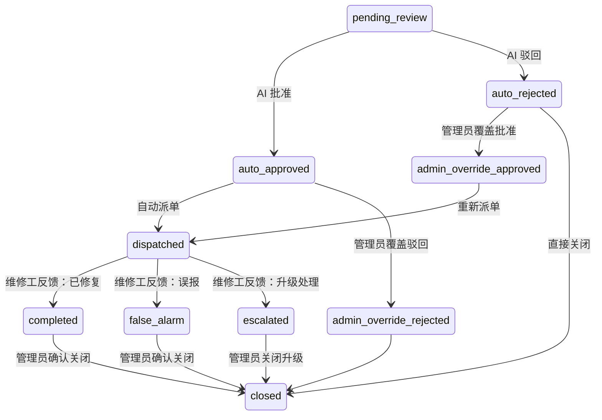

# 楼宇能耗管理系统 — 手机端设计方案

## 一、项目定位

| 维度 | 说明 |
|------|------|
| 技术栈 | uni-app (Vue 3 + TypeScript) + HBuilder X 打包 |
| 项目路径 | `project/mobile/` — 与 `backend/`、`frontend/` 同级 |
| 后端接口 | 100% 复用现有 FastAPI 接口，零改造 |
| 目标平台 | Android APK 为主，iOS 为辅，H5 调试用 |
| 文字适配 | 引入 `@chenglou/pretext` 实现精确文字测量与自适应布局 |

---

## 二、角色体系（严格对齐后端 User.role）

后端角色枚举：`resident` / `ops` / `manager` / `admin`

| 后端 role | 手机端角色 | 进入界面 | 核心权限 |
|-----------|-----------|---------|---------|
| `admin` | 系统管理员 | 运维端 | 工单审阅 + 覆盖AI决策 + 所有运维功能 |
| `manager` | 运维经理 | 运维端 | 工单审阅 + 覆盖AI决策 |
| `ops` | 维修人员 | 维修端 | 接单 + AI辅助维修 + 反馈结果 |
| `resident` | — | 登录拒绝 | 手机端暂不开放 |

**角色分流逻辑**：

```
POST /api/auth/login → 返回 user.role
    ├── admin / manager  → uni.reLaunch('/pages/operator/overview')
    ├── ops              → uni.reLaunch('/pages/worker/pending')
    └── resident         → 提示"暂不支持移动端访问"
```

---

## 三、工单状态机（对齐后端 VALID_TRANSITIONS）



**状态 → 中文映射（手机端显示用）**：

```typescript
const STATUS_LABEL: Record<string, string> = {
  pending_review:            '待AI审批',
  auto_approved:             'AI已批准',
  auto_rejected:             'AI已驳回',
  dispatched:                '已派单',
  completed:                 '已修复',
  false_alarm:               '误报',
  escalated:                 '已升级',
  admin_override_approved:   '管理员批准',
  admin_override_rejected:   '管理员驳回',
  closed:                    '已关闭',
}
```

---

## 四、页面结构

### 4.1 运维端（admin / manager）

**底部 Tab：总览 / 告警 / 工单 / 我的**

#### Tab 1：能耗总览 `/pages/operator/overview`
- 全局 KPI 卡片（总电耗、总水耗、总碳排、异常数）
- 日环比变化百分比（来自 `kpis_change`）
- 当日天气（温度、湿度）
- 3 栋建筑能耗卡片（电耗、水耗、暖通）
- 异常状态标识（Normal / Anomaly）
- 预测预警状态（normal / warning / critical）
- 60 秒自动刷新
- **接口**：`GET /api/overview`

#### Tab 2：异常告警 `/pages/operator/alerts`
- 近期异常事件列表（最近 7 天）
- 按 severity 筛选（高/中/低）
- 按建筑类型筛选
- 卡片显示：rule_triggered、deviation_pct、building_id、data_timestamp
- 未解决 / 全部切换
- **接口**：`GET /api/anomalies/recent?hours=168&only_unresolved=true`

#### Tab 3：工单审阅 `/pages/operator/workorders`
- 四个分组 Tab：AI已批准 | AI已驳回 | 已派单 | 已关闭
- `auto_approved` 状态：显示「覆盖驳回」按钮 → `override_reject`
- `auto_rejected` 状态：显示「覆盖批准」按钮 → `override_approve`
- `completed`/`false_alarm` 状态：显示「确认关闭」按钮 → `confirm`
- `escalated` 状态：显示「关闭升级」按钮 → `close_escalated`
- **接口**：
  - 列表：`GET /api/work-orders?status=auto_approved&page=1&page_size=20`
  - 审阅：`POST /api/work-orders/{ticket_id}/admin-review`
    - body: `{ action: "override_approve" | "override_reject" | "confirm" | "close_escalated", notes?: string }`

#### Tab 4：我的 `/pages/operator/profile`
- 用户信息、修改密码、退出登录

---

### 4.2 维修端（ops）

**底部 Tab：待处理 / 进行中 / 历史 / 我的**

#### Tab 1：待处理工单 `/pages/worker/pending`
- 状态为 `dispatched` 且 `assigned_to` 为当前用户的工单
- 按优先级分组统计（high / medium / low）
- 优先级筛选
- **接口**：`GET /api/work-orders?status=dispatched&page=1&page_size=20`
  - 前端过滤 `assigned_to === currentUser.id`（后端暂无 assigned_to_me 参数）

#### Tab 2：进行中 `/pages/worker/active`
- 与待处理共享同一数据源，但 UI 展示侧重"处理进度"
- 进度指示器：已接单 → 处理中 → 已完成

#### Tab 3：工单详情 `/pages/worker/workorder-detail`（非 Tab 页，navigateTo 进入）
- **第一层：工单信息**
  - ticket_id、building_id、issue_description、suggested_action、priority
  - AI 审批信息：ai_decision、ai_reason
  - anomaly_links 关联的异常数据
- **第二层：AI 辅助维修对话**
  - 调用 `POST /api/chat` 接口
  - 首次发消息时将工单上下文拼接到 message 前部（非 system_hint，后端不支持该字段）
  - SSE 流式显示 AI 回复
  - 对话格式：
    ```
    【当前工单信息】
    工单编号：WO-20160801-001
    建筑：Fox_education_Louie
    异常描述：electricity_kwh 偏高 32.5%
    建议措施：检查电气设备是否存在过载...

    维修工提问：我到现场了，电表读数正常，接下来查什么？
    ```
- **第三层：提交维修反馈**
  - 三个操作：已修复(`fixed`) / 误报(`false_alarm`) / 升级处理(`escalated`) / 需要配件(`needs_parts`)
  - **接口**：`POST /api/work-orders/{ticket_id}/worker-feedback`
    - body: `{ result: "fixed" | "false_alarm" | "escalated" | "needs_parts", notes?: string }`

#### Tab 4：历史记录 `/pages/worker/history`
- 状态为 `completed`、`false_alarm`、`closed` 的工单
- 按完成时间倒序
- 个人统计（总数、修复率）

#### Tab 5：我的 `/pages/worker/profile`
- 同运维端

---

## 五、API 对接合约（精确字段映射）

### 5.1 工单列表响应

```typescript
interface WorkOrderListResponse {
  total: number
  page: number
  page_size: number
  work_orders: WorkOrder[]  // 注意：key 是 work_orders 不是 items
}

interface WorkOrder {
  id: string
  ticket_id: string               // 格式: WO-YYYYMMDD-NNN
  building_id: string
  device_id: string | null
  issue_description: string       // 不是 description
  suggested_action: string        // 建议措施
  priority: 'high' | 'medium' | 'low'
  status: WorkOrderStatus
  ai_decision: 'approved' | 'rejected' | null   // auto_ 前缀在 status 上，不在这里
  ai_reason: string | null        // 不是 ai_reasoning
  ai_fallback: boolean
  ai_reviewed_at: string | null
  worker_result: string | null    // 不是 worker_feedback
  worker_notes: string | null     // 不是 worker_note
  worker_feedback_at: string | null
  assigned_to: string | null
  admin_action: string | null
  admin_notes: string | null
  admin_reviewed_by: string | null
  admin_reviewed_at: string | null
  created_at: string
  updated_at: string
  closed_at: string | null
  source: 'auto_detect' | 'prediction' | 'manual'
  session_id: string | null
  anomaly_links: AnomalyLink[]
}
```

### 5.2 总览响应

```typescript
interface OverviewResponse {
  data_date: string                // ISO 日期
  kpis: {
    total_electricity_kwh: number
    total_water_m3: number
    total_hac_energy_kwh: number
    total_carbon_kg: number
    anomaly_count: number
    prediction_warning_count: number
  }
  kpis_change: {
    total_electricity_pct: number | null
    total_water_pct: number | null
    total_hac_pct: number | null
    total_carbon_pct: number | null
  }
  weather: {
    temperature: number | null
    humidity: number | null
  }
  buildings: BuildingDetail[]
}

interface BuildingDetail {
  building_type: string
  display_name: string
  icon: string                    // emoji
  total_electricity_kwh: number
  total_water_m3: number
  total_hac_energy_kwh: number
  avg_ambient_temp: number | null
  sqm: number
  energy_intensity_kwh_per_sqm: number | null
  anomaly_status: 'Normal' | 'Anomaly'
  latest_water_m3: number
  electricity_change_pct: number | null
  water_change_pct: number | null
  hac_change_pct: number | null
  carbon_change_pct: number | null
  prediction_warning_count: number
  prediction_status: 'normal' | 'warning' | 'critical'
}
```

### 5.3 异常告警响应

```typescript
interface RecentAnomaliesResponse {
  anomalies: AnomalyItem[]
  total: number
  check_period: {
    start: string | null
    end: string | null
    hours: number
  }
}

interface AnomalyItem {
  id: string
  detected_at: string | null
  data_timestamp: string | null
  building_id: string
  rule_triggered: string
  actual_value: number | null
  expected_value: number | null
  deviation_pct: number | null
  message: string | null
  is_resolved: boolean
  severity: string | null
  hvac_root_cause: string | null
}
```

### 5.4 Chat 请求体

```typescript
// POST /api/chat
interface ChatRequest {
  message: string          // 1-2000 字符
  session_id?: string      // [a-zA-Z0-9_-]{1,64}
  enable_web_search?: boolean
  thinking_mode?: 'fast' | 'deep'
}
// ⚠ 不支持 system_hint 字段，工单上下文必须拼接到 message 中
```

### 5.5 认证响应

```typescript
interface LoginResponse {
  access_token: string
  refresh_token: string
  token_type: 'bearer'
  expires_in: number          // 秒
  user: {
    id: string
    username: string
    email: string | null
    phone: string | null
    role: 'resident' | 'ops' | 'manager' | 'admin'
    is_active: boolean
    created_at: string
  }
}
```

---

## 六、技术方案

### 6.1 文字适配（Pretext）

使用 `@chenglou/pretext` 解决移动端文字排版问题：

```typescript
import { prepare, layout } from '@chenglou/pretext'

// 场景1：工单卡片描述文字截断
// 精确计算文字行数，超过 2 行自动截断并显示 "..."
function measureText(text: string, width: number, font: string, lineHeight: number) {
  const prepared = prepare(text, font)
  const { height, lineCount } = layout(prepared, width, lineHeight)
  return { height, lineCount }
}

// 场景2：AI 对话气泡高度预测
// 在 scroll-view 中预估消息高度，优化滚动性能
function estimateBubbleHeight(content: string, maxWidth: number): number {
  const prepared = prepare(content, '14px -apple-system, PingFang SC')
  const { height } = layout(prepared, maxWidth, 22)
  return height + 36  // padding
}

// 场景3：建筑名/异常描述自动缩放
// 如果文字超出容器宽度，自动缩小字号
function autoFitFontSize(
  text: string,
  containerWidth: number,
  maxFontSize: number,
  minFontSize: number,
  lineHeight: number,
): number {
  for (let fs = maxFontSize; fs >= minFontSize; fs -= 1) {
    const prepared = prepare(text, `${fs}px PingFang SC`)
    const { lineCount } = layout(prepared, containerWidth, lineHeight)
    if (lineCount <= 1) return fs
  }
  return minFontSize
}
```

适用场景：
- 工单卡片中 `issue_description` 的精确行数控制
- AI 对话气泡的高度预估（避免 scroll-view 跳动）
- 建筑名称在不同屏幕宽度下的自适应字号
- 异常告警消息的折叠/展开判断

### 6.2 Token 自动续期

```
请求 → 401?
  ├── 有 refresh_token → POST /api/auth/refresh
  │     ├── 成功 → 存储新 token → 重试原请求
  │     └── 失败 → 清除登录态 → 跳转登录页
  └── 无 refresh_token → 跳转登录页
```

在 `request.ts` 中实现拦截器级别的自动续期，对业务代码透明。使用锁防止多个并发请求同时触发 refresh。

### 6.3 路由守卫

```typescript
// 每个页面 onLoad 时检查权限
function useRouteGuard(requiredRoles: string[]) {
  const authStore = useAuthStore()
  if (!authStore.isLoggedIn) {
    uni.reLaunch({ url: '/pages/login/index' })
    return false
  }
  if (!requiredRoles.includes(authStore.user?.role ?? '')) {
    uni.showToast({ title: '无权访问', icon: 'none' })
    uni.reLaunch({ url: '/pages/login/index' })
    return false
  }
  return true
}
```

### 6.4 AI 对话上下文注入

由于后端 `/api/chat` 不支持 `system_hint` 参数，采用**消息前缀拼接**方案：

```typescript
function buildContextMessage(order: WorkOrder, userInput: string): string {
  return `【当前工单信息 - 请基于此信息辅助维修】
工单编号：${order.ticket_id}
建筑ID：${order.building_id}
异常描述：${order.issue_description}
建议措施：${order.suggested_action}
优先级：${order.priority}
AI审批意见：${order.ai_reason || '无'}

维修人员提问：${userInput}`
}
```

仅首次消息拼接上下文，后续消息通过 session_id 维持对话连续性。

---

## 七、目录结构

```
mobile/
├── package.json
├── manifest.json
├── pages.json
├── vite.config.ts
├── .env.development
├── .env.production
└── src/
    ├── App.vue
    ├── main.ts
    ├── uni.scss                         # 全局样式变量
    ├── constants/
    │   ├── tabs.ts                      # 运维端/维修端 Tab 配置（提取公共常量）
    │   ├── status.ts                    # 工单状态、优先级映射
    │   └── roles.ts                     # 角色常量 + 权限判定
    ├── utils/
    │   ├── text-adapter.ts              # pretext 封装（测量/截断/自适应字号）
    │   ├── format.ts                    # 时间格式化、数字格式化
    │   └── route-guard.ts              # 路由守卫
    ├── api/
    │   ├── request.ts                   # 请求封装 + Token 自动续期
    │   ├── auth.ts                      # 认证接口
    │   ├── workorder.ts                 # 工单接口（精确对齐后端字段）
    │   ├── data.ts                      # 能耗数据 + 异常告警接口
    │   └── chat.ts                      # SSE 流式对话
    ├── stores/
    │   └── auth.ts                      # 登录态 + 角色分流
    ├── components/
    │   ├── NavBar.vue                   # 顶部导航
    │   ├── TabBar.vue                   # 底部导航
    │   ├── WorkOrderCard.vue            # 工单卡片
    │   ├── AiChat.vue                   # AI 对话组件（从详情页抽出）
    │   └── AdaptiveText.vue            # pretext 自适应文字组件
    └── pages/
        ├── login/index.vue
        ├── operator/
        │   ├── overview/index.vue
        │   ├── alerts/index.vue
        │   ├── workorders/index.vue
        │   └── profile/index.vue
        └── worker/
            ├── pending/index.vue
            ├── active/index.vue
            ├── workorder-detail/index.vue
            ├── history/index.vue
            └── profile/index.vue
```

---

## 八、与上一版的主要修正

| 问题 | v1（错误） | v2（修正） |
|------|-----------|-----------|
| 用户角色 | `operator` / `worker` | `admin` / `manager` / `ops` |
| 工单状态 | `ai_approved` / `ai_rejected` | `auto_approved` / `auto_rejected` |
| 工单列表 key | `items` | `work_orders` |
| 异常描述字段 | `description` | `issue_description` |
| AI 推理字段 | `ai_reasoning` | `ai_reason` |
| 维修反馈字段 | `feedback` / `note` | `result` / `notes` |
| 管理员审阅 action | `approve` / `reject` | `override_approve` / `override_reject` / `confirm` / `close_escalated` |
| 总览响应 | 自定义 `buildings[]` | `{ kpis, kpis_change, weather, buildings }` |
| 告警接口 | `/api/anomalies/attributions` | `/api/anomalies/recent` |
| AI 上下文注入 | `system_hint` 字段 | 拼接到 `message` 前部 |
| Token 续期 | 无 | 401 自动 refresh + 重试 |
| TabBar 跳转 | `switchTab`（会报错） | `reLaunch` |
| 路由守卫 | 无 | `useRouteGuard()` 角色校验 |
| 常量管理 | 每页重复定义 | 提取到 `constants/` |
| AI 对话 | 内嵌在 650 行大组件中 | 抽出为独立 `AiChat.vue` |
| 文字适配 | 无 | pretext 精确测量 + AdaptiveText 组件 |
