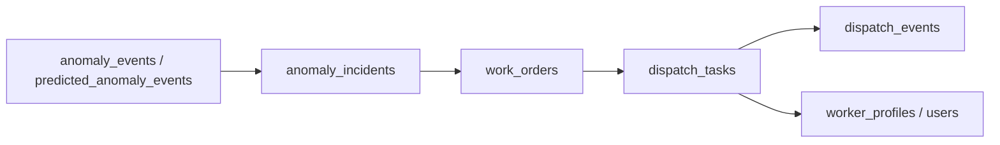
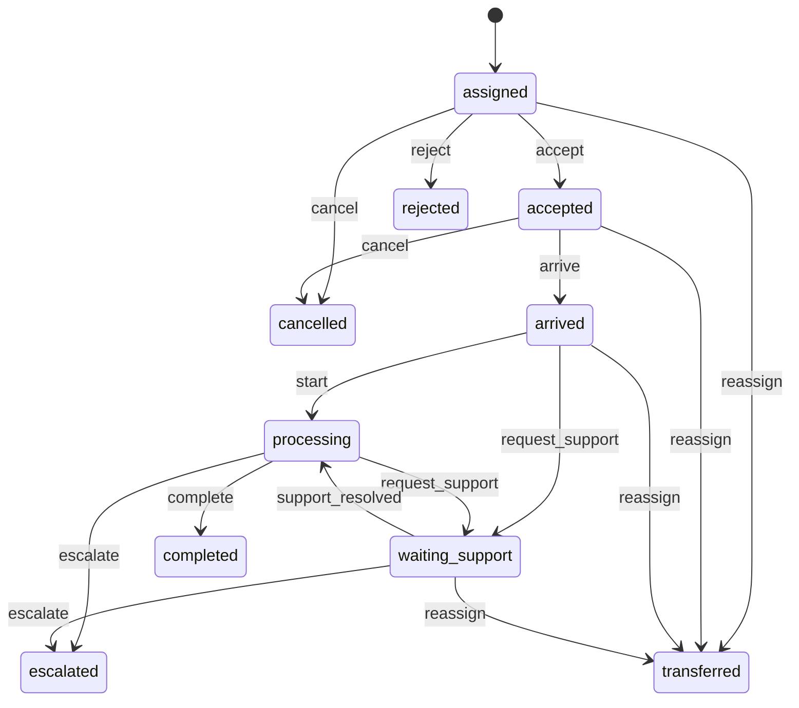

# 派单系统与维修端剩余未完成部分详细设计方案

## 1. 文档定位

本文档用于描述在《派单系统与维修端架构设计方案》和《派单系统与维修端已完成内容说明》之后，**剩余未完成部分**的完整详细设计。

本文档默认基于以下前提：

- 第一阶段已经完成：`pending_dispatch` 主链路已经落地
- 第二阶段已经完成：维修人员画像与候选人推荐已经落地
- 当前不考虑实现成本，优先追求：
  - 功能闭环完整
  - 复杂场景可承接
  - 性能与可维护性合理
  - 管理端与维修端的体验自然且清晰

本文档重点覆盖：

1. 第三阶段：引入 `dispatch_tasks` 独立执行对象
2. 第四阶段：自动派工引擎
3. Incident 读模型升级
4. Web 管理端重构
5. SLA、通知、审计、时间线与分析能力
6. 数据迁移与兼容策略

---

## 2. 当前基线与剩余问题

## 2.1 当前已经具备的能力

当前系统已经具备：

- AI 审批通过后进入 `pending_dispatch`
- 管理端可以查看候选人并人工派工
- 候选人排序已考虑技能、班组、值班、负载、楼宇覆盖
- 维修端已支持接单、到场、开始处理
- 用户画像已支持班组、技能、值班状态、负载上限、覆盖楼宇

这意味着：

- “该不该修”已经能够回答
- “优先派给谁”已经能够初步回答
- “维修员是否开始执行”已经能够表达

## 2.2 当前仍然没有解决透的问题

虽然前两阶段已经打通主链路，但系统仍停留在“单次线性派工”的层级，无法完整承接真实运维场景。

当前剩余问题如下：

### 问题 1：执行对象仍然寄生在 `work_orders`

现在派工、接单、到场、开始处理仍然写在 `work_orders` 上。

这会导致：

- 一个工单只能优雅表达“一次派工”
- 无法同时表达“当前派工”和“历史派工”
- 一旦发生改派、拒单、协同，记录会迅速混乱

### 问题 2：缺少完整执行事件流

当前系统能表达“现在处于哪个阶段”，但不能完整表达“它是怎么走到这个阶段的”。

这会导致：

- 无法回答“为什么超时”
- 无法回答“谁改派过”
- 无法回答“维修员何时拒单、为何拒单”
- 时间线只能依赖零散字段拼装

### 问题 3：Incident 展示层仍依赖猜测逻辑

当前 Incident 列表和详情虽然已能展示执行状态，但底层仍是通过 `work_orders` 上的字段推导。

这会导致：

- 当出现多次派工时，读模型会不准确
- 列表页难以高效呈现复杂执行语义
- 状态与历史之间存在潜在不一致

### 问题 4：维修端世界观仍偏“工单中心”，不是“任务中心”

维修人员真正关心的不是“这张工单的全生命周期”，而是：

- 这次派给我的任务是什么
- 什么时候必须接单
- 为什么被改派
- 什么时候需要协同

如果不把维修端动作切换到 `dispatch_task` 维度，后面会持续出现责任边界不清的问题。

### 问题 5：Web 管理端仍停留在旧状态语义

桌面 Web 端工单管理页目前仍使用：

- `pending_approval`
- `approved`
- `rejected`

这与当前后端和移动端已经落地的：

- `pending_dispatch`
- `dispatched`
- `execution_status`

明显不一致。

结果是：

- 同一个系统在不同端上讲的是两套语言
- 后续功能会重复开发
- 管理员体验会割裂

### 问题 6：自动派工已具备受控闭环，但尚未进入正式灰度运行阶段

当前系统已经具备候选推荐、三层策略评估、受控执行器，以及“AI 审批通过后自动尝试派工”的闭环；但默认开关仍关闭，线上灰度范围、阈值和回滚策略还没定稿。

这会导致：

- 调度效率依然依赖人工
- 夜间/高频工单的响应速度受限
- 管理员会成为瓶颈

---

## 3. 总体目标架构

## 3.1 最终目标

最终目标不是“再补几个派工按钮”，而是让系统具备以下能力：

1. 审批、派工、执行、关闭彻底拆层
2. 一张工单支持多次派工尝试
3. 所有派工与执行动作可追溯
4. 列表页、看板页、维修端工作台都基于真实执行对象
5. 在满足硬条件时，系统可以自动派工，但可追溯、可改派、可回滚

## 3.2 目标领域模型



## 3.3 各对象职责

### `anomaly_incidents`

负责表达“问题对象”。

面向：

- 管理端列表
- 聚合视角
- 问题趋势与当前处理进度

### `work_orders`

负责表达“审批与闭环对象”。

面向：

- AI 审批
- 管理员监督
- 维修结果归档
- 关闭与复盘

### `dispatch_tasks`

负责表达“某一次实际派工尝试”。

面向：

- 派给谁
- 谁接单
- 是否改派
- 是否拒单
- 是否待协同
- 当前一次执行卡在哪一步

### `dispatch_events`

负责表达“执行过程中的动作事件”。

面向：

- 时间线
- 审计
- SLA 分析
- 复盘与统计

---

## 4. 关键设计原则

## 4.1 审批和执行必须分离

AI 审批回答的是：

- 这单值不值得修

执行域回答的是：

- 派给谁
- 是否接单
- 是否到场
- 是否改派

这两类问题不能再共用一个状态字段。

## 4.2 `dispatch_task` 是执行聚合根

后续所有执行动作都围绕 `dispatch_task` 发生，而不是围绕 `work_order` 发生。

原因很简单：

- 一张工单可以有多次派工
- 一个维修员面对的是“本次任务”，不是“整个工单生命周期”

## 4.3 Incident 继续作为前端主对象

Incident 已经是很好的“前端主列表对象”，不需要推翻。

正确做法不是改成“全站都围绕 dispatch_task 展示”，而是：

- Incident 承载问题主视角
- WorkOrder 承载审批和闭环
- DispatchTask 承载执行
- Incident 读模型冗余最新执行态

## 4.4 自动派工必须服从规则引擎，不应直接由 AI 任意决策

AI 的职责：

- 给出派工画像
- 提供解释
- 辅助排序

规则引擎的职责：

- 校验值班
- 校验技能
- 校验负载
- 校验楼宇覆盖
- 校验自动派工阈值

只有在硬条件满足时，系统才允许自动指派。

---

## 5. 未完成部分一：执行域 `dispatch_tasks`

## 5.1 为什么必须引入 `dispatch_tasks`

现在继续把执行语义写在 `work_orders` 上，短期还能跑，但一旦进入真实现场就会立刻失真。

典型场景：

1. 张强被派单但 5 分钟未接单
2. 管理员改派给李晨
3. 李晨到场后发现不是本专业，申请协同
4. 暖通班接手处理
5. 最终完成

如果没有 `dispatch_tasks`，这一过程会变成：

- `assigned_to` 被反复覆盖
- `accepted_at` 不知道对应谁
- `worker_notes` 被多人混写
- 无法表达“第一次派工失败，第二次派工成功”

因此：

**`dispatch_tasks` 是后续所有复杂执行能力的基础。**

## 5.2 `dispatch_tasks` 的定位

一条 `dispatch_task` 代表：

> 针对某张工单的一次实际派工尝试

一张 `work_order` 可以对应多条 `dispatch_task`。

例如：

- 第 1 次派给暖通班张强
- 第 2 次改派给弱电班李晨
- 第 3 次升级外协厂商

这些都应该是独立记录。

## 5.3 `dispatch_tasks` 详细字段设计

### 基础标识

| 字段 | 类型 | 说明 |
|------|------|------|
| `id` | UUID / TEXT | 主键 |
| `work_order_id` | FK | 对应工单 |
| `incident_id` | FK | 冗余到 incident，便于查询 |
| `attempt_no` | INT | 第几次派工 |
| `is_current` | BOOL | 是否当前生效的派工任务 |

### 指派信息

| 字段 | 类型 | 说明 |
|------|------|------|
| `dispatch_mode` | ENUM | `manual / assisted / auto / reassigned / escalation` |
| `assigned_team_id` | FK | 指派班组 |
| `assigned_to` | FK | 指派维修员 |
| `assigned_by` | FK | 谁执行派工 |
| `selection_reason` | TEXT | 指派原因 |
| `candidate_snapshot_json` | JSON/TEXT | 派工时的候选池快照 |
| `dispatch_profile_snapshot_json` | JSON/TEXT | 派工画像快照 |

### 执行状态

| 字段 | 类型 | 说明 |
|------|------|------|
| `dispatch_status` | ENUM | 当前执行状态 |
| `worker_result` | ENUM | 当前任务结果 |
| `reject_reason` | TEXT | 拒单原因 |
| `cancel_reason` | TEXT | 取消原因 |
| `support_reason` | TEXT | 协同原因 |
| `support_team_id` | FK | 协同班组 |
| `transfer_from_dispatch_id` | FK | 从哪次派工转来 |

### SLA 与关键时间

| 字段 | 类型 | 说明 |
|------|------|------|
| `assigned_at` | TIMESTAMP | 派工时间 |
| `accept_deadline_at` | TIMESTAMP | 接单截止 |
| `accepted_at` | TIMESTAMP | 实际接单时间 |
| `arrive_deadline_at` | TIMESTAMP | 到场截止 |
| `arrived_at` | TIMESTAMP | 实际到场时间 |
| `start_deadline_at` | TIMESTAMP | 开始处理截止 |
| `processing_started_at` | TIMESTAMP | 实际开始处理时间 |
| `finish_deadline_at` | TIMESTAMP | 完成截止 |
| `completed_at` | TIMESTAMP | 本次派工完成时间 |
| `closed_at` | TIMESTAMP | 本次派工结束时间 |

### 系统控制字段

| 字段 | 类型 | 说明 |
|------|------|------|
| `reminder_count` | INT | 已提醒次数 |
| `last_reminded_at` | TIMESTAMP | 最近一次催办时间 |
| `timeout_level` | ENUM | `normal / warning / overdue / escalated` |
| `created_at` | TIMESTAMP | 创建时间 |
| `updated_at` | TIMESTAMP | 更新时间 |

## 5.4 `dispatch_tasks.dispatch_status` 状态设计

建议使用以下状态：

| 状态 | 说明 |
|------|------|
| `assigned` | 已派工，等待维修员接单 |
| `accepted` | 已接单，等待到场 |
| `arrived` | 已到场，等待开始处理 |
| `processing` | 正在处理 |
| `waiting_support` | 等待协同/配件/外部支持 |
| `rejected` | 维修员拒单 |
| `transferred` | 已改派到下一次 dispatch |
| `cancelled` | 本次派工被取消 |
| `completed` | 本次执行完成 |
| `escalated` | 本次派工升级处理 |

注意：

- `overdue` 不建议直接作为主状态，而应作为 SLA 派生标记
- `false_alarm` 更适合作为结果，不适合作为派工状态

## 5.5 状态机设计



## 5.6 `dispatch_tasks` 解决的问题与作用

### 解决的问题

- 一个工单多次派工无法表达
- 改派会覆盖旧信息
- 无法区分当前责任人与历史责任人
- 难以做派工效率分析

### 作用

- 为复杂派工场景提供结构化载体
- 为时间线、改派、拒单、协同提供基础
- 为自动派工、超时重派提供执行对象

---

## 6. 未完成部分二：执行事件流 `dispatch_events`

## 6.1 为什么必须有事件流

`dispatch_task` 解决的是“当前状态是什么”。

但很多业务问题需要回答的是：

- 是谁什么时候派工的
- 为什么发生改派
- 维修员拒单的理由是什么
- 系统何时触发了催办
- 协同请求是谁发起的

这些问题都属于**过程事件**，不是状态字段本身能表达清楚的。

## 6.2 推荐字段

| 字段 | 说明 |
|------|------|
| `id` | 主键 |
| `dispatch_task_id` | 对应派工任务 |
| `work_order_id` | 冗余工单 |
| `incident_id` | 冗余 incident |
| `event_type` | 事件类型 |
| `actor_type` | `system / admin / manager / worker / scheduler` |
| `actor_id` | 操作人 |
| `payload_json` | 事件详情 |
| `created_at` | 事件时间 |

## 6.3 推荐事件类型

- `assigned`
- `auto_assigned`
- `accepted`
- `arrived`
- `started`
- `support_requested`
- `support_joined`
- `support_resolved`
- `rejected`
- `transferred`
- `cancelled`
- `completed`
- `timeout_warning`
- `timeout_overdue`
- `timeout_escalated`

## 6.4 作用

### 对业务

- 可以做完整时间线
- 可以解释每一步为何发生

### 对管理

- 可以分析改派率、拒单率、超时率
- 可以复盘“派工环节”和“执行环节”到底卡在哪

### 对系统

- 很适合事件驱动更新 Incident 读模型
- 很适合作为通知和异步任务的触发源

---

## 7. 未完成部分三：多维状态模型

> 2026-04-08 更新：兼容版已落地。当前保留 `work_orders.status`，同时新增并回填 `approval_status / dispatch_summary_status / work_result`；服务层已在创建、状态流转、派工投影、维修动作中同步维护。后续可逐步把前端判断从旧 `status` 迁到三维字段。

## 7.1 当前问题

当前系统仍然保留一个 `work_orders.status` 作为主状态。

虽然前两阶段已经通过最小改造让它可用，但长期看仍然会遇到语义过载问题。

## 7.2 目标状态拆分

建议最终拆为三维：

### 维度一：审批状态 `approval_status`

建议取值：

- `pending_review`
- `approved`
- `rejected`

这里不再强调“AI 批准”还是“管理员覆盖批准”，这些可以进入审计和事件流。

### 维度二：执行状态 `dispatch_summary_status`

建议取值：

- `pending_dispatch`
- `assigned`
- `accepted`
- `arrived`
- `processing`
- `waiting_support`
- `completed`
- `cancelled`
- `escalated`

### 维度三：维修结果 `work_result`

建议取值：

- `fixed`
- `false_alarm`
- `needs_parts`
- `requires_external_vendor`
- `unable_to_access`
- `monitor_only`
- `other`

## 7.3 兼容策略

为兼容现有接口和前端，可以保留：

- `work_orders.status`

但它不再作为源状态，而应是：

> 由 `approval_status + current_dispatch_status + work_result` 推导出的展示状态

## 7.4 作用

- 审批语义、执行语义、结果语义彻底解耦
- 后面再加动作时，不会继续污染主状态机
- Web 端与移动端可以统一使用同一套派生展示语义

---

## 8. 未完成部分四：Incident 读模型升级

## 8.1 为什么必须升级

Incident 是前端最佳主对象，这一点不需要改变。

但 Incident 现在还没有真正拥有“当前派工态”的读模型，只是在服务层临时推导。

当引入 `dispatch_tasks` 后，如果继续靠推导：

- 列表页会越来越慢
- 多次派工时容易拿错当前任务
- 前端会频繁依赖深层 JOIN

## 8.2 建议新增 Incident 冗余字段

| 字段 | 说明 |
|------|------|
| `current_dispatch_id` | 当前有效派工任务 |
| `current_dispatch_status` | 当前执行状态 |
| `current_assigned_to` | 当前责任人 |
| `current_assigned_team_id` | 当前责任班组 |
| `current_accept_deadline_at` | 接单截止 |
| `current_arrive_deadline_at` | 到场截止 |
| `current_finish_deadline_at` | 完成截止 |
| `last_dispatch_at` | 最近派工时间 |
| `dispatch_overdue_flag` | 是否超时 |
| `dispatch_blocked_reason` | 为什么卡住 |
| `latest_dispatch_note` | 最近执行进展 |

## 8.3 读模型更新机制

建议采用事件驱动更新：

1. `dispatch_task` 创建或更新
2. 写入 `dispatch_event`
3. 触发 `incident_read_model_service`
4. 更新 incident 的冗余字段

不要每次列表查询都去实时推导全量执行语义。

## 8.4 性能设计

### 原则

- 列表读模型走 incident 冗余字段
- 详情页再按需查 `dispatch_tasks + dispatch_events`
- 当前任务通过 `current_dispatch_id` 直连

### 好处

- 列表页无需深度 JOIN
- 看板刷新成本低
- SLA 看板可以直接查 incident 读模型字段

## 8.5 作用

- 保证大列表页性能
- 保证状态一致性
- 让管理端和移动端都能快速读取当前执行态

---

## 9. 未完成部分五：维修端动作体系升级

## 9.1 目标

维修端后续不再对 `work_order` 做动作，而是对 `dispatch_task` 做动作。

这样维修员面对的对象就会从：

- “工单”

切换成：

- “派给我的这次任务”

## 9.2 目标动作

建议支持以下动作：

### `accept`

含义：

- 维修员确认接单

解决的问题：

- 系统终于知道“责任人是否已响应”

### `arrive`

含义：

- 维修员确认到场

解决的问题：

- 管理端终于知道“人到底到了没有”

### `start`

含义：

- 维修员开始处理

解决的问题：

- 区分“到场排队”和“真正开始处理”

### `request_support`

含义：

- 维修员申请协同或缺件支持

解决的问题：

- 避免工单停在 `processing` 却没有解释
- 允许系统进入“待协同”而不是假装仍在正常处理中

### `complete`

含义：

- 本次执行完成，提交维修结果

解决的问题：

- 结果归档与执行完成建立直接关系

### `reject`

含义：

- 维修员拒单

解决的问题：

- 系统终于能知道是“没空”还是“专业不匹配”
- 后续自动重派有依据

### `reassign`

含义：

- 管理员改派

解决的问题：

- 旧派工与新派工分离记录

## 9.3 推荐接口

### 派工任务接口

- `GET /api/dispatch-tasks`
- `GET /api/dispatch-tasks/{dispatch_id}`
- `GET /api/work-orders/{ticket_id}/timeline`

### 执行动作接口

- `POST /api/dispatch-tasks/{dispatch_id}/accept`
- `POST /api/dispatch-tasks/{dispatch_id}/arrive`
- `POST /api/dispatch-tasks/{dispatch_id}/start`
- `POST /api/dispatch-tasks/{dispatch_id}/request-support`
- `POST /api/dispatch-tasks/{dispatch_id}/complete`
- `POST /api/dispatch-tasks/{dispatch_id}/reject`
- `POST /api/dispatch-tasks/{dispatch_id}/reassign`
- `POST /api/dispatch-tasks/{dispatch_id}/cancel`

## 9.4 示例：申请协同

请求：

```json
{
  "support_team_id": "team_hvac",
  "reason": "现场判断为供回水系统阀控问题，需要暖通班协同"
}
```

行为：

1. 当前任务状态进入 `waiting_support`
2. 写入 `dispatch_event: support_requested`
3. 通知对应班组和管理员
4. 更新 Incident 读模型为“待协同”

## 9.5 作用

- 维修端动作更贴近真实工作流
- 管理端看到的状态更可信
- 协同、缺件、拒单等真实场景可以被系统接住

---

## 10. 未完成部分六：Web 管理端重构

## 10.1 为什么必须重构

当前桌面 Web 管理页仍以旧状态工作：

- `pending_approval`
- `approved`
- `rejected`

这套语义已经落后于当前系统现实。

如果不重构，会造成：

- 桌面 Web 和移动端说两套语言
- 管理员在 Web 上看不到待派工、执行看板、改派历史
- 后续所有复杂功能都只能继续在移动端堆积

## 10.2 Web 端目标页面结构

建议拆成 4 个页面：

### 页面一：工单审阅

职责：

- 待审批
- AI 已驳回待监督
- 待关闭/待复核

它解决的问题：

- 审批流与派工流彻底分离

### 页面二：派工中心

职责：

- 待派工
- 候选人推荐
- 一键派工
- 超时未接单处理
- 改派入口

它解决的问题：

- 管理员终于有一个真正以调度为中心的工作台

### 页面三：执行跟踪

职责：

- 已派未接
- 已接未到
- 到场处理中
- 待协同
- 超时任务

它解决的问题：

- 管理员能够快速发现“卡住的地方”

### 页面四：人员与班组

职责：

- 班组管理
- 维修人员画像管理
- 值班与派工开关
- 楼宇覆盖与技能维护

它解决的问题：

- 人员画像不再只能通过迁移脚本初始化
- 后续规则派工有管理入口

## 10.3 派工中心页面详细设计

推荐布局：

```text
顶部：
  KPI 摘要（待派工 / 已派未接 / 超时 / 待协同）

左侧：
  Incident / WorkOrder 列表
  支持筛选：楼栋 / 系统 / 优先级 / SLA 风险 / 推荐班组

中间：
  当前工单详情
  - 异常摘要
  - AI 审批理由
  - 派工画像
  - 当前派工状态
  - 时间线

右侧：
  候选人列表
  - 推荐分
  - 技能匹配
  - 班组
  - 值班状态
  - 负载
  - 覆盖楼宇
  - 推荐解释
  - 派工 / 改派按钮
```

## 10.4 执行跟踪页详细设计

推荐以看板呈现：

- `已派未接`
- `已接未到`
- `处理中`
- `待协同`
- `超时升级`

每个卡片重点展示：

- 工单编号
- 楼栋与系统
- 当前责任人
- 当前 SLA 倒计时
- 卡住原因
- 最近动作时间
- 快捷操作：催办 / 改派 / 联系

## 10.5 作用

- 让审批、派工、执行三类工作各归其位
- 降低管理端认知负担
- 为后续复杂调度操作提供稳定入口

---

## 11. 未完成部分七：SLA、通知与超时机制

## 11.1 为什么必须独立设计

如果只保留一个总 SLA，管理端无法知道问题卡在哪一步。

真正需要的是分段 SLA：

- 接单 SLA
- 到场 SLA
- 开始处理 SLA
- 完成 SLA

## 11.2 建议的 SLA 模型

### 基础 SLA

| 类型 | 高优先 | 中优先 | 低优先 |
|------|------|------|------|
| 接单 | 5 分钟 | 10 分钟 | 15 分钟 |
| 到场 | 20 分钟 | 30 分钟 | 60 分钟 |
| 开始处理 | 30 分钟 | 45 分钟 | 90 分钟 |
| 完成 | 90 分钟 | 180 分钟 | 360 分钟 |

### 派生状态

- `normal`
- `warning`
- `overdue`
- `escalated`

## 11.3 通知节点

建议触发通知的节点：

1. 进入 `pending_dispatch`
2. 派工成功
3. 接单即将超时
4. 接单已超时
5. 到场即将超时
6. 到场已超时
7. 协同请求
8. 完成待复核

## 11.4 超时自动动作

建议采用如下策略：

### 接单超时

- 第一次超时：提醒责任人
- 第二次超时：提醒管理员
- 第三次超时：给出改派建议
- 自动派工白名单场景：允许系统执行自动重派

### 到场超时

- 提醒责任人
- 管理端卡片高亮
- 超过更高阈值进入升级建议

### 处理超时

- 允许维修员主动申请延期或协同
- 无说明持续超时则升级经理视角

## 11.5 调度器设计

建议新增后台扫描服务：

- `dispatch_sla_scheduler`

工作方式：

1. 每分钟扫描活跃 `dispatch_tasks`
2. 查找接近 deadline 或已超时任务
3. 生成 `dispatch_events`
4. 推送通知
5. 更新 Incident 冗余字段

## 11.6 作用

- 管理端能看清到底卡在接单、到场还是处理
- 维修端能获得明确时限反馈
- 系统能从“被动记录”升级为“主动调度”

---

## 12. 未完成部分八：自动派工引擎

## 12.1 自动派工的目标

自动派工不是为了替代管理员，而是为了让**明确、低风险、规则充分**的工单能够快速进入责任人工作台。

## 12.2 自动派工不解决什么

自动派工不应解决：

- 模糊复杂问题的最终责任判断
- 多专业协同初始拆分
- 不具备完整画像数据时的强行拍板

## 12.3 自动派工原则

### 原则一：规则优先，AI 辅助

AI 提供：

- `dispatch_profile`
- 解释
- 语义补充

规则引擎负责：

- 是否允许自动派工
- 候选池过滤
- 排序打分
- 是否达到自动派工阈值

### 原则二：自动派工必须可追溯

每一次自动派工必须保留：

- 候选池快照
- 命中规则
- 自动派工原因
- 分数与阈值
- 回滚路径

### 原则三：自动派工必须可改派

自动派工不是“锁死”，而是“默认最优选择”。

管理员可以随时：

- 改派
- 取消
- 升级

## 12.4 自动派工引擎结构

建议拆成 4 层：

### 第一层：工单派工画像生成

输入：

- `issue_description`
- `suggested_action`
- anomaly rule
- building/system/device context

输出：

- `required_skill_codes`
- `preferred_team_code`
- `priority_level`
- `accept_sla_minutes`
- `arrive_sla_minutes`
- `auto_dispatch_allowed_hint`

### 第二层：候选人硬过滤

过滤条件：

- `is_active = true`
- `dispatch_enabled = true`
- `shift_status in (on_duty, standby)`
- 具备必要技能
- 当前负载未超上限
- 楼宇覆盖匹配或允许跨楼宇支援
- 紧急工单场景下允许处理紧急任务

### 第三层：候选人排序

排序维度建议如下：

| 维度 | 权重 |
|------|------|
| 技能匹配 | 35% |
| 楼宇覆盖 | 20% |
| 值班状态 | 15% |
| 当前负载 | 15% |
| 紧急承接能力 | 10% |
| 近期超时/拒单惩罚 | 5% |

### 第四层：自动派工判定

建议满足以下条件才允许自动派工：

1. 候选池非空
2. 第一名得分 >= 自动派工阈值
3. 第一名与第二名分差 >= 安全差值
4. 不存在 `dispatch_blocked_reason`
5. 当前策略对该工单类别允许自动派工

## 12.5 自动派工分级模式

建议支持 4 个级别：

### Level 0：纯人工

- 系统只给推荐，不自动指派

### Level 1：辅助派工

- 系统默认选中第一候选人
- 管理员点击确认

### Level 2：半自动

- 命中强规则时自动派工
- 管理员收到派工结果通知

### Level 3：完全自动

- 极少数高确定性场景允许直接自动派工
- 必须具备回滚和升级机制

## 12.6 典型适合自动派工的场景

- 楼宇责任明确
- 技能匹配单一明确
- 当前值班人员唯一明显最优
- 工单优先级高，人工等待成本高
- 该类问题历史上改派率低

## 12.7 不适合自动派工的场景

- 多专业边界模糊
- 当前候选人得分接近
- 无明确班组归属
- 历史上改派率高
- 涉及重大风险或对外协同

## 12.8 自动派工接口建议

> 2026-04-08 更新：只读 dry-run 评估已落地为 `GET /api/work-orders/{ticket_id}/auto-dispatch-evaluation`。当前接口只返回是否满足自动派工条件、阻塞原因、第一/第二候选人、分差和可供后续执行器使用的 `apply_payload`，不会直接创建派工任务。
>
> 同日补充：自动派工执行器已接入为 `POST /api/work-orders/{ticket_id}/auto-dispatch`，但默认由 `ENABLE_AUTO_DISPATCH_EXECUTION=false` 关闭；未开启时只返回评估结果，不写 `dispatch_task`。启用后按三层策略推进：
>
> - 高置信自动派工：`strategy=high_confidence_dispatch`，使用 `AUTO_DISPATCH_MIN_SCORE / AUTO_DISPATCH_MIN_GAP / AUTO_DISPATCH_REQUIRE_ON_DUTY` 控制阈值，执行时写 `dispatch_mode=auto`。
> - 低置信兜底派工：`strategy=low_confidence_fallback_dispatch`，不限制深夜/无人值守，由 `ENABLE_AUTO_DISPATCH_FALLBACK_EXECUTION / AUTO_DISPATCH_FALLBACK_MIN_SCORE / AUTO_DISPATCH_FALLBACK_ALLOW_STANDBY` 控制，执行时写 `dispatch_mode=auto_fallback`。
> - 无法指定个人兜底：`strategy=hall_fallback`，由 `ENABLE_AUTO_DISPATCH_HALL_FALLBACK` 控制，开启后创建工单大厅 `takeover_candidate`，不直接派给个人。
>
> 2026-04-09 更新：AI 审批通过后的后台闭环已接入自动派工执行器。实现方式为“审批先提交，再在独立事务里尝试自动派工/大厅兜底”，这样自动派工失败不会回滚 AI 审批结果。
>
> 同日补充：已增加灰度闸门，使用 `AUTO_DISPATCH_ALLOWED_BUILDINGS / AUTO_DISPATCH_ALLOWED_PRIORITIES / AUTO_DISPATCH_ALLOWED_REQUIRED_SKILLS` 控制哪些工单允许进入自动派工闭环；使用 `AUTO_DISPATCH_ALLOW_LOW_CONFIDENCE_IN_GREY / AUTO_DISPATCH_ALLOW_HALL_FALLBACK_IN_GREY` 控制灰度范围内是否放开第二层、第三层策略。该闸门仅作用于 AI 审批后的自动触发，不影响管理员显式调用自动派工接口。
>
> 同日补充 2：本地灰度阈值已从 `AUTO_DISPATCH_MIN_SCORE=110` 放宽到 `105`，仍只开放高置信自动派工；`GET /api/work-order-insights/metrics` 已增加 `auto_dispatch` 观测块，用于统计自动派工任务、灰度拦截、自动尝试跳过和大厅兜底创建情况。

### `POST /api/dispatch-engine/evaluate/{ticket_id}`

作用：

- 输出当前是否满足自动派工条件及原因

### `POST /api/dispatch-engine/auto-dispatch/{ticket_id}`

作用：

- 在满足条件时执行自动派工

### `POST /api/dispatch-engine/rollback/{dispatch_id}`

作用：

- 对自动派工进行回滚或人工接管

## 12.9 作用

- 提升夜间与高频工单响应速度
- 降低人工调度负担
- 在规则成熟后释放系统规模能力

---

## 13. 未完成部分九：改派、拒单、协同的完整设计

## 13.1 改派

> 2026-04-08 更新：自动重派已先落到只读建议层，接口为 `GET /api/work-orders/{ticket_id}/auto-reassign-evaluation`。当前不会执行改派，只返回是否满足自动重派条件、阻塞原因、排除当前责任人后的候选人、分差和后续可人工确认的 `apply_payload`。

### 场景

- 责任人超时未接单
- 到场后发现专业不匹配
- 当前值班人员临时离岗

### 设计

- 原 `dispatch_task` 标记为 `transferred`
- 新建一条新的 `dispatch_task`
- `transfer_from_dispatch_id` 指向原任务
- 时间线中保留完整改派原因

### 作用

- 保留责任链
- 不覆盖历史
- 便于分析改派原因

## 13.2 拒单

### 场景

- 非本专业
- 当前无法到岗
- 现场区域不匹配

### 设计

- `dispatch_status = rejected`
- 记录 `reject_reason`
- 写入 `dispatch_event`
- Incident 高亮“待重新派工”

### 作用

- 系统知道为什么派工失败
- 自动派工后续能据此优化策略

## 13.3 协同

### 场景

- 需要其他班组配合
- 需要外协
- 需要配件

### 设计

- 当前任务进入 `waiting_support`
- 记录 `support_team_id / support_reason`
- 必要时新建协同子任务或新的 `dispatch_task`

### 作用

- 让“处理中但卡住”的状态有明确定义
- 管理端可以单独跟踪协同任务

---

## 14. 未完成部分十：时间线、复盘与分析

## 14.1 目标

后续系统不应只能“现在能看”，还应该支持：

- 事后复盘
- 派工效率分析
- 团队管理

## 14.2 建议提供的分析指标

### 派工效率

- 平均派工时长
- 平均接单时长
- 平均到场时长
- 平均处理完成时长

### 质量与稳定性

- 改派率
- 拒单率
- 超时率
- 协同率
- 首次派工成功率

### 人员与班组

- 班组任务承接量
- 班组超时分布
- 个人负载分布
- 高频拒单原因

## 14.3 时间线设计

建议工单详情页和 Dispatch 详情页都展示统一时间线：

- AI 审批通过
- 进入待派工
- 第一次派工
- 接单
- 到场
- 申请协同
- 改派
- 完成
- 关闭

## 14.4 作用

- 为运营和管理提供复盘抓手
- 为自动派工规则优化提供真实数据

---

## 15. 数据迁移与兼容策略

## 15.1 迁移目标

在不打断现有第一、第二阶段能力的前提下，逐步切到最终结构。

## 15.2 建议迁移步骤

### 第一步：新增执行域表

新增：

- `dispatch_tasks`
- `dispatch_events`

以及：

- `work_orders.current_dispatch_id`
- `anomaly_incidents.current_dispatch_id`

### 第二步：回填现有数据

对已经存在的工单按如下规则回填：

#### `pending_dispatch`

- 不创建 `dispatch_task`
- `current_dispatch_id = null`

#### `dispatched`

- 创建一条 `dispatch_task`
- 回填：
  - `assigned_at`
  - `accepted_at`
  - `arrived_at`
  - `processing_started_at`

#### `completed / false_alarm / escalated`

- 若有责任人且存在执行痕迹，则回填一条已结束的 `dispatch_task`

### 第三步：兼容旧接口

短期内：

- 旧 `worker-action` 接口内部可转调到 `dispatch_task` 动作
- `serialize_work_order` 继续输出兼容字段

### 第四步：切换读模型

- Incident 列表优先读 `current_dispatch`
- 详情页再查完整 `dispatch_events`

### 第五步：淘汰旧推导逻辑

完成稳定验证后：

- 停止基于 `work_orders.assigned_to` 猜执行态
- 停止在 `work_orders` 上继续新增执行过程字段

## 15.3 作用

- 允许系统渐进演进
- 避免一次性大爆炸式重构
- 保护当前已经落地的移动端功能

---

## 16. 非功能设计：性能、可靠性、可维护性

## 16.1 性能目标

建议目标：

- Incident 列表 p95 < 300ms
- Dispatch 候选人查询 p95 < 500ms
- Dispatch 时间线查询 p95 < 300ms
- 派工操作提交到通知触达 < 3s

## 16.2 性能策略

### 读模型前置

- Incident 列表只读冗余字段

### 索引前置

- `dispatch_tasks(work_order_id, is_current)`
- `dispatch_tasks(assigned_to, dispatch_status)`
- `dispatch_tasks(assigned_team_id, dispatch_status)`
- `dispatch_tasks(accept_deadline_at)`
- `dispatch_tasks(arrive_deadline_at)`
- `dispatch_events(dispatch_task_id, created_at)`

### 异步化

- 通知异步
- SLA 扫描异步
- 分析统计异步

## 16.3 可靠性设计

建议所有派工关键动作都做到：

- 幂等
- 可追溯
- 有审计
- 失败可重试

例如：

- 重复点“接单”不应重复推进状态
- 超时提醒不能无限重复发送

## 16.4 可维护性设计

建议拆分服务：

- `dispatch_service.py`
- `dispatch_event_service.py`
- `dispatch_candidate_service.py`
- `dispatch_sla_service.py`
- `dispatch_notification_service.py`
- `incident_read_model_service.py`
- `auto_dispatch_service.py`

作用：

- 每类职责边界清晰
- 后续扩展不会继续堆进 `work_order_service.py`

---

## 17. 分阶段落地建议

## 17.1 第三阶段 A：执行域落表

目标：

- 把 `dispatch_tasks` 和 `dispatch_events` 建起来

完成标志：

- 派工成功后创建 `dispatch_task`
- 维修动作走 `dispatch_task`
- 一张工单支持多次派工

## 17.2 第三阶段 B：Incident 读模型切换

目标：

- 列表页不再靠猜

完成标志：

- Incident 返回 `current_dispatch`
- 执行状态与时间线一致

## 17.3 第三阶段 C：改派/拒单/协同

目标：

- 让复杂执行场景被系统接住

完成标志：

- 支持改派
- 支持拒单
- 支持协同
- 支持待协同与超时高亮

## 17.4 第四阶段 A：自动派工辅助模式

目标：

- 自动推荐 + 管理员确认

完成标志：

- 系统可给出“建议自动派给谁”
- 管理员一键确认即可

## 17.5 第四阶段 B：规则自动派工

目标：

- 对明确场景执行全自动派工

完成标志：

- 部分工单可自动进入责任人工作台
- 保留完整审计与回滚路径

## 17.6 Web 端并行重构

目标：

- 让桌面端与移动端、后端语义彻底一致

完成标志：

- 不再出现 `pending_approval / approved / rejected` 的旧语义主导页面

---

## 18. 每一块设计到底解决了什么问题

## 18.1 `dispatch_tasks`

解决：

- 多次派工表达不了
- 改派覆盖历史
- 当前责任人与历史责任人混淆

作用：

- 建立真正执行层

## 18.2 `dispatch_events`

解决：

- 时间线不完整
- 派工与超时无法复盘

作用：

- 提供审计、时间线、分析能力

## 18.3 Incident 读模型

解决：

- 列表页依赖猜状态
- 多次派工后容易读错当前任务

作用：

- 保证性能与状态一致性

## 18.4 维修端动作切换到任务维度

解决：

- 维修端责任边界不清
- 拒单、协同、改派无法自然表达

作用：

- 维修端真正以“我的任务”为核心

## 18.5 Web 管理端重构

解决：

- 多端状态语义不一致
- 管理员缺少专业调度入口

作用：

- 让调度和执行跟踪有正式工作台

## 18.6 自动派工

解决：

- 调度效率完全依赖人工
- 高频工单响应慢

作用：

- 在可控前提下提升响应速度与规模能力

---

## 19. 最终总结

前两阶段已经解决了：

- 这单是否要修
- 人工派工时推荐给谁
- 维修员如何接单开工

剩余未完成部分真正要解决的是：

> **当现场开始变复杂时，系统还能不能继续接住真实业务。**

这包括：

- 一张工单多次派工
- 责任人拒单
- 管理员改派
- 维修员申请协同
- 超时自动升级
- 规则自动派工
- 多端统一状态语义

因此，后续建设的本质不是“补功能点”，而是：

> **把派单系统从“能跑通的主链路”升级成“能稳定承接复杂运维现场的执行系统”。**

一句话概括后续总目标：

> **让系统不仅知道“该不该派、该派给谁”，还知道“派出去之后到底发生了什么、为什么卡住、是否该改派、是否可以自动处理”。**
