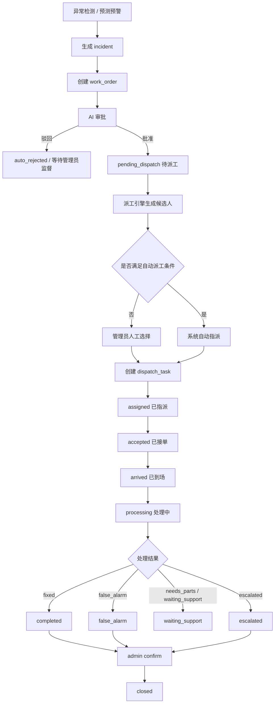
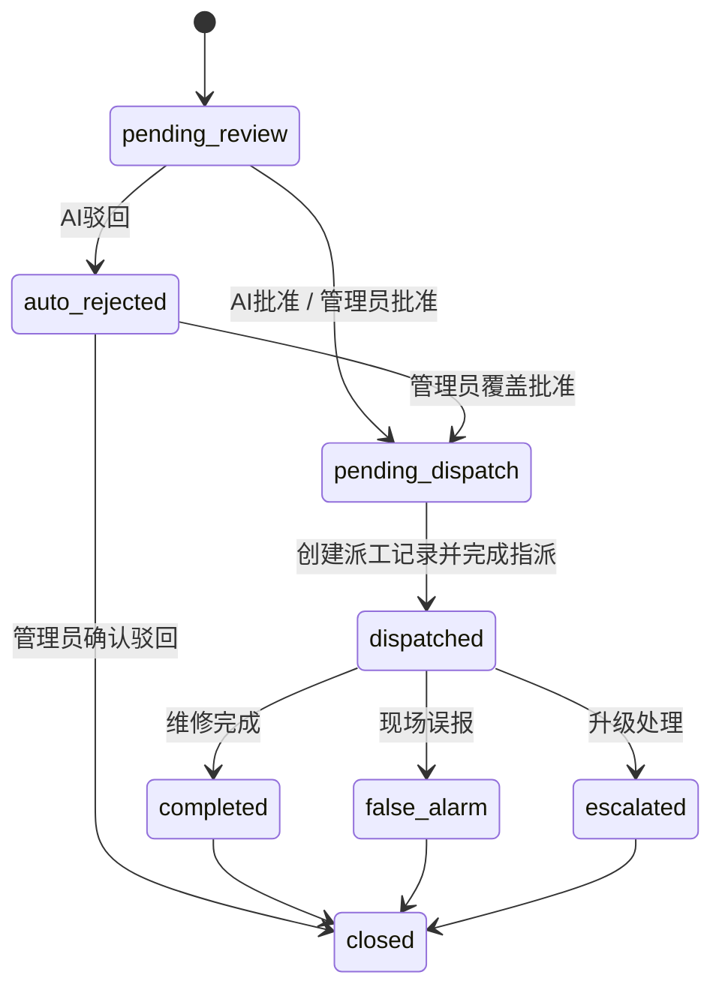

# 派单系统与维修端架构设计方案

## 1. 文档目标

本文档用于回答一个核心问题：

**在当前项目中，AI 审批通过以后，工单到底应该如何“真正派出去”，以及维修人员页面应该围绕什么对象来设计。**

本文档不是单纯补一个“派单按钮”，而是给出一套完整、可落地、可迭代的方案，覆盖：

- 领域模型拆分
- 状态机重构
- 派单策略
- AI 在派单链路中的职责边界
- 数据模型设计
- 接口设计
- 维修端与管理端页面设计
- 分阶段实施路径

本文档默认基于当前仓库现状设计，重点兼容现有的 `incident -> work_order -> mobile/frontend` 结构，不推倒重来。

---

## 2. 当前系统现状与核心断点

### 2.1 当前已有基础

当前仓库已经具备以下基础能力：

- 异常检测与预测预警可以自动创建 `incident` 与 `work_order`
- AI 审批服务可以判断“当前异常是否值得派修”
- 管理端和移动端已经围绕 `incident + current_work_order` 构建页面
- 移动端已经开始尝试使用 `execution_status`、`assigned_to_name`、`accepted_at`、`arrived_at` 等字段

也就是说，系统已经有了：

- 问题层：`incident`
- 审批对象：`work_order`
- 页面雏形：维修端工作台、管理端工单页

真正缺失的是：

**派工执行层（dispatch domain）**

### 2.2 当前最关键的问题

当前后端逻辑里，AI 一旦批准，工单会直接从 `auto_approved` 自动流转为 `dispatched`。这在演示阶段可以跑通闭环，但在真实业务里会造成结构性问题：

1. `审批通过` 被错误等同于 `已经派给具体维修人员`
2. `dispatched` 成为了一个语义过载的状态
3. 维修端页面需要的“待接单 / 已接单 / 已到场 / 处理中 / 待协同”没有真实数据支撑
4. 系统没有真正的“派给谁、何时派、为何派、是否改派”的结构化记录
5. 管理端无法做真正的调度，只能做“批准/驳回”

### 2.3 当前代码层面的具体断点

结合现有实现，可以明确看到以下冲突：

#### 断点 1：AI 批准后直接进入 `dispatched`

当前 `work_order_service.py` 中，AI 审批通过后会自动流转到 `dispatched`：

- `backend/app/services/work_order_service.py`

这意味着系统还没完成“选人/选班组/派工确认”，就已经把单标成“已派单”。

#### 断点 2：维修端只能看派给自己的单，但系统没有真正派人

当前 `routes_incidents.py` 对 `ops` 用户做了按 `assigned_to=user.id` 过滤：

- `backend/app/api/routes_incidents.py`

而当前仓库并没有完整的“候选人选择 + 指派接口 + 派单记录”，所以会出现：

- 管理端看到单已派发
- 维修端却看不到任何属于自己的单

#### 断点 3：移动端 UI 已经按执行阶段设计，但后端没有真实执行对象

移动端已经定义了这些子状态：

- `pending_accept`
- `accepted`
- `arrived`
- `processing`
- `waiting_support`
- `overdue`

但后端当前并没有真正维护：

- 接单动作
- 到场动作
- 开始处理动作
- 改派动作
- 协同动作

于是页面展示的是“看起来像流程”的状态，不是“真实发生过动作”的状态。

#### 断点 4：用户表没有派工必需的人员画像

当前 `users` 表只有：

- `username`
- `phone`
- `role`

但真正派工至少需要：

- 所属班组
- 技能标签
- 值班状态
- 当前负载
- 服务楼栋范围
- 是否可接单

否则 AI 就算审批通过，也没有足够的信息做派工决策。

### 2.4 结论

当前系统真正缺失的，不是“审批后再点一次按钮”，而是：

**将“审批决策”和“派工决策”彻底拆开。**

---

## 3. 设计原则

### 3.1 总原则

系统应该把三个问题分开建模：

1. **这是不是值得维修的问题？**
   由 `AI 审批` 回答。
2. **这个问题应该派给谁处理？**
   由 `派工引擎 + 管理员` 共同决定。
3. **维修实际处理到哪一步了？**
   由 `维修执行动作` 驱动。

### 3.2 关键原则

1. `incident` 是问题主对象，不是工单
2. `work_order` 是审批与闭环对象，不是派工对象的全部语义
3. `dispatch` 是执行对象，必须独立建模
4. AI 负责“是否派修”和“推荐如何派”，不直接承担全部派工责任
5. 维修端只看派给自己的执行任务，不看未指派工单
6. 管理端默认看 `incident` 视角，不直接沉迷于工单碎片
7. 状态机必须拆维度，不再让一个字段承载全部业务含义

---

## 4. 目标领域模型

## 4.1 四层模型

推荐将系统拆成四层：

1. **事实层**：`anomaly_events` / `predicted_anomaly_events`
2. **问题层**：`anomaly_incidents`
3. **工单层**：`work_orders`
4. **执行层**：`dispatch_tasks`

### 4.2 每层职责

| 层级 | 对象 | 职责 |
|------|------|------|
| 事实层 | `anomaly_events` | 记录小时级异常事实，不承载流程状态 |
| 问题层 | `anomaly_incidents` | 聚合同一持续问题，是前端主列表对象 |
| 工单层 | `work_orders` | 承载审批、闭环、监督、结果归档 |
| 执行层 | `dispatch_tasks` | 承载“派给谁、接单、到场、改派、协同、完成” |

### 4.3 对象关系


### 4.4 为什么必须新增 `dispatch_tasks`

如果不新增执行对象，系统会继续出现以下问题：

- `work_order.status` 继续越来越臃肿
- 无法记录多次派工尝试
- 无法支持改派/转派/拒单
- 无法支持“先派暖通班，后升级弱电班”
- 无法支持维修端的真实过程动作

因此：

**派单系统的核心不是再加几个字段，而是引入执行对象。**

---

## 5. AI、工单、派单三者的职责边界

### 5.1 AI 审批的职责

AI 审批只负责回答：

- 该异常在当前业务语境下是否需要派修
- 如果需要派修，推荐什么样的处理方式

AI 审批不直接决定：

- 派给具体哪一个维修员
- 何时改派
- 是否因为排班或负载问题转给其他班组

### 5.2 派工引擎的职责

派工引擎负责：

- 根据规则和人员画像筛选候选人
- 给出候选排序和推荐理由
- 在满足条件时执行自动派工
- 在条件不足时进入人工派工

### 5.3 管理员/经理的职责

管理员或运维经理负责：

- 对 AI 驳回做监督和覆盖
- 确认推荐派工对象是否合理
- 处理无人可派、超时未接单、需要改派等情况

### 5.4 维修人员的职责

维修人员负责：

- 接单
- 到场
- 开始处理
- 申请协同/缺件
- 提交处理结果

---

## 6. 推荐的整体流程



### 6.1 最重要的改动

AI 审批通过后，目标状态不应该是 `dispatched`，而应该是：

**`pending_dispatch`**

这一步是整个设计里最关键的一刀。

---

## 7. 状态模型设计

## 7.1 当前问题

当前系统把以下含义混在同一个状态字段里：

- AI 是否批准
- 是否已派工
- 是否维修完成
- 是否管理员覆盖

这会导致状态名越来越像“历史动作”，而不是“当前业务状态”。

例如：

- `auto_approved`
- `admin_override_approved`
- `admin_override_rejected`

这些更像“审批结果事件”，不适合作为长期主状态。

## 7.2 目标方案：拆成三维状态

### 维度一：审批结果 `approval_status`

| 状态 | 说明 |
|------|------|
| `pending` | 待 AI 审批 |
| `ai_approved` | AI 批准 |
| `ai_rejected` | AI 驳回 |
| `admin_approved` | 管理员最终批准 |
| `admin_rejected` | 管理员最终驳回 |

### 维度二：工单生命周期 `work_order_status`

| 状态 | 说明 |
|------|------|
| `pending_review` | 待审批 |
| `pending_dispatch` | 已批准，待派工 |
| `active` | 已有派工执行中 |
| `completed` | 维修确认已完成 |
| `false_alarm` | 现场确认误报 |
| `escalated` | 需升级处理 |
| `closed` | 已关闭 |
| `cancelled` | 已取消 |

### 维度三：派工执行状态 `dispatch_status`

| 状态 | 说明 |
|------|------|
| `unassigned` | 尚未指派 |
| `assigned` | 已指派，待接单 |
| `accepted` | 已接单 |
| `arrived` | 已到场 |
| `processing` | 处理中 |
| `waiting_support` | 待协同 / 待配件 |
| `transferred` | 已转派 |
| `completed` | 本次派工已完成 |
| `cancelled` | 本次派工已取消 |
| `timeout` | 本次派工已超时未推进 |

## 7.3 兼容当前代码的过渡版

由于当前代码大量依赖 `work_orders.status`，建议分两步走：

### 阶段一：兼容版

继续保留 `work_orders.status`，但调整为：

- `pending_review`
- `auto_rejected`
- `pending_dispatch`
- `dispatched`
- `completed`
- `false_alarm`
- `escalated`
- `closed`

并停止使用或逐步废弃：

- `auto_approved`
- `admin_override_approved`
- `admin_override_rejected`

审批结果改存到：

- `ai_decision`
- `admin_action`
- `audit_log`

### 阶段二：目标版

进一步正式拆成：

- `approval_status`
- `work_order_status`
- `dispatch_status`

让状态职责彻底分离。

## 7.4 状态迁移建议



---

## 8. AI 审批输出设计

## 8.1 AI 审批输出不应只有 approve/reject

当前 AI 审批输出过于简单。为了进入派工链路，建议让 AI 审批多输出一个 `dispatch_profile`。

### 8.2 推荐输出结构

```json
{
  "decision": "approve",
  "reason": "当前无可解释该异常的特殊事件，建议派修",
  "matched_event_ids": null,
  "dispatch_profile": {
    "required_skill_codes": ["hvac", "bms"],
    "preferred_team_code": "hvac_team",
    "onsite_level": "onsite",
    "urgency_level": "high",
    "accept_sla_minutes": 10,
    "arrive_sla_minutes": 30,
    "finish_sla_minutes": 120,
    "recommended_mode": "semi_auto",
    "risk_tags": ["continuous_anomaly", "night_shift"],
    "dispatch_hint": "优先选择熟悉该楼宇空调系统的值班人员"
  }
}
```

## 8.3 `dispatch_profile` 的价值

它解决的是：

- AI 提供“如何派”的辅助信息
- 但又不直接越权决定“具体派给张三”

这样做的好处：

1. AI 保留决策支持价值
2. 派工仍然可解释
3. 管理员仍可监督
4. 后续可以平滑升级为自动派工

---

## 9. 派工策略设计

## 9.1 派工模式分层

建议支持三种派工模式：

### 模式一：人工派工

适用于：

- 候选人很多
- 人员画像不完整
- 高优先级故障
- 管理员想人工确认

系统行为：

- AI 审批通过
- 进入 `pending_dispatch`
- 系统给出候选人列表与推荐排序
- 管理员点击确认派工

### 模式二：半自动派工

适用于：

- 候选人排序很清晰
- 管理员只需一键确认

系统行为：

- 生成候选人 Top 3
- 默认勾选第一候选人
- 管理员一键确认后生成派工

### 模式三：自动派工

适用于：

- 有完整班组、技能、值班、负载数据
- 规则足够稳定
- 业务愿意接受自动指派

自动派工必须有硬条件，缺一不可：

- 至少 1 名有效候选人
- 技能匹配
- 当前可接单
- 未超负载
- 所属班组/楼宇覆盖范围匹配

否则应自动降级到人工派工。

## 9.2 候选人选择的硬约束

候选人筛选先做硬过滤，再做打分排序。

### 硬过滤条件

1. `role = ops`
2. `is_active = true`
3. `on_duty = true`
4. `is_accepting_orders = true`
5. `current_active_orders < max_active_orders`
6. 具备必要技能
7. 服务范围覆盖当前楼栋或系统

只要有任一条件不满足，就不进入候选池。

## 9.3 候选人排序建议

### 推荐评分维度

| 维度 | 建议权重 | 说明 |
|------|---------|------|
| 技能匹配度 | 35% | 是否具备所需系统技能 |
| 楼宇熟悉度 | 20% | 是否服务过该楼栋/设备 |
| 当前负载 | 15% | 当前在手工单数越少越优 |
| 值班可用性 | 10% | 当前是否在线、是否值班 |
| 历史处理效果 | 10% | 历史完成率、误报率等 |
| SLA 紧迫度适配 | 5% | 高优先级更偏向最近可响应人员 |
| 近时段均衡派工 | 5% | 避免永远派给同一人 |

### 推荐输出

系统给管理员展示候选人时，不只给“名字”，而要给：

- 班组
- 技能标签
- 当前在手单数
- 最近一次接单时间
- 推荐理由

例如：

- 张强｜暖通班｜HVAC/BMS｜在手 1 单｜推荐：技能最匹配，负责该楼栋，当前负载较低
- 李晨｜暖通班｜HVAC｜在手 0 单｜推荐：空闲，但该楼栋历史经验较少

## 9.4 无人可派时的策略

当候选池为空时，不应直接卡死在审批通过后。

推荐进入：

- `pending_dispatch`
- 并打上 `dispatch_blocked_reason`

阻塞原因可枚举：

- `no_qualified_worker`
- `no_on_duty_worker`
- `all_over_capacity`
- `missing_worker_profile`

管理端要能看到“为什么派不出去”。

---

## 10. 维修人员画像设计

## 10.1 为什么必须补人员画像

没有人员画像，派工只能“手动选一个用户 ID”。

那样带来的问题：

- AI 无法推荐
- 自动派工无法成立
- 页面只能展示名字，不能展示班组、技能、负载
- 无法做“为什么派给这个人”的解释

## 10.2 推荐新增表

### 表一：`worker_teams`

用于维护班组。

建议字段：

- `id`
- `team_code`
- `team_name`
- `team_type`
- `service_scope_json`
- `leader_user_id`
- `is_active`
- `created_at`

### 表二：`worker_profiles`

用于维护维修人员的工作属性。

建议字段：

- `user_id`
- `team_id`
- `on_duty`
- `is_accepting_orders`
- `max_active_orders`
- `current_active_orders`
- `service_buildings_json`
- `service_systems_json`
- `skill_summary_json`
- `last_seen_at`
- `last_assigned_at`
- `last_completed_at`

### 表三：`worker_skills`

用于维护技能标签。

建议字段：

- `id`
- `user_id`
- `skill_code`
- `skill_level`
- `certified_until`

### 表四：`worker_shifts`

用于维护值班与排班。

建议字段：

- `id`
- `user_id`
- `shift_date`
- `shift_type`
- `start_time`
- `end_time`
- `is_on_call`

## 10.3 第一阶段可简化

如果项目当前时间紧，第一阶段可以不马上建完整排班系统，先落这几个最小字段：

- `team_id`
- `on_duty`
- `is_accepting_orders`
- `max_active_orders`
- `service_buildings_json`
- `skill_summary_json`

这样就足够先跑通“候选人推荐 + 人工确认派工”。

---

## 11. 派工执行对象设计

## 11.1 推荐新增 `dispatch_tasks`

建议新增独立表 `dispatch_tasks`，作为派工执行主对象。

### 为什么不是只给 `work_orders` 加几个字段

只给 `work_orders` 加字段，短期能用，但长期会碰到这些问题：

- 一个工单多次改派没法优雅记录
- 转派历史混乱
- 无法区分“当前派工”和“历史派工”
- 很难做派工分析和 SLA 分析

### `dispatch_tasks` 的定位

它代表：

**针对某张工单的一次实际派工尝试**

一个工单可以有多次派工：

- 第一次派给暖通班
- 第二次改派给弱电班
- 第三次升级到外协

这些都应该是多条 `dispatch_tasks`。

## 11.2 `dispatch_tasks` 建议字段

| 字段 | 说明 |
|------|------|
| `id` | 主键 |
| `work_order_id` | 对应工单 |
| `incident_id` | 冗余关联 incident，便于查询 |
| `attempt_no` | 第几次派工 |
| `dispatch_mode` | manual / semi_auto / auto |
| `dispatch_status` | 当前执行状态 |
| `assigned_team_id` | 指派班组 |
| `assigned_to` | 指派维修员 |
| `assigned_by` | 谁执行的派工 |
| `selection_reason` | 派工原因说明 |
| `candidate_snapshot_json` | 当时候选池快照 |
| `assigned_at` | 派工时间 |
| `accept_deadline_at` | 接单 SLA 截止时间 |
| `accepted_at` | 接单时间 |
| `arrive_deadline_at` | 到场 SLA 截止时间 |
| `arrived_at` | 到场时间 |
| `processing_started_at` | 开始处理时间 |
| `finish_deadline_at` | 完成 SLA 截止时间 |
| `completed_at` | 本次派工完成时间 |
| `waiting_support` | 是否待协同 |
| `support_team_id` | 待协同班组 |
| `support_reason` | 协同原因 |
| `reject_reason` | 拒单原因 |
| `transfer_from_dispatch_id` | 从哪次派工转来 |
| `cancel_reason` | 取消原因 |
| `created_at` | 创建时间 |
| `updated_at` | 更新时间 |

## 11.3 推荐索引

- `idx_dispatch_work_order`
- `idx_dispatch_assigned_to_status`
- `idx_dispatch_team_status`
- `idx_dispatch_deadline`
- `idx_dispatch_incident`

## 11.4 推荐审计表 `dispatch_events`

如果希望派工链路可追溯，建议再加一张事件表：

- `assigned`
- `accepted`
- `rejected`
- `arrived`
- `processing_started`
- `support_requested`
- `transferred`
- `completed`
- `cancelled`
- `timeout_triggered`

这样后续做：

- 派工效率分析
- 接单时长分析
- 到场时长分析
- 改派原因统计

会非常自然。

---

## 12. 对现有表的改造建议

## 12.1 `work_orders` 的建议改动

### 第一阶段最小增量

建议先增加以下字段：

- `pending_dispatch_at`
- `current_dispatch_id`
- `dispatch_blocked_reason`
- `dispatch_profile_json`

并把 AI 审批通过后的主状态改为：

- `pending_dispatch`

### 第二阶段结构优化

进一步新增：

- `approval_status`
- `work_order_status`

并逐步废弃将审批动作编码进主状态的做法。

## 12.2 `anomaly_incidents` 的建议改动

当前 incident 已经是很好的前端主对象，建议继续强化。

推荐增加派工相关冗余读模型字段：

- `current_dispatch_id`
- `current_dispatch_status`
- `current_assigned_to`
- `current_assigned_team_id`
- `last_dispatch_at`
- `dispatch_overdue_flag`

这样列表页不需要每次深度 JOIN 很多表。

---

## 13. 接口设计

## 13.1 审批接口

### 保留现有能力，但改语义

#### `POST /api/work-orders/{ticket_id}/approve-decision`

请求：

```json
{
  "decision": "approve",
  "notes": "当前异常持续且无特殊事件解释，允许进入派工"
}
```

行为：

- `approve`：工单进入 `pending_dispatch`
- `reject`：工单进入 `auto_rejected`

注意：

**审批通过不再直接变成 `dispatched`。**

## 13.2 候选人查询接口

#### `GET /api/work-orders/{ticket_id}/dispatch-candidates`

返回：

```json
{
  "ticket_id": "WO-20260404-001",
  "dispatch_profile": {
    "required_skill_codes": ["hvac"],
    "preferred_team_code": "hvac_team",
    "accept_sla_minutes": 10,
    "arrive_sla_minutes": 30
  },
  "candidates": [
    {
      "user_id": "u_1",
      "username": "张强",
      "team_name": "暖通班",
      "phone": "13800000000",
      "current_active_orders": 1,
      "score": 92,
      "badges": ["技能匹配", "熟悉楼栋", "值班中"],
      "recommend_reason": "负责该楼栋空调系统，当前负载较低"
    }
  ]
}
```

## 13.3 派工接口

#### `POST /api/work-orders/{ticket_id}/dispatch`

请求：

```json
{
  "dispatch_mode": "manual",
  "assigned_team_id": "team_hvac",
  "assigned_to": "u_1",
  "selection_reason": "技能最匹配，当前值班且在手单较少"
}
```

行为：

- 创建 `dispatch_task`
- 写入 `assigned_at`
- 设置接单/到场/完成 SLA
- 更新 `work_order` 为执行中
- 推送维修端通知

## 13.4 改派接口

#### `POST /api/dispatch-tasks/{dispatch_id}/reassign`

请求：

```json
{
  "assigned_team_id": "team_weak_current",
  "assigned_to": "u_7",
  "reason": "原责任人超时未接单，转派弱电班"
}
```

行为：

- 当前派工记录标记为 `transferred`
- 新建一条新的 `dispatch_task`
- 保留完整改派历史

## 13.5 维修端动作接口

建议新增以下动作接口：

### `POST /api/dispatch-tasks/{dispatch_id}/accept`

维修人员确认接单。

### `POST /api/dispatch-tasks/{dispatch_id}/arrive`

维修人员确认到场。

### `POST /api/dispatch-tasks/{dispatch_id}/start`

维修人员开始处理。

### `POST /api/dispatch-tasks/{dispatch_id}/request-support`

维修人员申请协同/缺件。

### `POST /api/dispatch-tasks/{dispatch_id}/complete`

维修人员提交结果：

```json
{
  "result": "fixed",
  "notes": "更换阀门执行器，试运行正常"
}
```

### `POST /api/dispatch-tasks/{dispatch_id}/reject`

维修人员拒单，并给出原因：

- 不属于本专业
- 当前不在岗
- 现场位置不匹配

## 13.6 Incident 列表读模型接口

现有 `GET /api/incidents` 可以继续保留，但建议输出结构从：

- `current_work_order`

扩展为：

- `current_work_order`
- `current_dispatch`

其中 `current_dispatch` 至少包含：

- `dispatch_status`
- `assigned_to_name`
- `assigned_team_name`
- `assigned_at`
- `accepted_at`
- `arrived_at`
- `processing_started_at`
- `latest_progress_note`
- `sla_due_at`
- `sla_status`

---

## 14. 页面设计

## 14.1 管理端页面分工

建议将当前管理端能力拆成三块：

### 页面一：工单审阅

关注：

- 待 AI 审批
- AI 已驳回待监督
- 待关闭

不负责真正派工，只负责审阅。

### 页面二：派工中心

这是当前真正缺失的页面。

关注：

- 待派工
- 候选人推荐
- 一键派工
- 改派/转派
- 超时未接单

### 页面三：执行跟踪

关注：

- 已指派但未接单
- 已接单未到场
- 到场处理中
- 待协同
- 已超时

## 14.2 派工中心页面建议结构

```text
顶部摘要：待派工 / 待接单 / 超时未接 / 待协同
筛选栏：楼栋 / 系统 / 优先级 / 班组 / 是否超时
列表卡片：incident + work_order 摘要
右侧抽屉或详情页：
  - 异常摘要
  - AI 审批理由
  - 派工画像 dispatch_profile
  - 候选人列表
  - 派工按钮
  - 改派历史
```

## 14.3 卡片上应该重点展示什么

对派工中心来说，最重要的不是“异常细节多不多”，而是：

1. 要不要马上派
2. 派给谁更合适
3. 当前派工是否卡住

因此卡片重点应是：

- 优先级
- 楼栋 / 系统 / 设备
- 持续异常时长
- AI 审批结论
- 推荐班组
- 推荐技能
- 候选人数
- 是否已经超出接单窗口

## 14.4 维修端页面建议结构

维修端不要再以“工单总体状态”做主导航，而应以“执行动作状态”做主导航。

推荐 Tab：

- `待接单`
- `待到场`
- `处理中`
- `待协同`
- `已完成`

### 每个卡片至少展示

- 楼栋 / 系统 / 设备
- 工单编号
- 派工时间
- 接单 SLA 倒计时
- AI 建议措施
- 联系方式
- 当前动作按钮

### 动作按钮应该动态变化

| 当前状态 | 主按钮 |
|---------|-------|
| `assigned` | 接单 |
| `accepted` | 到场 |
| `arrived` | 开始处理 |
| `processing` | 提交结果 |
| `waiting_support` | 更新进展 |

## 14.5 当前移动端页面与目标方案的关系

当前已有的这份文档：

- `docs/工单审阅-已派单页面状态驱动卡片设计方案.md`

已经把 `execution_status` 的展示思路讲得很清楚。

本方案对它的补充是：

- 不只定义 UI 字段
- 还定义这些字段在后端应该由哪个对象、哪个动作产生

也就是说：

**原有文档主要解决“怎么展示”，本文档解决“这些状态从哪里来”。**

---

## 15. 通知与超时机制

## 15.1 通知节点

建议在以下节点触发通知：

1. 工单进入 `pending_dispatch`
2. 派工成功，通知责任人
3. 接单超时前 3 分钟提醒
4. 接单超时触发催办
5. 到场超时提醒
6. 协同请求通知相关班组
7. 完成后通知管理员复核

## 15.2 超时规则

建议至少拆三段 SLA：

- `accept_sla_minutes`
- `arrive_sla_minutes`
- `finish_sla_minutes`

不要只保留一个总 SLA，否则管理端不知道到底是卡在：

- 没人接
- 没到场
- 到场后没处理

## 15.3 超时后的自动动作

建议支持以下自动规则：

1. 未接单超时 -> 自动提醒责任人
2. 连续两次提醒无动作 -> 提醒管理员
3. 超过更长阈值 -> 自动进入改派建议
4. 当前责任人离线或停班 -> 推荐重新派工

---

## 16. 审计与可解释性

## 16.1 审计必须覆盖两条线

### 审批线

记录：

- AI 为什么批准/驳回
- 管理员是否覆盖
- 覆盖理由是什么

### 派工线

记录：

- 为什么推荐这个人
- 最终是谁确认派给谁
- 是否发生改派
- 改派原因
- 维修动作推进时间线

## 16.2 为什么这很重要

后续你们一定会遇到这些复盘问题：

- 为什么这单派给了张强，不是李晨？
- 为什么维修端显示已派单，但实际没人处理？
- 为什么这个楼栋总是超时？
- 为什么某类工单总是需要改派？

如果没有结构化审计，后面所有复盘都会非常痛苦。

---

## 17. 与当前代码的映射关系

## 17.1 后端改造点

### 新增服务

- `backend/app/services/dispatch_service.py`
- `backend/app/services/dispatch_candidate_service.py`

### 重点修改文件

- `backend/app/services/work_order_service.py`
  - 去掉 AI 批准后直接进入 `dispatched`
  - 引入 `pending_dispatch`
- `backend/app/services/ai_review_service.py`
  - 输出 `dispatch_profile`
- `backend/app/api/routes_workorder.py`
  - 新增派工、改派、接单、到场、开始处理、协同、完成接口
- `backend/app/services/incident_service.py`
  - 从 `current_dispatch` 而不是猜测逻辑衍生执行状态
- `backend/app/db/models.py`
  - 新增班组、人员画像、派工表

## 17.2 前端与移动端改造点

### Web 端

- `frontend/src/views/WorkOrders.vue`

当前它还使用旧状态：

- `pending_approval`
- `approved`
- `rejected`

建议将其升级为真实后端状态，或者拆成：

- 工单审阅页
- 派工中心页

### 移动端管理页

- `mobile/src/pages/operator/workorders/index.vue`

建议从“已派单列表”进一步升级为“执行跟踪 + 派工中心”的组合。

### 移动端维修页

- `mobile/src/pages/worker/pending/index.vue`
- `mobile/src/pages/worker/active/index.vue`
- `mobile/src/pages/worker/workorder-detail/index.vue`

这些页面已经具备不错的 UI 基础，下一步重点不是重画，而是改成真实动作驱动：

- 接单
- 到场
- 开始处理
- 申请协同
- 提交结果

---

## 18. 分阶段实施方案

## 18.1 第一阶段：先把“审批”和“派工”拆开

目标：

- 让系统不再出现“AI 一批准就等于已派单”

建议动作：

1. 增加 `pending_dispatch` 状态
2. 去掉 AI 审批通过后的自动 `dispatched`
3. 管理端增加“待派工” Tab
4. 增加最小派工接口：`POST /work-orders/{id}/dispatch`
5. 在 `work_orders` 上先临时补齐：
   - `assigned_to`
   - `assigned_at`
   - `accepted_at`
   - `arrived_at`
   - `processing_started_at`

这是最短路径，也是收益最大的一步。

## 18.2 第二阶段：补齐人员画像与候选人推荐

目标：

- 能够给出“推荐派给谁”

建议动作：

1. 新增 `worker_teams`
2. 新增 `worker_profiles`
3. 新增 `worker_skills`
4. 实现候选人排序逻辑
5. 管理端派工弹层展示候选人卡片

## 18.3 第三阶段：引入 `dispatch_tasks`

目标：

- 支持改派、转派、拒单、协同

建议动作：

1. 新增 `dispatch_tasks`
2. `incident_service` 改成读取 `current_dispatch`
3. 维修端动作全部切换到 `dispatch_tasks`
4. 增加改派历史和执行时间线

## 18.4 第四阶段：自动派工

目标：

- 在规则成熟后，让部分工单自动进入责任人工作台

建议动作：

1. 派工引擎先做规则版
2. AI 只做推荐与解释
3. 满足硬条件时允许自动指派
4. 所有自动派工必须可追溯、可改派、可回滚

---

## 19. 关键设计决策

## 19.1 不建议一上来让 AI 直接选具体维修员

原因：

- 当前人员画像不足
- 排班和负载信息不足
- 可解释性不够
- 业务信任成本过高

更稳的方式是：

**AI 给派工画像，规则引擎排候选人，管理员确认。**

## 19.2 不建议让维修端看到未指派工单

原因：

- 维修端关注的是“我的任务”
- 未指派工单属于调度视角，不属于执行视角
- 混到维修端会造成责任边界不清

## 19.3 不建议继续用一个主状态扛完整流程

因为后面一定会遇到：

- 改派
- 协同
- 缺件
- 拒单
- 取消
- 超时自动处理

继续塞在一个状态字段里，只会越来越难维护。

---

## 20. 验收标准

如果本方案落地，系统至少应满足以下标准：

### 架构层

1. AI 审批通过后，工单进入 `pending_dispatch` 而不是直接 `dispatched`
2. 派工动作有独立接口和独立审计记录
3. 维修执行状态由真实动作产生，不再由后端猜测

### 页面层

1. 管理端能看到“待派工”列表
2. 每张待派工单能看到候选人推荐
3. 维修端只看到派给自己的任务
4. 维修端能执行接单、到场、开始处理、协同、完成

### 数据层

1. 至少能追溯一张工单被谁审批、被谁派出、派给谁、是否改派
2. 至少能统计接单时长、到场时长、完成时长
3. 至少能分析某类工单为何频繁改派或超时

---

## 21. 最终结论

这个项目下一步最重要的架构动作，不是继续优化“AI 审批页面”，而是：

**把 AI 审批、派工决策、维修执行三层彻底拆开。**

可以用一句话概括本方案：

> `incident` 负责表达“出了什么问题”，  
> `work_order` 负责表达“这个问题是否要维修、如何闭环”，  
> `dispatch_task` 负责表达“这次实际派给谁、处理到哪一步”。

只有这样，维修端页面才会从“看起来像流程”变成“真正由业务动作驱动的流程”。

---

## 22. 建议的第一批开发任务

为了让方案尽快落地，建议先按下面顺序拆任务：

1. 后端新增 `pending_dispatch`，停止 AI 审批后自动 `dispatched`
2. 后端新增最小派工接口 `POST /api/work-orders/{ticket_id}/dispatch`
3. 后端补 `assigned_at / accepted_at / arrived_at / processing_started_at`
4. 管理端新增“待派工”列表和派工弹层
5. 维修端新增“接单 / 到场 / 开始处理”三个动作
6. 再推进班组、技能、候选人推荐
7. 最后引入完整 `dispatch_tasks`

这个顺序的好处是：

- 第一周就能把结构性断点切开
- 不需要等完整自动派工才能见效
- 现有前后端页面都可以平滑过渡

