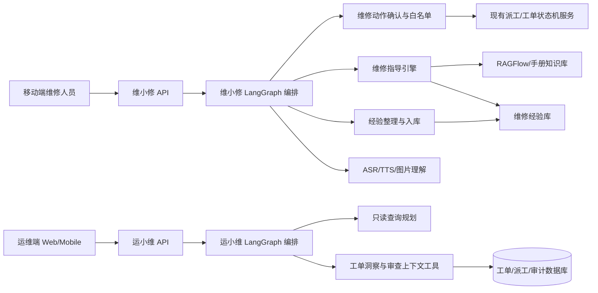

# 维小修与运小维双端 AI 逻辑框架设计方案

## 0. 结论先行

本文档定义两个 AI 助手的第一版落地边界和后续演进方向：

- 维修端 AI 叫 **维小修**。它不是只把按钮搬进聊天框，而是分两层：前半段把“接单、到场、开始处理、请求协同、完成”等既有工单动作变成对话式确认；真正开始维修后，进入现场维修指导，结合工单内容、异常证据、维修手册和经验库给出步骤卡片与聊天式辅导。
- 运维端 AI 叫 **运小维**。第一版确定只做“查和解释”：查单、查流程、查统计、解释状态、追溯谁接了单、为什么超时、哪天哪些人处理得多。第一版不做“改派、关闭、审批、驳回”等会改变工单状态的动作。
- 模型 API 选型优先考虑国内服务，默认优先 **Qwen / DashScope / 阿里云百炼**。OpenAI、其他海外模型或本地模型只作为可插拔备选，不作为默认实现前提。
- 两个 AI 都不能绕过现有后端状态机。凡是会改变工单状态的动作，都必须走现有后端服务或接口，并保留审计日志。

## 1. 技术调研结论

### 1.1 编排框架

建议继续使用仓库现有的 **LangGraph** 作为主编排框架。原因是它适合“状态化、多步骤、可中断、可恢复、可流式输出”的 Agent 工作流，也能把“意图识别、工具调用、人工确认、知识检索、结果总结”拆成明确节点。项目后端已经有 LangGraph 基础，不需要再引入一套新的核心编排系统。

备选框架：

- **Qwen-Agent**：适合和 Qwen 模型、工具调用、RAG 结合，但如果直接替换现有 LangGraph，会增加迁移成本。建议先作为参考或局部工具封装思路，不作为第一版主编排核心。
- **OpenAI Agents SDK**：工具、handoff、trace 能力完整，但考虑用户明确要求国内模型 API 优先，且仓库已有 LangGraph，第一版不建议把它作为默认依赖。

### 1.2 工具边界

建议继续沿用项目已有的 **MCP 工具箱思路**：AI 不直接写数据库，而是通过类型清晰、权限明确、可审计的工具或服务调用业务能力。

新增工具可以分成四类：

- 只读事实工具：读取工单上下文、派工历史、审计日志、异常证据、维修人员负载。
- 维修指导工具：检索维修手册、相似历史经验、设备故障步骤。
- 状态动作工具：只暴露维修端白名单动作，例如接单、到场、开始处理、请求协同、完成；运维端第一版不暴露写工具。
- 多模态工具：语音转文字、文字转语音、图片理解、图片上传。

### 1.3 模型 API 优先级

第一版建议做成统一 `ModelProvider` 适配层，不把业务逻辑绑死到某个模型厂商：

| 优先级 | Provider | 使用场景 | 说明 |
| --- | --- | --- | --- |
| P0 | Qwen / DashScope / 阿里云百炼 | 默认文本对话、工具调用、结构化输出、图像理解、语音相关能力 | 国内优先，适合作为生产默认路线 |
| P1 | 私有化 Qwen / vLLM / ModelScope | 内网部署、数据不出域、成本可控 | 适合后续企业化部署 |
| P2 | OpenAI | 备选或国际化部署 | 不作为第一版默认方案 |

实现上建议把模型配置放进后端配置，例如：

```text
AI_PROVIDER=qwen_dashscope
AI_TEXT_MODEL=qwen-plus
AI_VISION_MODEL=<按百炼当前可用模型配置>
AI_ASR_MODEL=<按百炼当前可用模型配置>
AI_TTS_MODEL=<按百炼当前可用模型配置>
AI_FALLBACK_PROVIDER=openai
```

这里不在文档中写死所有具体模型名，原因是模型版本更新很快；工程上应通过配置切换，文档只规定“国内 Qwen 优先”的策略。

### 1.4 语音与图片能力

维修端需要支持：

- 语音输入：维修人员现场说话，系统先做 ASR 转文字，再进入维小修对话编排。
- AI 语音播报：维小修回复文本后生成 TTS 音频，移动端可以自动或手动播放。
- 图片输入：维修人员上传现场照片，例如阀门、控制柜、仪表读数、漏水点、传感器状态，由视觉模型辅助判断。
- 关键动作二次确认：语音识别可能误触发，所以“完成工单、拒单、请求协同、退回改派”这类动作必须再次确认。

第一版不建议直接做全实时语音 Agent。更稳的路线是：

```text
录音 -> ASR -> 文本 Agent -> 工具确认/维修指导 -> TTS -> 播放
```

后续如果需要“免手持连续对话”，再评估 Qwen 实时语音/端到端多模态模型。

### 1.5 RAG 与经验库

维修知识建议采用“双存储”：

- 维修手册、规范、SOP：进入 RAGFlow 或现有 RAG 管线，做文档级检索。
- 现场经验：进入业务数据库，保留原文、整理结果、标签、来源工单、贡献人、设备类型、故障现象、适用条件，再异步同步到向量索引。

这样做的好处是：经验库既能结构化管理，也能被语义检索召回。经验内容不需要审核，但要保留原文和版本，方便后续追溯和纠错。

## 2. 总体架构



核心原则：

- 前端体验可以是对话式，后端仍然是状态机。
- 模型只负责理解、解释、建议和生成结构化意图。
- 真正动作由后端 Action Gate 校验后执行。
- 运小维第一版没有写工具，只有只读查询工具。

## 3. 维小修设计

### 3.1 维小修的职责

维小修面向维修人员，目标是降低现场维修门槛：

- 新维修人员：按 AI 推荐步骤走，有清单、有解释、有语音播报，可以随时问“下一步怎么做”。
- 经验维修人员：可以快速跳过基础步骤，提出更好的处理经验；AI 只做整理和归档，不强行改写经验。
- 系统侧：把对话、步骤、动作、经验、证据全部沉淀到数据库，后续类似问题可复用。

### 3.2 入口体验

当前“立即处理/继续处理”按钮建议改造成：

```text
点击立即处理 -> 进入维小修对话页 -> 自动加载当前工单 -> AI 先确认当前可执行动作
```

示例：

```text
维小修：这张工单是【公共楼】供水温度偏离，当前状态是待接单。你要现在确认接单吗？
维修人员：确认接单。
维小修：收到。我会为你提交接单确认。
系统：已接单。
维小修：下一步建议到场后检查供水温度传感器、阀门开度和泵运行状态。到达现场后你可以说“我已到场”。
```

### 3.3 动作层：把按钮变成对话，但不绕过状态机

维小修可以识别以下动作意图：

| 场景 | 用户可能说法 | 后端实际动作 |
| --- | --- | --- |
| 待接单 | “确认接单”“我接了” | `accept` |
| 已接单 | “我到现场了”“确认到场” | `arrive` |
| 已到场 | “开始处理”“开始维修” | `start` |
| 处理中 | “需要协同”“请求支援” | `request_support` |
| 等待协同 | “问题恢复了”“协同已解决” | `support_resolved` |
| 协同指派 | “确认协同”“我来支援” | `accept_support` |
| 协同指派 | “无法支援” | `reject_support` |
| 任意关键阶段 | “无法接单”“退回改派” | `reject` |
| 处理中 | “处理完成” | `complete` |

执行规则：

- AI 只输出结构化意图，例如 `{ "action": "accept", "confidence": 0.93 }`。
- 后端 `WorkerActionGate` 重新读取当前工单和派工状态。
- 后端检查当前状态是否允许该动作。
- 需要原因的动作必须补齐原因，例如拒单、请求协同。
- 高风险或语音触发动作必须二次确认。
- 最终仍调用现有工单/派工接口或服务。

### 3.4 指导层：真正开始维修后的 AI

当工单进入 `processing` 或已有 `processing_started_at` 后，维小修进入维修指导模式。

维小修不只是聊天，它要同时生成两种输出：

- 聊天式指导：自然语言解释原因、注意事项、下一步建议。
- 步骤卡片：结构化清单，可打勾、可跳过、可补充备注、可上传图片。

推荐步骤结构：

```json
{
  "work_order_id": "WO-20260403-005",
  "guide_version": 1,
  "steps": [
    {
      "id": "step_1",
      "title": "确认传感器读数",
      "reason": "工单显示供水温度偏离，先排除读数异常。",
      "expected_result": "现场读数与系统读数偏差不超过允许范围。",
      "risk_note": "不要直接重置传感器，先拍照记录。",
      "status": "pending"
    }
  ]
}
```

步骤生成输入：

- 工单标题、内容、设备、楼宇、优先级、SLA。
- 异常证据，例如偏离时间、峰值偏离、最新实际值、预测值。
- 历史同类工单和维修结果。
- 维修手册/RAG 检索结果。
- 经验库中相似故障的处理建议。
- 当前维修人员等级、技能标签、是否协同处理。

### 3.5 经验整理与入库

用户已经明确：经验类内容不需要审核，但 AI 只负责整理，不负责替用户改动原始经验。

建议数据库保存两份内容：

- `source_text`：用户原始输入，永不覆盖。
- `organized_text`：AI 整理后的结构化经验，用于后续检索和推荐。

建议表结构：

```text
maintenance_experiences
- id
- source_type              -- worker_note / operator_note / completion_summary
- source_work_order_id
- source_dispatch_id
- contributor_user_id
- contributor_role
- device_type
- building_id
- fault_keywords
- symptom_tags
- source_text              -- 原始经验，不覆盖
- organized_text           -- AI 整理结果
- suggested_steps_json
- safety_notes_json
- applicable_conditions_json
- model_provider
- model_name
- vector_index_status      -- pending / indexed / failed
- usage_count
- helpful_count
- is_active
- created_at
- updated_at
```

经验入库流程：

```text
用户提出经验 -> AI 判断是否属于经验类内容 -> 保存原文 -> AI 整理标签和步骤 -> 入库 -> 异步向量化 -> 后续相似工单召回
```

重要边界：

- 不需要审核，但保留删除、停用、纠错能力。
- 不把 AI 整理结果覆盖原文。
- 维小修引用经验时要提示“经验推荐”，不要伪装成强制规范。
- 如果经验与安全规范冲突，优先展示安全规范，并把冲突标记给运维人员。

## 4. 运小维设计

### 4.1 第一版边界

运小维第一版确定只做：

- 查某张工单是谁接的。
- 查这张工单到哪一步了。
- 解释为什么出现超时、改派、协同、接管。
- 统计某天、本周、本月哪些人处理得多。
- 统计哪个楼宇、哪个班组、哪个阶段问题多。
- 汇总某天的异常工单和处理链路。
- 给出“建议人工关注”的提示。

移动端集成边界：

- 运维移动端只在独立 AI 对话模块接入运小维。
- 具体工单详情页不内嵌运小维入口，避免把只读问询误解为工单流程动作。

运小维第一版不做：

- 不改派。
- 不关闭工单。
- 不审批工单。
- 不驳回工单。
- 不修改维修员画像、班组、技能或负载上限。
- 不替管理员确认任何状态动作。

如果用户说“帮我把这张单改派给张三”，运小维第一版应该回答：

```text
我可以帮你查看当前责任人、候选人建议和改派原因，但第一版不会直接执行改派。你可以在工单详情页人工确认改派。
```

### 4.2 查询编排

运小维的编排建议：

```text
自然语言问题
-> 意图分类
-> 参数抽取：时间、楼宇、人员、工单号、状态
-> 只读事实工具查询
-> 证据引用整理
-> AI 解释输出
```

意图类型：

- `single_work_order_summary`：单张工单概况。
- `single_work_order_timeline_question`：单张工单流程问答。
- `worker_performance`：人员维度统计。
- `team_performance`：班组维度统计。
- `building_hotspot`：楼宇热点。
- `overdue_analysis`：超时分析。
- `support_takeover_analysis`：协同/接管分析。
- `month_report`：月度运营总结。

### 4.3 对接现有能力

现有文档已经有只读一期能力：

- `GET /api/work-order-insights/metrics`
- `POST /api/work-order-insights/query`
- `GET /api/work-orders/{ticket_id}/review-context`

运小维应该优先复用这些能力，再在后端扩展参数化查询。

建议新增：

```text
POST /api/operator-ai/chat
```

请求示例：

```json
{
  "message": "这个月谁处理的工单最多？有没有超时？",
  "session_id": "opai_20260411_001",
  "scope": {
    "date_from": "2026-04-01",
    "date_to": "2026-04-30"
  },
  "include_evidence": true
}
```

响应示例：

```json
{
  "assistant": "运小维",
  "answer": "本月处理数量最多的是张三，共 18 单，其中 2 单到场超时。建议重点查看 WO-xxx 和 WO-yyy。",
  "facts": [],
  "evidence_refs": [
    "metrics.worker_rank[0]",
    "dispatch_tasks.accepted_at",
    "dispatch_tasks.arrived_at"
  ],
  "readonly": true,
  "blocked_actions": []
}
```

## 5. 后端模块规划

建议新增模块：

```text
backend/app/api/routes_worker_ai.py
backend/app/api/routes_operator_ai.py
backend/app/services/worker_ai_service.py
backend/app/services/operator_ai_service.py
backend/app/services/ai_model_provider.py
backend/app/services/maintenance_guidance_service.py
backend/app/services/maintenance_experience_service.py
backend/app/services/ai_media_service.py
backend/app/graph/worker_ai_graph.py
backend/app/graph/operator_ai_graph.py
```

核心 API：

```text
POST /api/worker-ai/chat
POST /api/worker-ai/media/transcribe
POST /api/worker-ai/media/analyze-image
POST /api/worker-ai/tts
GET  /api/worker-ai/work-orders/{ticket_id}/steps
POST /api/worker-ai/work-orders/{ticket_id}/steps/{step_id}/update

POST /api/operator-ai/chat

POST /api/maintenance-experiences
GET  /api/maintenance-experiences/search
```

模型 Provider 伪接口：

```python
class ModelProvider:
    async def chat(self, messages, tools=None, response_schema=None, stream=False): ...
    async def transcribe(self, audio_file): ...
    async def synthesize(self, text, voice=None): ...
    async def analyze_image(self, prompt, image_file): ...
```

第一版实现：

- `QwenDashScopeProvider`：默认实现。
- `OpenAIProvider`：可选 fallback。
- `LocalQwenProvider`：后续私有化部署再接。

## 6. 数据与审计

建议新增或扩展以下数据：

```text
ai_assistant_sessions
- id
- assistant_name              -- wei_xiao_xiu / yun_xiao_wei
- user_id
- role
- work_order_id
- session_state_json
- created_at
- updated_at

ai_assistant_messages
- id
- session_id
- role                        -- user / assistant / tool / system
- content
- content_type                -- text / audio / image / tool_result
- model_provider
- model_name
- created_at

worker_ai_step_plans
- id
- work_order_id
- dispatch_id
- generated_from_json
- steps_json
- status
- created_at
- updated_at

ai_assistant_action_audits
- id
- session_id
- work_order_id
- proposed_action
- confirmation_text
- execution_status
- backend_action_ref
- error_message
- created_at

ai_media_assets
- id
- owner_user_id
- work_order_id
- media_type                  -- audio / image
- storage_url
- transcript
- analysis_json
- created_at
```

审计要求：

- 维小修每次触发状态动作都写 `ai_assistant_action_audits`。
- 真正工单状态变更仍写现有工单审计日志。
- 运小维第一版所有会话都标记 `readonly=true`。
- 模型返回的结构化意图和后端最终执行结果都要保留，便于追查“AI 理解错了”还是“状态机拒绝了”。

## 7. 性能设计

### 7.1 快路径与慢路径分离

快路径：

- 接单、到场、开始处理这类明确动作，不需要每次都跑完整 RAG。
- 先用规则和轻量意图识别处理，只有歧义时再调用大模型。

慢路径：

- 故障分析、步骤生成、经验检索、图片理解需要调用模型和知识库。
- 慢路径通过 SSE/流式响应逐步返回：“正在读取工单 -> 正在检索经验 -> 已生成建议步骤”。

### 7.2 缓存

建议缓存：

- 工单详情与审查上下文：短 TTL，例如 15-60 秒。
- RAG 检索结果：按 `device_type + symptom + building_id` 缓存。
- TTS 音频：按 `text_hash + voice + model` 缓存。
- 经验检索向量：入库后异步索引，避免阻塞用户对话。

不建议缓存：

- 状态动作前的工单状态。每次执行前必须重新查数据库，避免并发误操作。

### 7.3 并发与幂等

- 状态动作执行前使用当前工单状态校验。
- 同一个 `session_id + action + work_order_id` 生成幂等键，防止重复点击或语音重复识别。
- 完成、拒单、协同这类动作必须要求确认文本或确认按钮。
- 对同一工单的步骤计划更新要带版本号，避免多端同时修改覆盖。

## 8. 前端与移动端交互

### 8.1 维修端

建议新增维小修页面：

```text
mobile/src/pages/worker/ai-workorder/index.vue
```

页面结构：

- 顶部：工单摘要、当前状态、SLA。
- 中部：对话流。
- 右侧或下方：步骤卡片，支持打勾、跳过、上传图片、备注。
- 底部：文字输入、语音按钮、图片上传、播放上一条 AI 回复。

当前 `workorder-detail` 中的 AI 对话可以作为过渡，但长期建议维小修是一个独立的“执行型 AI 工作台”，不只是详情页里的问答组件。

### 8.2 运维端

建议新增运小维入口：

```text
frontend/src/views/OperatorAI.vue
mobile/src/pages/operator/ai/index.vue
```

第一版重点是自然语言查询和证据展示：

- “今天谁接了公共楼的温度偏离单？”
- “本月接单最多的人是谁？”
- “3 月 7 日那张供水温度偏离单流程是什么？”
- “哪些工单发生过协同？”

返回结果要展示证据引用，避免用户只看到一段没有出处的文字。

## 9. 分阶段落地

阶段实施文档：

- [阶段 1：动作对话化与只读问询实施方案](./维小修与运小维AI阶段1-动作对话化与只读问询实施方案.md)
- [阶段 2：维修指导与多模态实施方案](./维小修与运小维AI阶段2-维修指导与多模态实施方案.md)
- [阶段 3：经验库闭环实施方案](./维小修与运小维AI阶段3-经验库闭环实施方案.md)
- [阶段 4：运维运营分析增强实施方案](./维小修与运小维AI阶段4-运维运营分析增强实施方案.md)

### Phase 1：维小修动作对话化 + 运小维只读问询

- 新增 `QwenDashScopeProvider` 适配层。
- 维小修支持文本对话触发接单、到场、开始处理、请求协同、完成等白名单动作。
- 所有动作经二次确认和后端状态机执行。
- 运小维接入现有 `work-order-insights/query` 和 `review-context`，只读回答。
- 不做实时语音，不做自动改派/关闭/审批。

### Phase 2：维小修维修指导

- 接入维修手册 RAG。
- 生成步骤卡片。
- 支持图片上传和图像理解。
- 支持语音输入和 TTS 播报。
- 支持维修过程步骤打勾和备注。

### Phase 3：经验库闭环

- 新增经验表。
- AI 整理经验但保留原文。
- 异步向量化并参与相似工单推荐。
- 统计经验使用次数、点赞/有用反馈。

### Phase 4：运小维运营分析增强

- 支持月报、班组对比、超时原因归因。
- 支持可视化卡片或图表。
- 仍保持只读，除非后续单独设计“带确认的写动作 V2”。

## 10. 风险与约束

- 语音误识别风险：关键动作必须确认。
- AI 幻觉风险：运小维回答必须来自只读事实工具和证据引用。
- 经验污染风险：经验不审核但必须可停用、可追溯、可纠错。
- 模型切换风险：必须用 Provider 层隔离模型厂商差异。
- 现场安全风险：维小修建议必须标注安全注意事项，安全规范优先级高于经验推荐。
- 延迟风险：动作快路径不跑 RAG，指导慢路径流式返回。

## 11. 参考资料

- LangGraph 文档：https://docs.langchain.com/oss/python/langgraph/overview
- Model Context Protocol 文档：https://modelcontextprotocol.io/docs/getting-started/intro
- Qwen API 文档：https://www.alibabacloud.com/help/tc/model-studio/use-qwen-by-calling-api
- Qwen Function Calling 文档：https://www.alibabacloud.com/help/en/model-studio/qwen-function-calling
- Qwen JSON 输出文档：https://www.alibabacloud.com/help/zh/model-studio/json-mode
- Qwen2.5-Omni 官方说明：https://qwenlm.github.io/blog/qwen2.5-omni/
- Qwen-Agent GitHub：https://github.com/QwenLM/Qwen-Agent
- RAGFlow 官网：https://ragflow.io/
- RAGFlow HTTP API 文档：https://ragflow.com.cn/docs/http_api_reference
- pgvector：https://github.com/pgvector/pgvector
- Uni-app 录音管理器：https://uniapp.dcloud.net.cn/api/media/record-manager.html
- Uni-app 音频播放：https://uniapp.dcloud.net.cn/api/media/audio-context.html
- Uni-app 图片选择：https://uniapp.dcloud.net.cn/api/media/image.html
- Uni-app 文件上传：https://uniapp.dcloud.net.cn/api/request/network-file.html
- OpenAI 结构化输出备选参考：https://platform.openai.com/docs/guides/structured-outputs
- OpenAI 语音与视觉备选参考：https://platform.openai.com/docs/guides/speech-to-text
